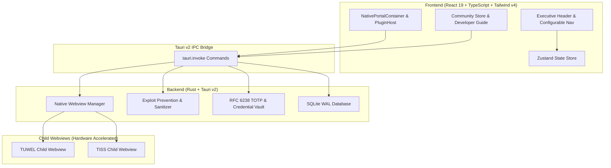

<div align="center">

# 🏛️ TU Cockpit
**The Extensible Desktop Workstation for TU Wien Students**

[](https://v2.tauri.app/)
[](https://react.dev/)
[](https://www.typescriptlang.org/)
[](https://www.rust-lang.org/)
[](https://tailwindcss.com/)
[](https://sqlite.org/)
[](LICENSE)

*A secure, high-performance, modular desktop client uniting TUWEL (Moodle), TISS, Room Finder, and community plugins in one unified workspace.*

</div>

---

## 📌 Overview

**TU Cockpit** is an open-source native desktop workstation engineered specifically for students, researchers, and lecturers at **TU Wien (Vienna University of Technology)**.

Instead of juggling dozens of browser tabs, fighting cookie timeouts, getting blocked by `X-Frame-Options` on university portals, or running untrusted third-party scripts, TU Cockpit brings all university digital services together into a single, cohesive desktop environment with zero-trust security and native OS speed.

---

## ✨ Key Features

### 🌐 1. Native Child-Webviews for University Portals
- **No Blank Screens or Iframe Blocks:** Uses Tauri v2 native child webviews (`tauri::Webview`) attached directly to the main application window via `window.add_child`.
- **Persistent University Sessions:** Configures dedicated data storage directories (`tuwien-official-tuwel`, `tuwien-official-tiss`), preserving Shibboleth SSO cookies and session state across app restarts.
- **Dynamic Viewport Synchronization:** Frontend `ResizeObserver` sends container bounding rects to Rust in real time, resizing and positioning native portals seamlessly alongside the sidebar.

### 🛡️ 2. Exploit-Free Community Store
- **Strict Marketplace Policy:** Rejects arbitrary, unverified GitHub repository sideloading. Installs are strictly enforced at the backend Rust level to repositories within the official [`tu-cockpit-community`](https://github.com/tu-cockpit-community) organization.
- **GitHub Auto-Discovery:** Real-time synchronization with GitHub API caches repository releases, with a built-in offline verified catalog fallback.
- **Developer Guide & Tech Matrix:** Built-in graphical technology support matrix indicating approved runtimes (TypeScript, React 19, Tailwind CSS v4) and forbidden APIs (native binaries, eval scripts, wildcard networks).

### 🎨 3. Adaptive TU Wien Design Engine
- **Universal `--tu-*` Token System:** Complete CSS variable palette (`--tu-bg-canvas`, `--tu-bg-surface`, `--tu-accent`, `--tu-border`, etc.) shared between host and plugins.
- **TU Wien Corporate Identity:** Built-in TU Blue (`#006699`) primary accent, dark mode, light mode, and high-contrast accessibility modes.
- **Dynamic Typography:** Choose between Inter, Outfit, JetBrains Mono, and Fira Code system fonts on the fly.

### 🧭 4. Multi-Orientation Navigation & Category Management
- **Flexible Dock Positioning:** Seamlessly toggle your workspace navigation dock between **Left**, **Right**, **Bottom**, and **Top**.
- **Custom Category Organization:** Group university portals and installed community plugins into custom user folders (e.g. *Academic*, *Campus Life*, *Exams*, *Projects*) with collapsible accordions.
- **Dock Pinning:** Pin your favorite tools and portals to the executive header dock for single-click access.

### 🔐 5. Integrated SSO & MFA Vault
- **RFC 6238 TOTP Engine:** Native Rust time-based one-time password computation with live countdown indicators.
- **Hardware-Isolated Storage:** Student credentials and MFA seeds encrypted and securely persisted in local application storage.
- **One-Click Autofill:** Injects credentials into TU Wien Shibboleth authentication screens without exposing keys to web content.

---

## 🏗️ Architecture



---

## 🚀 Quickstart & Development

### Prerequisites
- **Node.js:** v20.x or later (`node -v`)
- **npm:** v10.x or later
- **Rust:** 1.78+ (`rustc --version`)
- **System Dependencies:**
  - **macOS:** Xcode Command Line Tools (`xcode-select --install`)
  - **Linux (Debian/Ubuntu):** `libwebkit2gtk-4.1-dev build-essential curl wget file libssl-dev libgtk-3-dev libayatana-appindicator3-dev librsvg2-dev`
  - **Windows:** WebView2 runtime and MSVC C++ Build Tools

### 1. Clone & Install
```bash
git clone https://github.com/tu-cockpit-community/TU-Cockpit.git
cd TU-Cockpit
npm install
```

### 2. Launch Local Development Server
```bash
npm run tauri dev
```
This runs Vite on `localhost:1420` with HMR and launches the native Tauri v2 desktop shell.

### 3. Run Quality Assurance & Tests
```bash
# TypeScript compilation & production web bundle validation
npm run build

# Rust backend unit tests
cd src-tauri
cargo test
```

### 4. Build Production Desktop Bundles
```bash
npm run tauri build
```
The installer package (`.dmg`, `.deb`, `.appImage`, or `.msi`) will be generated inside `src-tauri/target/release/bundle/`.

---

## 🛠️ Community Plugin Developer Guide

Community plugins execute in an isolated sandbox iframe and communicate with the host via a secure postMessage bridge.

### 1. Manifest Specification (`manifest.json`)
Every plugin in `tu-cockpit-community` must provide a `manifest.json` at repository root:

```json
{
  "$schema": "https://tu-cockpit-community.github.io/schemas/v1/plugin-manifest.json",
  "id": "tuwien.community.freihaus-timer",
  "name": "Freihaus Menü & Timer",
  "version": "1.0.0",
  "description": "Daily canteen menu preview and lecture break countdown.",
  "author": {
    "name": "TU Student",
    "github": "tu-student",
    "email": "student@student.tuwien.ac.at"
  },
  "entrypoint": "index.html",
  "category": "Campus Life",
  "icon": "Coffee",
  "permissions": {
    "network": [
      "https://*.tuwien.ac.at/*",
      "https://menu.mensen.at/api/*"
    ],
    "storage": "local",
    "clipboard": false
  }
}
```

### 2. Using Host Design Tokens
In your plugin CSS, adopt the adaptive tokens:
```css
body {
  background-color: var(--tu-bg-canvas);
  color: var(--tu-text-primary);
  font-family: var(--tu-font-family, system-ui, sans-serif);
}

.card {
  background: var(--tu-bg-card);
  border: 1px solid var(--tu-border);
  border-radius: var(--tu-radius);
}

.button-primary {
  background: var(--tu-accent);
  color: var(--tu-accent-contrast);
  border-radius: var(--tu-radius-sm);
}
```

### 3. Submitting to the Community Store
1. Develop and test your plugin locally.
2. Ensure no remote scripts are loaded from unapproved external CDNs.
3. Open a verification issue at [github.com/tu-cockpit-community/registry](https://github.com/tu-cockpit-community).
4. Once transferred to `tu-cockpit-community`, your plugin is instantly discoverable by all TU Cockpit desktop users.

---

## 📄 License & Contributing

TU Cockpit is developed by TU Wien students for TU Wien students and is distributed under the **[MIT License](LICENSE)**.

Pull requests, feature suggestions, and bug reports are warmly welcomed. Please check existing issues before submitting new ones.

---

<div align="center">
  <sub>Crafted with ❤️ for students of the Vienna University of Technology (TU Wien). Not officially affiliated with TU Wien administration.</sub>
</div>
