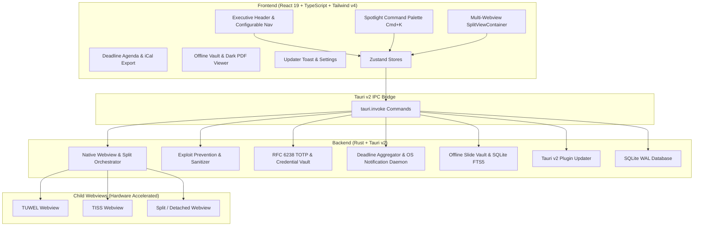

<div align="center">

# 🏛️ TU Cockpit
**The Extensible Desktop Workstation for TU Wien Students**

[](https://v2.tauri.app/)
[](https://react.dev/)
[](https://www.typescriptlang.org/)
[](https://www.rust-lang.org/)
[](https://tailwindcss.com/)
[](https://sqlite.org/)
[](LICENSE)

*A secure, high-performance, modular desktop client uniting TUWEL (Moodle), TISS, Room Finder, and community plugins in one unified workspace.*

</div>

---

## 📌 Overview

**TU Cockpit** is an open-source native desktop workstation engineered specifically for students, researchers, and lecturers at **TU Wien (Vienna University of Technology)**.

Instead of juggling dozens of browser tabs, fighting cookie timeouts, getting blocked by `X-Frame-Options` on university portals, or running untrusted third-party scripts, TU Cockpit brings all university digital services together into a single, cohesive desktop environment with zero-trust security and native OS speed.

---

## ✨ Key Features

### 🌐 1. Native Child-Webviews for University Portals
- **No Blank Screens or Iframe Blocks:** Uses Tauri v2 native child webviews (`tauri::Webview`) attached directly to the main application window via `window.add_child`.
- **Persistent University Sessions:** Configures dedicated data storage directories (`tuwien-official-tuwel`, `tuwien-official-tiss`), preserving Shibboleth SSO cookies and session state across app restarts.
- **Dynamic Viewport Synchronization:** Frontend `ResizeObserver` sends container bounding rects to Rust in real time, resizing and positioning native portals seamlessly alongside the sidebar.

### 🛡️ 2. Exploit-Free Community Store
- **Strict Marketplace Policy:** Rejects arbitrary, unverified GitHub repository sideloading. Installs are strictly enforced at the backend Rust level to repositories within the official [`tu-cockpit-community`](https://github.com/tu-cockpit-community) organization.
- **GitHub Auto-Discovery:** Real-time synchronization with GitHub API caches repository releases, with a built-in offline verified catalog fallback.
- **Developer Guide & Tech Matrix:** Built-in graphical technology support matrix indicating approved runtimes (TypeScript, React 19, Tailwind CSS v4) and forbidden APIs (native binaries, eval scripts, wildcard networks).

### 🎨 3. Adaptive TU Wien Design Engine
- **Universal `--tu-*` Token System:** Complete CSS variable palette (`--tu-bg-canvas`, `--tu-bg-surface`, `--tu-accent`, `--tu-border`, etc.) shared between host and plugins.
- **TU Wien Corporate Identity:** Built-in TU Blue (`#006699`) primary accent, dark mode, light mode, and high-contrast accessibility modes.
- **Dynamic Typography:** Choose between Inter, Outfit, JetBrains Mono, and Fira Code system fonts on the fly.

### 🧭 4. Multi-Orientation Navigation & Category Management
- **Flexible Dock Positioning:** Seamlessly toggle your workspace navigation dock between **Left**, **Right**, **Bottom**, and **Top**.
- **Custom Category Organization:** Group university portals and installed community plugins into custom user folders (e.g. *Academic*, *Campus Life*, *Exams*, *Projects*) with collapsible accordions.
- **Dock Pinning:** Pin your favorite tools and portals to the executive header dock for single-click access.

### 🔐 5. Integrated SSO & MFA Vault
- **RFC 6238 TOTP Engine:** Native Rust time-based one-time password computation with live countdown indicators.
- **Hardware-Isolated Storage:** Student credentials and MFA seeds encrypted and securely persisted in local application storage.
- **One-Click Autofill:** Injects credentials into TU Wien Shibboleth authentication screens without exposing keys to web content.

### ⚡ 6. Full-Bleed Canvas & Collapsible Sidebar
- **Zero-Gutter Workstation:** Elimination of artificial `max-w-6xl` containers and redundant faux-browser header banners. University portals render edge-to-edge taking up 100% of the viewport.
- **Orientation-Aware Collapse (`Cmd+B`):** Lateral sidebars (Left/Right) instantly toggle into a space-saving 56px icon rail or expand to full width.

### 🔍 7. Global Spotlight / Command Palette (`Cmd+K`)
- **Campus Room Index:** Instant fuzzy matching for TU Wien lecture halls (e.g. *EI 7*, *Freihaus Hörsaal 1*, *Informatikhörsaal*) with direct TU Maps jumping.
- **Unified 4-Domain Search:** Query across campus rooms, installed community plugins, official university portals, active semester courses, and system actions in milliseconds.

### 🪟 8. Multi-Webview Split-Screen & Detachable Windows
- **Side-by-Side Multitasking:** Split the workstation canvas between two active webviews with presets (`1:1`, `7:3`, `3:7`) and interactive drag-to-resize dividers.
- **Detachable Floating Windows:** Pop portals out into dedicated OS windows for multi-monitor lecture setups.

### 📅 9. University Deadline Aggregator & Calendar Sync
- **Automated Synchronization:** Ingests TUWEL assignment deadlines and TISS exam dates into a local SQLite table (`student_deadlines`).
- **Native OS Daemon Alerts:** Background notification daemon alerts students 24 hours and 2 hours prior to assignment submissions.
- **Dynamic `.ics` Feed Export:** One-click calendar export compatible with Apple Calendar, Google Calendar, and Microsoft Outlook.

### 📚 10. Offline Lecture Material Vault (SQLite FTS5)
- **Train & Subway Resilience:** Download course slides and PDFs into a local vault for offline study without Wi-Fi.
- **Per-Page Full-Text Search:** High-performance SQLite FTS5 search across slide contents with highlighted search snippets.
- **OLED Dark-Mode Reader:** Integrated PDF viewer with zoom controls, page jumping, and inverted canvas rendering for late-night studying.

### 🚀 11. Cryptographically Signed In-App Auto-Updater
- **Tauri v2 Auto-Updater:** Seamless background update delivery powered by `@tauri-apps/plugin-updater` and GitHub Releases.
- **Minisign Ed25519 Signatures:** Delta packages verified cryptographically before installation with one-click restart.

---

## 🏗️ Architecture



---

## 🚀 Quickstart & Development Across Platforms

TU Cockpit runs natively on **macOS**, **Windows 10/11**, and modern **Linux** distributions. Follow the instructions below for your operating system.

---

### 🍎 1. macOS (Apple Silicon M1–M4 & Intel x86_64)

#### Prerequisites & Setup
1. **Install Xcode Command Line Tools:**
   ```bash
   xcode-select --install
   ```
2. **Install Node.js (v20+) & Rust:**
   ```bash
   # Via Homebrew
   brew install node
   # Install official Rust toolchain
   curl --proto '=https' --tlsv1.2 -sSf https://sh.rustup.rs | sh
   ```
3. **(Optional) Add Universal Apple Targets:**
   ```bash
   rustup target add aarch64-apple-darwin x86_64-apple-darwin
   ```

#### Run in Development Mode
```bash
npm install
npm run tauri dev
```
> *Vite will launch on `http://localhost:1420` with instant HMR and the native macOS window with child webviews.*

#### Build Production Packages
```bash
# Compile native .dmg and .app bundle for your active Mac:
npm run build:mac

# Compile universal binary (runs natively on both Apple Silicon and Intel Macs):
npm run build:mac:universal
```
*Output Location:* `src-tauri/target/release/bundle/dmg/TU Cockpit_0.1.0_universal.dmg`  
*To install:* Double-click the `.dmg` and drag **TU Cockpit** into your `/Applications` folder.

> [!TIP]
> **Gatekeeper Notice (Unsigned/Ad-Hoc Binaries):** If macOS displays *"TU Cockpit cannot be opened because the developer cannot be verified"*, either right-click the app in Finder and choose **Open**, or run:
> ```bash
> xattr -cr "/Applications/TU Cockpit.app"
> ```

---

### 🪟 2. Windows (Windows 10 & 11)

#### Prerequisites & Setup
1. **Install Node.js (v20+):** Download the LTS installer from [nodejs.org](https://nodejs.org/).
2. **Install Microsoft C++ Build Tools:**
   - Download Visual Studio Build Tools from [visualstudio.microsoft.com](https://visualstudio.microsoft.com/visual-cpp-build-tools/).
   - In the Visual Studio Installer, select and install the **"Desktop development with C++"** workload.
3. **Install Rust (MSVC):**
   - Download and run `rustup-init.exe` from [rustup.rs](https://rustup.rs/).
   - Choose default installation (`x86_64-pc-windows-msvc`).
4. **WebView2 Runtime:** Pre-installed on Windows 10 (recent updates) and Windows 11. If missing, install the [Evergreen Bootstrapper](https://developer.microsoft.com/en-us/microsoft-edge/webview2/).

#### Run in Development Mode
Open **PowerShell** or **Windows Terminal**:
```powershell
npm install
npm run tauri dev
```

#### Build Production Packages
```powershell
# Compile standalone setup .exe (NSIS currentUser - no administrator prompt required):
npm run build:win:exe

# Compile both standalone setup .exe and WiX enterprise .msi:
npm run build:win
```
*Output Location:* `src-tauri/target/release/bundle/nsis/TU Cockpit_0.1.0_x64-setup.exe`  
*To install:* Double-click `TU Cockpit_0.1.0_x64-setup.exe`. It automatically creates Start Menu shortcuts and registers clean uninstallation without requiring UAC administrator elevation.

---

### 🐧 3. Linux (Ubuntu, Debian, Fedora, Arch)

#### Prerequisites & Setup

* **Ubuntu / Debian (22.04 LTS, 24.04 LTS, Mint, Pop!_OS):**
  ```bash
  sudo apt update
  sudo apt install -y build-essential curl wget file libssl-dev libgtk-3-dev \
    libayatana-appindicator3-dev librsvg2-dev libwebkit2gtk-4.1-dev patchelf
  ```
* **Fedora / RHEL / CentOS Stream:**
  ```bash
  sudo dnf install -y gcc gcc-c++ webkit2gtk4.1-devel openssl-devel gtk3-devel \
    libappindicator-gtk3-devel librsvg2-devel patchelf
  ```
* **Arch Linux / Manjaro:**
  ```bash
  sudo pacman -S --needed base-devel webkit2gtk-4.1 openssl gtk3 libappindicator-gtk3 librsvg patchelf
  ```
* **Install Node.js & Rust:**
  ```bash
  curl -fsSL https://deb.nodesource.com/setup_20.x | sudo -E bash - && sudo apt install -y nodejs
  curl --proto '=https' --tlsv1.2 -sSf https://sh.rustup.rs | sh
  source "$HOME/.cargo/env"
  ```

#### Run in Development Mode
```bash
npm install
npm run tauri dev
```

#### Build Production Packages
```bash
# Compile both Debian package (.deb) and standalone AppImage:
npm run build:linux

# Compile standalone .deb only:
npm run build:linux:deb

# Compile standalone .AppImage only:
npm run build:linux:appimage
```
*Output Locations:*
- `.deb`: `src-tauri/target/release/bundle/deb/tu-cockpit_0.1.0_amd64.deb`
- `.AppImage`: `src-tauri/target/release/bundle/appimage/tu-cockpit_0.1.0_amd64.AppImage`

#### Running the Built Application on Linux
* **Installing the `.deb` package:**
  ```bash
  sudo dpkg -i src-tauri/target/release/bundle/deb/*.deb || sudo apt-get install -f
  # Or with apt directly:
  sudo apt install ./src-tauri/target/release/bundle/deb/*.deb
  # Launch via terminal or application launcher:
  tu-cockpit
  ```
* **Running the `.AppImage` directly:**
  ```bash
  chmod +x src-tauri/target/release/bundle/appimage/*.AppImage
  ./src-tauri/target/release/bundle/appimage/*.AppImage
  ```

---

### ☁️ 4. 1-Click Multi-Platform Cloud Builder (No VMs Required)

Because native desktop apps require their host operating system's native webview and windowing stack, you cannot easily cross-compile Windows `.exe` or Linux `.deb` from macOS locally without complex emulation.

TU Cockpit solves this with a **1-Click GitHub Actions Cloud Pipeline**:
1. Go to the **[Actions tab](https://github.com/tu-cockpit-community/TU-Cockpit/actions)** of the repository.
2. Select **"1-Click Multi-Platform Artifact Builder"** from the left sidebar.
3. Click **Run workflow**, pick your branch and compilation profile (`release` or `debug`), and click the green button.
4. Clean GitHub-hosted virtual runners will build native packages in parallel:
   - `windows-latest` -> Builds standalone NSIS `.exe` setup & `.msi`
   - `ubuntu-22.04` -> Builds WebKitGTK 4.1 `.deb` & standalone `.AppImage`
   - `macos-latest` -> Builds universal `.dmg` & `.app`
5. Download `tu-cockpit-windows-x64.zip`, `tu-cockpit-linux-x64.zip`, or `tu-cockpit-macos-universal.zip` directly from the workflow summary!

---

### 🧪 5. Testing & Quality Assurance

```bash
# 1. Frontend TypeScript & React production compilation:
npm run build

# 2. Rust backend unit tests (24+ tests across portals, vault, FTS5 & auth):
cargo test --manifest-path src-tauri/Cargo.toml
# Note (macOS if using beta SDKs):
# SDKROOT=/Library/Developer/CommandLineTools/SDKs/MacOSX.sdk cargo test --manifest-path src-tauri/Cargo.toml

# 3. Rust syntax & Tauri capability check:
cargo check --manifest-path src-tauri/Cargo.toml
```

---

## 🛠️ Community Plugin Developer Guide

Community plugins execute in an isolated sandbox iframe and communicate with the host via a secure postMessage bridge.

### 1. Manifest Specification (`manifest.json`)
Every plugin in `tu-cockpit-community` must provide a `manifest.json` at repository root:

```json
{
  "$schema": "https://tu-cockpit-community.github.io/schemas/v1/plugin-manifest.json",
  "id": "tuwien.community.freihaus-timer",
  "name": "Freihaus Menü & Timer",
  "version": "1.0.0",
  "description": "Daily canteen menu preview and lecture break countdown.",
  "author": {
    "name": "TU Student",
    "github": "tu-student",
    "email": "student@student.tuwien.ac.at"
  },
  "entrypoint": "index.html",
  "category": "Campus Life",
  "icon": "Coffee",
  "permissions": {
    "network": [
      "https://*.tuwien.ac.at/*",
      "https://menu.mensen.at/api/*"
    ],
    "storage": "local",
    "clipboard": false
  }
}
```

### 2. Using Host Design Tokens
In your plugin CSS, adopt the adaptive tokens:
```css
body {
  background-color: var(--tu-bg-canvas);
  color: var(--tu-text-primary);
  font-family: var(--tu-font-family, system-ui, sans-serif);
}

.card {
  background: var(--tu-bg-card);
  border: 1px solid var(--tu-border);
  border-radius: var(--tu-radius);
}

.button-primary {
  background: var(--tu-accent);
  color: var(--tu-accent-contrast);
  border-radius: var(--tu-radius-sm);
}
```

### 3. Submitting to the Community Store
1. Develop and test your plugin locally.
2. Ensure no remote scripts are loaded from unapproved external CDNs.
3. Open a verification issue at [github.com/tu-cockpit-community/registry](https://github.com/tu-cockpit-community).
4. Once transferred to `tu-cockpit-community`, your plugin is instantly discoverable by all TU Cockpit desktop users.

---

## 📄 License & Contributing

TU Cockpit is developed by TU Wien students for TU Wien students and is distributed under the **[MIT License](LICENSE)**.

Pull requests, feature suggestions, and bug reports are warmly welcomed. Please check existing issues before submitting new ones.

---

<div align="center">
  <sub>Crafted with ❤️ for students of the Vienna University of Technology (TU Wien). Not officially affiliated with TU Wien administration.</sub>
</div>
