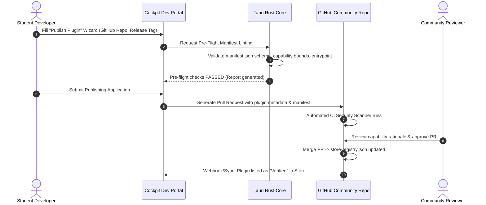

# TU Cockpit: Master Architectural Blueprint & Agent Execution Plan

> **Target Ecosystem:** Desktop Hub & Dynamic Plugin Ecosystem for TU Wien Students  
> **Core Technologies:** Tauri v2, Rust (2021+), React 19, TypeScript 5.5+, Tailwind CSS v4, SQLite (WAL mode), WebCrypto E2EE  
> **Current Project Status:**
> - 🟢 **PHASE 1 (COMPLETED):** Foundational Desktop Runtime, Sandboxed Engine, Dynamic Theme Engine, E2EE Sync, Starter Widget Proof-of-Concept, Multi-Platform CI/CD (Milestones 0–7)  
> - 🟢 **PHASE 2 (COMPLETED):** Marketplace-First Workstation, GitHub Dynamic Plugin Engine, Embedded University Webviews, Student Auth & RBAC (Milestones 8–13)  
> - 🟢 **PHASE 3 (COMPLETED):** GitHub Community Org Auto-Discovery, Uninstallable Portals Plugins, Configurable Multi-Orientation Sidebar & Custom Categories, Redesigned Header, GitHub Author Attribution, and SSO/MFA Autofill Vault (Milestones 14–19)  
> - 🟢 **PHASE 4 (COMPLETED):** Native Child-Webviews (`tauri::Webview`) for TUWEL/TISS, Exploit Prevention (Marketplace-Only Policy), Community Store Developer Guide Tab, Living GitHub `README.md` (Milestones 20–23)  
> - 🔵 **PHASE 5 (PLANNED / UPCOMING):** Global Command Palette (`Cmd+K`), Split-View Multitasking & Detachable Windows, Deadline Aggregator & Calendar Sync, Offline Slide Caching, and In-App Auto-Updater (Milestones 24–28)

> [!IMPORTANT]
> **OFFICIAL REPOSITORY & GITHUB COMMUNITY ORGANIZATION:**
> - **Official Organization:** [`tu-cockpit-community`](https://github.com/tu-cockpit-community)
> - **Official Core Project Repository:** [`tu-cockpit-community/TU-Cockpit`](https://github.com/tu-cockpit-community/TU-Cockpit)
> - **Git Remote Origin:** `https://github.com/tu-cockpit-community/TU-Cockpit.git`
> - **Auto-Updater & Release Endpoints:** `https://github.com/tu-cockpit-community/TU-Cockpit/releases/latest/download/latest.json`
> - **MANDATE FOR ALL AGENTS & CONTRIBUTORS:**
>   All worker agents, documentation, CI/CD pipelines, and configuration files **MUST** target and reference `https://github.com/tu-cockpit-community/TU-Cockpit`. All previous personal repository URLs (such as `OliverKnapp/Tuwel-Tools`) are permanently superseded by this official community organization repository.

---

## Master Table of Contents

### 🟢 PART I: PHASE 1 — FOUNDATIONAL RUNTIME & PROOF-OF-CONCEPT (COMPLETED)
* [1. Executive Product Vision & Architecture Overview](#1-executive-product-vision--architecture-overview)
* [2. Dynamic Plugin Engine & Sandboxing Specification](#2-dynamic-plugin-engine--sandboxing-specification)
* [3. Centralized Theming Engine & Global Styling Customization](#3-centralized-theming-engine--global-styling-customization)
* [4. Cross-Device End-to-End Encrypted (E2EE) Sync Protocol](#4-cross-device-end-to-end-encrypted-e2ee-sync-protocol)
* [5. Phase 1 Implementation Reference Code](#5-phase-1-implementation-reference-code)
* [6. Automated CI/CD Matrix (`.github/workflows/release.yml`)](#6-automated-cicd-matrix-githubworkflowsreleaseyml)
* [7. Phase 1 Completed Execution Schedule & Commits (Milestones 0–7 [STATUS: COMPLETED])](#7-phase-1-completed-execution-schedule--commits-milestones-07-status-completed)

---

### 🟢 PART II: PHASE 2 — CLEAN-SLATE WORKSTATION, EMBEDDED PORTALS & RBAC (COMPLETED)
* [8. Phase 2 Architecture: The Marketplace-First Paradigm & Clean-Slate Purge](#8-phase-2-architecture-the-marketplace-first-paradigm--clean-slate-purge)
* [9. Dynamic GitHub Plugin Distribution & Verification Engine](#9-dynamic-github-plugin-distribution--verification-engine)
* [10. In-App Embedded Institutional Portals Architecture (TUWEL, TISS, VoWi, TU Maps)](#10-in-app-embedded-institutional-portals-architecture)
* [11. Cross-Site Theme Injection Engine & Curated Style Sheets](#11-cross-site-theme-injection-engine--curated-style-sheets)
* [12. Student Identity, Authentication & Role-Based Access Control (RBAC)](#12-student-identity-authentication--role-based-access-control-rbac)
* [13. Developer Registration & Marketplace Publishing Application Flow](#13-developer-registration--marketplace-publishing-application-flow)
* [14. Phase 2 Target File Hierarchy & Dependencies](#14-phase-2-target-file-hierarchy--dependencies)
* [15. Phase 2 Completed Execution Schedule & Commits (Milestones 8–13 [STATUS: COMPLETED])](#15-phase-2-completed-execution-schedule--commits-milestones-813-status-completed)

---

### 🟢 PART III: PHASE 3 — GITHUB COMMUNITY ORG, CONFIGURABLE SIDEBAR & AUTOFILL VAULT (COMPLETED)
* [16. Phase 3 Architecture: The GitHub Community Organization & Modular Workstation Paradigm](#16-phase-3-architecture-the-github-community-organization--modular-workstation-paradigm)
* [17. GitHub Community Organization Automated Discovery Engine](#17-github-community-organization-automated-discovery-engine)
* [18. Native Webview Engine & Institutional Portals as Uninstallable Plugins](#18-native-webview-engine--institutional-portals-as-uninstallable-plugins)
* [19. Dynamic Sidebar & Dock Orientation Engine with Custom User Categories & Sorting](#19-dynamic-sidebar--dock-orientation-engine-with-custom-user-categories--sorting)
* [20. Redesigned Executive Header & Quick-Access Settings Architecture](#20-redesigned-executive-header--quick-access-settings-architecture)
* [21. Student Identity, GitHub Community Attribution & Profile Association](#21-student-identity-github-community-attribution--profile-association)
* [22. Secure Credential Vault, TOTP Engine & In-Webview SSO/MFA Autofill Daemon](#22-secure-credential-vault-totp-engine--in-webview-ssomfa-autofill-daemon)
* [23. Phase 3 Target File Hierarchy & Dependencies](#23-phase-3-target-file-hierarchy--dependencies)
* [24. Phase 3 Completed Execution Schedule & Commits (Milestones 14–19 [STATUS: COMPLETED])](#24-phase-3-ai-worker-agent-prompts--step-by-step-implementation-milestones)

---

### 🟢 PART IV: PHASE 4 — NATIVE CHILD-WEBVIEWS, HARDENED STORE & DEVELOPER GUIDE MATRIX (COMPLETED)
* [25. Phase 4 Architecture: Native Child-Webviews & Hardened Community Ecosystem](#25-phase-4-architecture-native-child-webviews--hardened-community-ecosystem)
* [26. Tauri v2 Native Child-Webview (`tauri::Webview`) Engine for TUWEL & TISS](#26-tauri-v2-native-child-webview-tauriwebview-engine-for-tuwel--tiss)
* [27. Security Hardening: Strict Marketplace-Only Plugin Policy (Exploit Prevention)](#27-security-hardening-strict-marketplace-only-plugin-policy-exploit-prevention)
* [28. Community Store Developer Guidelines Tab & Technology Visual Matrix](#28-community-store-developer-guidelines-tab--technology-visual-matrix)
* [29. Project Documentation Standards & Living GitHub README.md](#29-project-documentation-standards--living-github-readmemd)
* [30. Phase 4 Target File Hierarchy & Dependencies](#30-phase-4-target-file-hierarchy--dependencies)
* [31. Phase 4 Completed Execution Schedule & Commits (Milestones 20–23 [STATUS: COMPLETED])](#31-phase-4-ai-worker-agent-prompts--step-by-step-implementation-milestones)

---

### 🔵 PART V: PHASE 5 — PRODUCTIVITY WORKSTATION, OFFLINE VAULT & AUTO-UPDATER (PLANNED / UPCOMING)
* [32. Phase 5 Architecture: Workstation Productivity, Offline Resilience & Global Navigation](#32-phase-5-architecture-workstation-productivity-offline-resilience--global-navigation)
* [33. Global Command Palette (`Cmd+K`) & Campus-Wide Fuzzy Search](#33-global-command-palette-cmdk--campus-wide-fuzzy-search)
* [34. Split-View Multitasking & Multi-Window Detachable Workspace](#34-split-view-multitasking--multi-window-detachable-workspace)
* [35. Deadline Aggregator, System Notification Daemon & Calendar Sync (iCal)](#35-deadline-aggregator-system-notification-daemon--calendar-sync-ical)
* [36. Offline Course Materials Syncer & Local PDF Slide Caching](#36-offline-course-materials-syncer--local-pdf-slide-caching)
* [37. Tauri v2 In-App Auto-Updater (`@tauri-apps/plugin-updater`) & GitHub Release Pipeline](#37-tauri-v2-in-app-auto-updater-tauri-appsplugin-updater--github-release-pipeline)
* [38. Phase 5 Target File Hierarchy & Dependencies](#38-phase-5-target-file-hierarchy--dependencies)
* [39. Phase 5 AI Worker Agent Prompts & Step-by-Step Implementation Milestones (Milestones 24–28 [STATUS: READY TO EXECUTE])](#39-phase-5-ai-worker-agent-prompts--step-by-step-implementation-milestones-milestones-2428-status-ready-to-execute)

---

# ==============================================================================
# 🟢 PART I: PHASE 1 — FOUNDATIONAL RUNTIME & PROOF-OF-CONCEPT (COMPLETED)
# ==============================================================================

> **Phase 1 Summary & Status:** ✅ COMPLETED & VERIFIED IN GIT (Commits `0df51c1` back to `2e6cb13`)  
> **Delivered Capabilities:** Tauri v2 desktop shell, sandboxed iframe RPC bridge (`PluginFrame.tsx`, `plugin_gateway.rs`), centralized CSS variable theme customizer (`useThemeStore.ts`), zero-knowledge E2EE sync engine (`CryptoSyncEngine.ts`), starter deadlines proof-of-concept widget (`plugins/tuwel-deadlines/`), and automated release packaging matrix (`release.yml`).

## 1. Executive Product Vision & Architecture Overview

### 1.1 Core Metaphor
**TU Cockpit** is an extensible, modular student workstation client for TU Wien. It aggregates institutional services (TISS, TUWEL, campus room search, library catalogs, cafeteria menus) and community-contributed tools through an isolated, sandboxed runtime engine.

### 1.2 Technology Stack Justification
* **Desktop Runtime:** Tauri v2 (`@tauri-apps/api@^2.0`, Rust 2021). Chosen over Electron to ensure minimal binary footprint (<15MB), near-zero idle memory consumption (<40MB RAM), native OS integration, and compile-time capabilities/security boundary enforcement.
* **Host UI Layer:** React 19, TypeScript 5.5+, Vite 5, Tailwind CSS v4, Lucide React icons, Radix UI primitives.
* **Central Theming & Customization Engine:** Dynamic CSS custom properties (`--tu-*` design tokens), dynamic font loader (`@font-face` / system font picker), and real-time token propagation across host and sandboxed plugin iframes.
* **Host State & Storage:**
  * Client UI state: Zustand 5.
  * Async queries & caching: TanStack Query v5.
  * Structured local persistence: `@tauri-apps/plugin-sql` (embedded SQLite with WAL mode).
  * Sensitive credential storage: Platform OS Keyring via Tauri Keychain plugin.
* **Plugin Isolation Layer:** Sandboxed `<iframe>` instances with strict `sandbox="allow-scripts"` (without `allow-same-origin`) communicating via bidirectional `MessagePort` channels and typed JSON-RPC 2.0.
* **Cross-Device Sync Engine:** End-to-End Encrypted (E2EE) zero-knowledge state synchronization using WebCrypto (`AES-256-GCM` with `PBKDF2`/`Argon2id` key derivation) with provider adapters (GitHub Gist API or self-hosted REST/Supabase relay).

### 1.3 Architecture Topology
```
+-------------------------------------------------------------------------+
|                              TU COCKPIT SHELL                           |
|  +--------------------+  +----------------------+  +-----------------+  |
|  | Dock & Navigation  |  | Plugin Registry / Store| | E2EE Sync Engine|  |
|  +--------------------+  +----------------------+  +-----------------+  |
|  +-------------------------------------------------------------------+  |
|  |       Central Theme Engine (CSS Design Tokens & Dynamic Fonts)    |  |
|  +-------------------------------------------------------------------+  |
|  |             Plugin Host Manager & Permission Gateway             |  |
|  +-------------------------------------------------------------------+  |
|            | MessagePort RPC (Tokens & API)      | Tauri IPC Bridge     |
|            v                                     v                      |
|  +---------------------------+       +-------------------------------+  |
|  | Sandboxed <iframe> Plugin |       | Tauri v2 Rust Core Runtime    |  |
|  | - Auto-injected CSS vars  |       | - Gated HTTP Proxy (CORS-free)|  |
|  | - Restricted DOM context  |       | - Secure Keychain Storage     |  |
|  | - Local Storage Emulation |       | - SQLite Local Database       |  |
|  | - Scoped RPC API Client   |       |                               |  |
|  +---------------------------+       +-------------------------------+  |
+-------------------------------------------------------------------------+
```

---

## 2. Dynamic Plugin Engine & Sandboxing Specification

### 2.1 Manifest Schema (`manifest.json`)
Every plugin repository or release bundle must contain a `manifest.json`:

```json
{
  "$schema": "https://tu-cockpit.tuwien.ac.at/schemas/v1/plugin-manifest.json",
  "id": "tuwien.tuwel.deadlines",
  "name": "TUWEL Deadline Tracker",
  "version": "1.0.0",
  "author": {
    "name": "TU Wien Student Devs",
    "email": "devs@student.tuwien.ac.at",
    "url": "https://github.com/tuwien-community"
  },
  "description": "Displays upcoming assignment deadlines and submission statuses from TUWEL.",
  "homepage": "https://github.com/tuwien-community/tuwel-deadlines",
  "entrypoint": "index.html",
  "icon": "icon.svg",
  "type": "widget",
  "capabilities": {
    "network": [
      "https://tuwel.tuwien.ac.at/calendar/*",
      "https://tuwel.tuwien.ac.at/mod/assign/*"
    ],
    "storage": {
      "quotaBytes": 5242880
    },
    "notifications": true,
    "systemClipboard": false
  },
  "ui": {
    "minWidth": 320,
    "minHeight": 240,
    "defaultWidth": 400,
    "defaultHeight": 300,
    "resizable": true
  }
}
```

### 2.2 Security Sandboxing & Permission Model
1. **Network Requests:** Standard web browser contexts enforce CORS, blocking client fetches to TISS/TUWEL. Plugins **cannot** make direct `fetch()` or `XMLHttpRequest` calls. Instead, plugins call `client.http.get(url)`. This dispatches a request to the host shell, which forwards it to the Rust core via Tauri IPC. The Rust gateway verifies that `url` matches the declarative glob patterns in `capabilities.network` before dispatching via `reqwest` with authenticated student session cookies.
2. **Storage Isolation:** Untrusted plugins do not have access to the shell's `localStorage` or IndexedDB. A key-value API (`client.storage.get/set`) persists data to an isolated SQLite table keyed by `plugin_id`.
3. **DOM & Context Isolation:** Untrusted third-party code runs inside an `<iframe>` configured with `sandbox="allow-scripts"`. Omitting `allow-same-origin` gives the iframe an opaque origin (`null`), isolating it from the host DOM, parent cookies, and Tauri IPC globals (`window.__TAURI__`).

### 2.3 RPC Message Contract
Host and Plugin communicate through a dedicated `MessageChannel`.

```typescript
export type RpcRequest = {
  jsonrpc: "2.0";
  id: string;
  method: "http:request" | "storage:get" | "storage:set" | "notify" | "lifecycle:ready";
  params: unknown;
};

export type RpcResponse = {
  jsonrpc: "2.0";
  id: string;
  result?: unknown;
  error?: {
    code: number;
    message: string;
    data?: unknown;
  };
};
```

---

## 3. Centralized Theming Engine & Global Styling Customization

### 3.1 Design Token Architecture & CSS Variable Contract
The entire application (host shell, dock, settings, dialogs, and untrusted plugin iframes) is styled via a unified set of CSS custom properties defined at `:root`. Every UI component derives colors, surface elevations, radiuses, borders, and typography exclusively from these tokens:

```css
:root {
  /* Surface & Background Hierarchies */
  --tu-bg-base: #0f172a;           /* App main canvas / window background */
  --tu-bg-surface: #1e293b;        /* Panels, cards, and modal bodies */
  --tu-bg-card: #334155;           /* Embedded interactive cards / widgets */
  --tu-bg-hover: #475569;          /* Hover states for interactive surfaces */

  /* Structural Borders & Dividers */
  --tu-border: #334155;            /* Standard structural borders */
  --tu-border-subtle: #1e293b;     /* Card dividers and inner borders */
  --tu-border-focus: #38bdf8;      /* Active / focused element outline */

  /* Typography Colors */
  --tu-text-primary: #f8fafc;      /* High-contrast headings and body text */
  --tu-text-secondary: #94a3b8;    /* Subheadings, labels, card captions */
  --tu-text-muted: #64748b;        /* Inactive states, metadata, timestamps */
  --tu-text-accent: #38bdf8;       /* Highlighted text */

  /* Brand & Status Colors */
  --tu-accent: #006699;            /* TU Wien Corporate Blue / User Accent */
  --tu-accent-hover: #007ab8;      /* Darkened / lightened accent on hover */
  --tu-accent-contrast: #ffffff;   /* Foreground text color on top of accent */
  --tu-danger: #ef4444;            /* Deadlines, errors, warnings */
  --tu-success: #10b981;           /* Completed assignments, online status */
  --tu-warning: #f59e0b;           /* Approaching submission deadlines */

  /* Typography Stack */
  --tu-font-sans: 'Inter', system-ui, -apple-system, BlinkMacSystemFont, 'Segoe UI', Roboto, sans-serif;
  --tu-font-mono: 'JetBrains Mono', 'Fira Code', ui-monospace, monospace;
  --tu-font-size-base: 14px;
  --tu-ui-scale: 1.0;              /* Global zoom scaling multiplier: 0.85 to 1.5 */

  /* Geometry & Elevation */
  --tu-radius-sm: 4px;
  --tu-radius: 8px;                /* Standard corner radius for cards & widgets */
  --tu-radius-lg: 12px;
  --tu-shadow: 0 4px 6px -1px rgba(0, 0, 0, 0.3), 0 2px 4px -2px rgba(0, 0, 0, 0.3);
}
```

### 3.2 Typography Engine & Dynamic Font Management
Users can configure and hot-swap fonts globally without rebuilding or restarting:
1. **System Native Stacks:** macOS (`-apple-system`), Windows (`Segoe UI`), Linux (`Ubuntu`, `Cantarell`).
2. **Curated Open-Source Fonts:** Built-in font definitions:
   * **Sans-serif:** `Inter`, `Geist`, `Plus Jakarta Sans`.
   * **Monospace:** `JetBrains Mono`, `Fira Code`.
   * **Accessibility & Dyslexia-friendly:** `OpenDyslexic`, `Atkinson Hyperlegible` (for low-vision readability).
3. **Custom Local & Web Font Loader:**
   * Users can select custom `.woff2` / `.ttf` files from disk (loaded via Tauri's secure asset protocol `asset://`) or provide a web font stylesheet URL.
   * Dynamic `@font-face` rules are synthesized and injected into the document `<head>`.
4. **Fluid UI Scaling:** A master slider in Settings modifies `--tu-ui-scale` (0.85x, 1.0x, 1.15x, 1.25x, 1.5x) to guarantee WCAG compliance and comfort on HiDPI / 4K displays.

### 3.3 Built-in Themes & Custom Theme JSON Schema
The client ships with pre-tuned theme presets and supports user-created JSON themes:

```json
{
  "$schema": "https://tu-cockpit.tuwien.ac.at/schemas/v1/theme.json",
  "id": "tu-wien-dark",
  "name": "TU Wien Night",
  "type": "dark",
  "author": "TU Cockpit Core",
  "tokens": {
    "--tu-bg-base": "#0c131f",
    "--tu-bg-surface": "#141e30",
    "--tu-bg-card": "#1d2b45",
    "--tu-border": "#28395a",
    "--tu-accent": "#006699",
    "--tu-accent-hover": "#007ab8",
    "--tu-accent-contrast": "#ffffff",
    "--tu-text-primary": "#f1f5f9",
    "--tu-text-secondary": "#94a3b8",
    "--tu-radius": "10px",
    "--tu-font-sans": "'Inter', system-ui, sans-serif"
  }
}
```

**Pre-Bundled Presets:**
* **TU Wien Night:** Dark slate canvas with TU Wien Blue (`#006699`) and TU Red accents (`#E3001B`).
* **TU Wien Daylight:** High-contrast crisp academic white and university corporate blue.
* **Catppuccin Mocha:** Warm pastel developer dark theme.
* **Nord:** Arctic, calm north-bluish palette.
* **Tokyo Night:** Modern violet-blue IDE aesthetic.
* **OLED Stealth:** Pure `#000000` deep black for OLED battery saving.
* **Accessible High-Contrast:** WCAG AAA compliant (>= 7:1 contrast ratio) with clear structural borders.

### 3.4 Cross-Boundary Plugin Styling (Auto-Theming Engine)
Community plugins running in sandboxed `<iframe>`s MUST reflect user theme and font choices automatically without manual effort:
1. **Dynamic Style Injection into `srcDoc`:** When `PluginFrame.tsx` mounts, it synthesizes the active CSS variables from `useThemeStore` and prepends a `<style id="tu-cockpit-injected-theme">` tag to the plugin document `<head>`.
2. **Live Theme Change Broadcast (`theme:changed`):** When the user updates any theme token, changes fonts, or toggles dark/light mode in Settings:
   * The host iterates active plugins and sends `{ jsonrpc: "2.0", method: "theme:changed", params: { tokens, fontSans, uiScale } }` over the RPC `MessagePort`.
   * The `@tu-cockpit/plugin-sdk` catches this event and immediately updates the iframe's `:root` CSS properties in memory with zero layout jump.
3. **Universal Plugin Styling Rule:** Plugin authors only need to write standard CSS using `var(--tu-bg-base)`, `var(--tu-text-primary)`, `var(--tu-accent)`, etc.

---

## 4. Cross-Device End-to-End Encrypted (E2EE) Sync Protocol

### 4.1 Encryption & Key Derivation Model
To synchronize layout configurations, installed plugin lists, themes, and custom settings without exposing university credentials or personal data:
* **Passphrase:** User enters a personal Sync Passphrase (zero-knowledge).
* **Salt:** 16-byte cryptographically secure random salt generated on first setup.
* **Key Derivation:** WebCrypto `PBKDF2` with `SHA-256`, 600,000 iterations (or client-side `argon2id`), deriving a 256-bit AES key.
* **Payload Encryption:** `AES-GCM` with a fresh 12-byte initialization vector (IV) per sync push.
* **Envelope Structure:**
  ```json
  {
    "version": 1,
    "deviceId": "uuid-v4",
    "updatedAt": "2026-10-13T17:15:00.000Z",
    "salt": "base64-salt",
    "iv": "base64-iv",
    "ciphertext": "base64-encrypted-data"
  }
  ```
* **Decrypted Payload Schema:**
  ```json
  {
    "theme": {
      "activeThemeId": "tu-wien-dark",
      "fontSans": "JetBrains Mono",
      "uiScale": 1.0,
      "customOverrides": {
        "--tu-accent": "#006699"
      }
    },
    "installedPlugins": [
      { "id": "tuwien.tuwel.deadlines", "version": "1.0.0", "enabled": true }
    ],
    "dockLayout": ["tuwien.tuwel.deadlines", "tuwien.tiss.calendar"]
  }
  ```

### 4.2 Conflict Resolution
* State synchronizes via **Last-Write-Wins (LWW)** with Lamport Vector Timestamps at the field level (e.g., individual plugin configs and theme preferences merge independently from global layout state).

---

## 5. Complete Implementation Roadmap & Source Code

### 5.1 Target File Hierarchy
```
tu-cockpit/
├── .github/
│   └── workflows/
│       └── release.yml
├── package.json
├── tsconfig.json
├── vite.config.ts
├── src-tauri/
│   ├── Cargo.toml
│   ├── tauri.conf.json
│   ├── capabilities/
│   │   └── default.json
│   └── src/
│       ├── main.rs
│       └── plugin_gateway.rs
├── src/
│   ├── main.tsx
│   ├── App.tsx
│   ├── index.css
│   ├── styles/
│   │   └── theme.css
│   ├── components/
│   │   ├── dock/
│   │   ├── marketplace/
│   │   ├── settings/
│   │   │   └── ThemeCustomizer.tsx
│   │   └── plugin-host/
│   │       ├── PluginFrame.tsx
│   │       └── PluginHostManager.ts
│   ├── sdk/
│   │   └── index.ts
│   ├── services/
│   │   ├── db/
│   │   │   └── sqlite.ts
│   │   └── sync/
│   │       ├── CryptoSyncEngine.ts
│   │       └── GistSyncAdapter.ts
│   └── store/
│       ├── useAppStore.ts
│       └── useThemeStore.ts
└── plugins/
    └── tuwel-deadlines/
        ├── manifest.json
        ├── index.html
        └── app.ts
```

### 5.2 Bootstrapping Commands
```bash
# 1. Initialize Git Repository & Version Control Hygiene
git init -b main
cat << 'EOF' > .gitignore
# Dependencies
node_modules/
target/
src-tauri/target/
src-tauri/gen/

# Build artifacts & distribution
dist/
dist-ssr/
*.dmg
*.app
*.exe
*.msi
*.AppImage
*.deb

# Environment & Secrets
.env
.env.*
!.env.example

# Logs & System
*.log
.DS_Store
Thumbs.db
EOF
git add .
git commit -m "chore: initialize repository and master plan"

# 2. Initialize project with Tauri v2 + React + TypeScript
npm create tauri-app@latest tu-cockpit -- --template react-ts
cd tu-cockpit

# 3. Install UI, State, and Tauri plugin dependencies
npm install zustand @tanstack/react-query lucide-react clsx tailwindcss @tailwindcss/vite
npm install @tauri-apps/api@^2.0 @tauri-apps/plugin-sql@^2.0 @tauri-apps/plugin-shell@^2.0 @tauri-apps/plugin-notification@^2.0

# 4. Add Rust dependencies in src-tauri
cd src-tauri
cargo add reqwest --features "json rustls-tls"
cargo add serde --features "derive"
cargo add serde_json
cargo add regex
cargo add thiserror
cd ..
```

### 5.3 Rust Host Core (`src-tauri/src/plugin_gateway.rs`)
```rust
use std::collections::HashMap;
use serde::{Deserialize, Serialize};
use regex::Regex;

#[derive(Debug, Serialize, Deserialize)]
pub struct NetworkResponse {
    pub status: u16,
    pub headers: HashMap<String, String>,
    pub body: String,
}

#[derive(Debug, Serialize, Deserialize)]
pub struct PluginRule {
    pub plugin_id: String,
    pub allowed_globs: Vec<String>,
}

fn glob_to_regex(glob: &str) -> Result<Regex, regex::Error> {
    let escaped = regex::escape(glob).replace(r"\*", ".*");
    Regex::new(&format!("^{}$", escaped))
}

pub fn is_url_allowed(url: &str, allowed_globs: &[String]) -> bool {
    for glob in allowed_globs {
        if let Ok(re) = glob_to_regex(glob) {
            if re.is_match(url) {
                return true;
            }
        }
    }
    false
}

#[tauri::command]
pub async fn execute_plugin_network_request(
    plugin_id: String,
    url: String,
    method: String,
    headers: HashMap<String, String>,
    body: Option<String>,
    allowed_globs: Vec<String>,
) -> Result<NetworkResponse, String> {
    if !is_url_allowed(&url, &allowed_globs) {
        return Err(format!(
            "Access Denied: URL '{}' is not whitelisted by plugin '{}'",
            url, plugin_id
        ));
    }

    let client = reqwest::Client::builder()
        .timeout(std::time::Duration::from_secs(10))
        .build()
        .map_err(|e| e.to_string())?;

    let req_method = match method.to_uppercase().as_str() {
        "GET" => reqwest::Method::GET,
        "POST" => reqwest::Method::POST,
        "PUT" => reqwest::Method::PUT,
        "DELETE" => reqwest::Method::DELETE,
        _ => return Err(format!("Unsupported HTTP method: {}", method)),
    };

    let mut request = client.request(req_method, &url);
    for (k, v) in headers {
        // Strip sensitive host headers
        if !k.eq_ignore_ascii_case("host") && !k.eq_ignore_ascii_case("cookie") {
            request = request.header(&k, &v);
        }
    }

    if let Some(b) = body {
        request = request.body(b);
    }

    let response = request.send().await.map_err(|e| e.to_string())?;
    let status = response.status().as_u16();

    let mut res_headers = HashMap::new();
    for (k, v) in response.headers() {
        if let Ok(val) = v.to_str() {
            res_headers.insert(k.as_str().to_string(), val.to_string());
        }
    }

    let body_text = response.text().await.map_err(|e| e.to_string())?;

    Ok(NetworkResponse {
        status,
        headers: res_headers,
        body: body_text,
    })
}
```

### 5.4 Central Theme Store & System Tokens (`src/store/useThemeStore.ts`)
```typescript
import { create } from "zustand";

export interface ThemeTokens {
  [key: string]: string;
}

export interface ThemeState {
  activeThemeId: string;
  tokens: ThemeTokens;
  fontSans: string;
  fontMono: string;
  uiScale: number;
  customCss: string;
  setTheme: (themeId: string, tokens: ThemeTokens) => void;
  setFontSans: (fontFamily: string) => void;
  setUiScale: (scale: number) => void;
  setCustomToken: (token: string, value: string) => void;
  setCustomCss: (css: string) => void;
}

export const DEFAULT_THEME_TOKENS: ThemeTokens = {
  "--tu-bg-base": "#0f172a",
  "--tu-bg-surface": "#1e293b",
  "--tu-bg-card": "#334155",
  "--tu-bg-hover": "#475569",
  "--tu-border": "#334155",
  "--tu-border-subtle": "#1e293b",
  "--tu-border-focus": "#38bdf8",
  "--tu-text-primary": "#f8fafc",
  "--tu-text-secondary": "#94a3b8",
  "--tu-text-muted": "#64748b",
  "--tu-text-accent": "#38bdf8",
  "--tu-accent": "#006699",
  "--tu-accent-hover": "#007ab8",
  "--tu-accent-contrast": "#ffffff",
  "--tu-danger": "#ef4444",
  "--tu-success": "#10b981",
  "--tu-warning": "#f59e0b",
  "--tu-radius": "8px",
  "--tu-radius-sm": "4px",
  "--tu-radius-lg": "12px",
};

export const useThemeStore = create<ThemeState>((set) => ({
  activeThemeId: "tu-wien-dark",
  tokens: DEFAULT_THEME_TOKENS,
  fontSans: "'Inter', system-ui, -apple-system, BlinkMacSystemFont, 'Segoe UI', Roboto, sans-serif",
  fontMono: "'JetBrains Mono', 'Fira Code', ui-monospace, monospace",
  uiScale: 1.0,
  customCss: "",
  setTheme: (themeId, tokens) => set({ activeThemeId: themeId, tokens }),
  setFontSans: (fontSans) => set({ fontSans }),
  setUiScale: (uiScale) => set({ uiScale }),
  setCustomToken: (token, value) =>
    set((state) => ({ tokens: { ...state.tokens, [token]: value } })),
  setCustomCss: (customCss) => set({ customCss }),
}));
```

### 5.5 Plugin Host Sandbox with Dynamic Theme Injection (`src/components/plugin-host/PluginFrame.tsx`)
```tsx
import React, { useEffect, useRef } from "react";
import { invoke } from "@tauri-apps/api/core";
import { useThemeStore } from "@/store/useThemeStore";

export interface PluginFrameProps {
  pluginId: string;
  htmlContent: string;
  allowedGlobs: string[];
  onReady?: () => void;
}

export const PluginFrame: React.FC<PluginFrameProps> = ({
  pluginId,
  htmlContent,
  allowedGlobs,
  onReady,
}) => {
  const iframeRef = useRef<HTMLIFrameElement>(null);
  const portRef = useRef<MessagePort | null>(null);
  const { tokens, fontSans, uiScale } = useThemeStore();

  // Synthesize CSS variables into an auto-injected style tag
  const generateThemeStyleBlock = () => `
    <style id="tu-cockpit-injected-theme">
      :root {
        ${Object.entries(tokens).map(([k, v]) => `${k}: ${v};`).join("\n        ")}
        --tu-font-sans: ${fontSans};
        --tu-ui-scale: ${uiScale};
      }
    </style>
  `;

  // Prepend or inject into the head of the plugin's HTML
  const themedHtml = htmlContent.includes("<head>")
    ? htmlContent.replace("<head>", `<head>${generateThemeStyleBlock()}`)
    : `${generateThemeStyleBlock()}${htmlContent}`;

  // Broadcast real-time theme updates whenever user customizes tokens or fonts
  useEffect(() => {
    if (portRef.current) {
      portRef.current.postMessage({
        jsonrpc: "2.0",
        method: "theme:changed",
        params: { tokens, fontSans, uiScale },
      });
    }
  }, [tokens, fontSans, uiScale]);

  useEffect(() => {
    const iframe = iframeRef.current;
    if (!iframe) return;

    const channel = new MessageChannel();
    const { port1, port2 } = channel;
    portRef.current = port1;

    // Handle RPC messages from the sandboxed iframe
    port1.onmessage = async (event: MessageEvent) => {
      const { jsonrpc, id, method, params } = event.data;
      if (jsonrpc !== "2.0") return;

      try {
        if (method === "lifecycle:ready") {
          onReady?.();
          port1.postMessage({ jsonrpc: "2.0", id, result: true });
        } else if (method === "theme:get") {
          port1.postMessage({
            jsonrpc: "2.0",
            id,
            result: { tokens, fontSans, uiScale },
          });
        } else if (method === "http:request") {
          const { url, method: httpMethod, headers, body } = params;
          const result = await invoke("execute_plugin_network_request", {
            pluginId,
            url,
            method: httpMethod || "GET",
            headers: headers || {},
            body: body || null,
            allowedGlobs,
          });
          port1.postMessage({ jsonrpc: "2.0", id, result });
        } else if (method === "storage:get") {
          const { key } = params;
          const val = localStorage.getItem(`plugin:${pluginId}:${key}`);
          port1.postMessage({ jsonrpc: "2.0", id, result: val });
        } else if (method === "storage:set") {
          const { key, value } = params;
          localStorage.setItem(`plugin:${pluginId}:${key}`, value);
          port1.postMessage({ jsonrpc: "2.0", id, result: true });
        } else {
          port1.postMessage({
            jsonrpc: "2.0",
            id,
            error: { code: -32601, message: "Method not found" },
          });
        }
      } catch (err: any) {
        port1.postMessage({
          jsonrpc: "2.0",
          id,
          error: { code: -32000, message: err.toString() },
        });
      }
    };

    const handleLoad = () => {
      iframe.contentWindow?.postMessage({ type: "INIT_RPC_PORT" }, "*", [port2]);
    };

    iframe.addEventListener("load", handleLoad);
    return () => {
      iframe.removeEventListener("load", handleLoad);
      port1.close();
      portRef.current = null;
    };
  }, [pluginId, allowedGlobs]);

  return (
    <iframe
      ref={iframeRef}
      srcDoc={themedHtml}
      sandbox="allow-scripts"
      className="w-full h-full border-none rounded-lg bg-transparent"
      title={`Plugin: ${pluginId}`}
    />
  );
};
```

### 5.6 Plugin SDK Runtime Client with Auto-Theming (`src/sdk/index.ts`)
```typescript
export interface PluginTheme {
  tokens: Record<string, string>;
  fontSans: string;
  uiScale: number;
}

export interface PluginClient {
  http: {
    get: <T = unknown>(url: string, headers?: Record<string, string>) => Promise<T>;
    post: <T = unknown>(url: string, body: unknown, headers?: Record<string, string>) => Promise<T>;
  };
  storage: {
    get: (key: string) => Promise<string | null>;
    set: (key: string, value: string) => Promise<void>;
  };
  theme: {
    get: () => Promise<PluginTheme>;
    onChange: (callback: (theme: PluginTheme) => void) => () => void;
  };
  lifecycle: {
    ready: () => Promise<void>;
  };
}

class TuCockpitClient implements PluginClient {
  private port: MessagePort | null = null;
  private pendingRequests = new Map<string, { resolve: (val: any) => void; reject: (err: any) => void }>();
  private themeListeners = new Set<(theme: PluginTheme) => void>();
  private currentTheme: PluginTheme | null = null;
  private reqIdCounter = 0;

  constructor() {
    window.addEventListener("message", (event) => {
      if (event.data?.type === "INIT_RPC_PORT" && event.ports[0]) {
        this.port = event.ports[0];
        this.port.onmessage = this.handleRpcMessage.bind(this);
      }
    });
  }

  private applyThemeToDocument(theme: PluginTheme) {
    this.currentTheme = theme;
    let styleEl = document.getElementById("tu-cockpit-injected-theme") as HTMLStyleElement | null;
    if (!styleEl) {
      styleEl = document.createElement("style");
      styleEl.id = "tu-cockpit-injected-theme";
      document.head.appendChild(styleEl);
    }
    const cssRules = Object.entries(theme.tokens)
      .map(([k, v]) => `${k}: ${v};`)
      .join("\n");
    styleEl.innerHTML = `
      :root {
        ${cssRules}
        --tu-font-sans: ${theme.fontSans};
        --tu-ui-scale: ${theme.uiScale};
      }
    `;
    this.themeListeners.forEach((fn) => fn(theme));
  }

  private handleRpcMessage(event: MessageEvent) {
    const { id, method, params, result, error } = event.data;

    // Handle broadcast notifications from host
    if (method === "theme:changed" && params) {
      this.applyThemeToDocument(params as PluginTheme);
      return;
    }

    if (!id) return;
    const pending = this.pendingRequests.get(id);
    if (!pending) return;

    this.pendingRequests.delete(id);
    if (error) {
      pending.reject(new Error(error.message));
    } else {
      pending.resolve(result);
    }
  }

  private call(method: string, params: unknown = {}): Promise<any> {
    return new Promise((resolve, reject) => {
      if (!this.port) {
        return reject(new Error("RPC channel not initialized yet"));
      }
      const id = `req_${++this.reqIdCounter}_${Date.now()}`;
      this.pendingRequests.set(id, { resolve, reject });
      this.port.postMessage({ jsonrpc: "2.0", id, method, params });
    });
  }

  public http = {
    get: async <T = unknown>(url: string, headers: Record<string, string> = {}): Promise<T> => {
      const res = await this.call("http:request", { url, method: "GET", headers });
      return JSON.parse(res.body);
    },
    post: async <T = unknown>(url: string, body: unknown, headers: Record<string, string> = {}): Promise<T> => {
      const res = await this.call("http:request", {
        url,
        method: "POST",
        headers: { "Content-Type": "application/json", ...headers },
        body: JSON.stringify(body),
      });
      return JSON.parse(res.body);
    },
  };

  public storage = {
    get: (key: string): Promise<string | null> => this.call("storage:get", { key }),
    set: (key: string, value: string): Promise<void> => this.call("storage:set", { key, value }),
  };

  public theme = {
    get: async (): Promise<PluginTheme> => {
      if (this.currentTheme) return this.currentTheme;
      return this.call("theme:get");
    },
    onChange: (callback: (theme: PluginTheme) => void) => {
      this.themeListeners.add(callback);
      if (this.currentTheme) callback(this.currentTheme);
      return () => this.themeListeners.delete(callback);
    },
  };

  public lifecycle = {
    ready: (): Promise<void> => this.call("lifecycle:ready"),
  };
}

export const createPluginClient = (): PluginClient => new TuCockpitClient();
```

### 5.7 Production-Ready Starter Plugin with Central Tokens (`plugins/tuwel-deadlines/`)
#### `plugins/tuwel-deadlines/manifest.json`
```json
{
  "id": "tuwien.tuwel.deadlines",
  "name": "TUWEL Deadlines",
  "version": "1.0.0",
  "entrypoint": "index.html",
  "type": "widget",
  "capabilities": {
    "network": ["https://tuwel.tuwien.ac.at/*"],
    "storage": { "quotaBytes": 1048576 },
    "notifications": true
  }
}
```

#### `plugins/tuwel-deadlines/index.html`
```html
<!DOCTYPE html>
<html lang="en">
<head>
  <meta charset="UTF-8">
  <meta name="viewport" content="width=device-width, initial-scale=1.0">
  <title>TUWEL Deadlines</title>
  <style>
    body {
      margin: 0;
      font-family: var(--tu-font-sans, system-ui, -apple-system, sans-serif);
      background: var(--tu-bg-base, #0f172a);
      color: var(--tu-text-primary, #f8fafc);
      padding: 16px;
      user-select: none;
      transition: background-color 0.2s ease, color 0.2s ease;
    }
    .header {
      display: flex;
      justify-content: space-between;
      align-items: center;
      margin-bottom: 12px;
    }
    .title {
      font-weight: 700;
      font-size: 13px;
      text-transform: uppercase;
      letter-spacing: 0.05em;
      color: var(--tu-accent, #006699);
    }
    .card {
      background: var(--tu-bg-surface, #1e293b);
      padding: 10px 14px;
      border-radius: var(--tu-radius, 8px);
      margin-bottom: 8px;
      display: flex;
      justify-content: space-between;
      align-items: center;
      border: 1px solid var(--tu-border, #334155);
      transition: border-color 0.2s ease, transform 0.15s ease;
    }
    .card:hover {
      background: var(--tu-bg-hover, #475569);
    }
    .course-label {
      font-size: 11px;
      color: var(--tu-text-secondary, #94a3b8);
      font-weight: 500;
    }
    .task-name {
      font-weight: 600;
      font-size: 13px;
      color: var(--tu-text-primary, #f8fafc);
    }
    .badge {
      font-size: 11px;
      padding: 3px 8px;
      border-radius: var(--tu-radius-sm, 4px);
      background: var(--tu-danger, #ef4444);
      color: #ffffff;
      font-weight: 600;
    }
    .badge.warning {
      background: var(--tu-warning, #f59e0b);
    }
  </style>
</head>
<body>
  <div class="header">
    <div class="title">TUWEL Upcoming Deadlines</div>
    <span id="sync-status" style="font-size: 11px; color: var(--tu-text-muted, #64748b);">Connecting...</span>
  </div>
  <div id="deadlines-list"></div>

  <script type="module">
    let port = null;
    let reqId = 0;
    const pending = new Map();

    window.addEventListener("message", (e) => {
      if (e.data?.type === "INIT_RPC_PORT") {
        port = e.ports[0];
        port.onmessage = (msg) => {
          const { id, method, params, result, error } = msg.data;
          if (method === "theme:changed" && params) {
            // Theme auto-updated by injected CSS, or custom JS hook here
            return;
          }
          if (!id) return;
          const p = pending.get(id);
          if (p) {
            pending.delete(id);
            error ? p.reject(error) : p.resolve(result);
          }
        };
        init();
      }
    });

    function call(method, params = {}) {
      return new Promise((resolve, reject) => {
        const id = `req_${++reqId}`;
        pending.set(id, { resolve, reject });
        port.postMessage({ jsonrpc: "2.0", id, method, params });
      });
    }

    async function init() {
      await call("lifecycle:ready");
      document.getElementById("sync-status").innerText = "Synced";

      const items = [
        { id: "1", course: "VU Algorithmen und Datenstrukturen", task: "Abgabe Aufgabe 2 (Graph Search)", due: "Tomorrow, 23:59", urgent: true },
        { id: "2", course: "UE Analysis 1", task: "Übungsblatt 4", due: "In 3 days", urgent: false },
        { id: "3", course: "VO Technische Grundlagen der Informatik", task: "Zwischentest Quiz", due: "Oct 20, 18:00", urgent: false }
      ];

      const container = document.getElementById("deadlines-list");
      container.innerHTML = items.map(item => `
        <div class="card" id="item-${item.id}">
          <div>
            <div class="course-label">${item.course}</div>
            <div class="task-name">${item.task}</div>
          </div>
          <div class="badge ${item.urgent ? '' : 'warning'}">${item.due}</div>
        </div>
      `).join("");
    }
  </script>
</body>
</html>
```

### 5.8 Cross-Device E2EE Sync Engine (`src/services/sync/CryptoSyncEngine.ts`)
```typescript
export class CryptoSyncEngine {
  private static ALGO = "AES-GCM";
  private static KEY_ALGO = "PBKDF2";

  public static async deriveKey(passphrase: string, salt: Uint8Array): Promise<CryptoKey> {
    const enc = new TextEncoder();
    const baseKey = await crypto.subtle.importKey(
      "raw",
      enc.encode(passphrase),
      { name: this.KEY_ALGO },
      false,
      ["deriveKey"]
    );

    return crypto.subtle.deriveKey(
      {
        name: this.KEY_ALGO,
        salt,
        iterations: 600000,
        hash: "SHA-256",
      },
      baseKey,
      { name: this.ALGO, length: 256 },
      false,
      ["encrypt", "decrypt"]
    );
  }

  public static async encryptPayload(data: unknown, key: CryptoKey): Promise<{ ciphertext: string; iv: string }> {
    const enc = new TextEncoder();
    const iv = crypto.getRandomValues(new Uint8Array(12));
    const encodedData = enc.encode(JSON.stringify(data));

    const encrypted = await crypto.subtle.encrypt(
      { name: this.ALGO, iv },
      key,
      encodedData
    );

    return {
      ciphertext: btoa(String.fromCharCode(...new Uint8Array(encrypted))),
      iv: btoa(String.fromCharCode(...iv)),
    };
  }

  public static async decryptPayload(ciphertext: string, ivBase64: string, key: CryptoKey): Promise<unknown> {
    const iv = Uint8Array.from(atob(ivBase64), (c) => c.charCodeAt(0));
    const data = Uint8Array.from(atob(ciphertext), (c) => c.charCodeAt(0));

    const decrypted = await crypto.subtle.decrypt(
      { name: this.ALGO, iv },
      key,
      data
    );

    const dec = new TextDecoder();
    return JSON.parse(dec.decode(decrypted));
  }
}
```

---

## 6. Automated CI/CD Matrix (`.github/workflows/release.yml`)

```yaml
name: Release Multi-Platform Binaries

on:
  push:
    tags:
      - 'v*'
  workflow_dispatch:

jobs:
  release:
    permissions:
      contents: write
    strategy:
      fail-fast: false
      matrix:
        include:
          - platform: 'macos-latest'
            args: '--target universal-apple-darwin'
          - platform: 'ubuntu-22.04'
            args: ''
          - platform: 'windows-latest'
            args: ''

    runs-on: ${{ matrix.platform }}
    steps:
      - name: Checkout repository
        uses: actions/checkout@v4

      - name: Setup Node.js
        uses: actions/setup-node@v4
        with:
          node-version: 20
          cache: 'npm'

      - name: Install Rust Stable
        uses: dtolnay/rust-toolchain@stable
        with:
          targets: ${{ matrix.platform == 'macos-latest' && 'aarch64-apple-darwin,x86_64-apple-darwin' || '' }}

      - name: Rust Cache
        uses: swatinem/rust-cache@v2
        with:
          work-dir: src-tauri

      - name: Install Linux Dependencies
        if: matrix.platform == 'ubuntu-22.04'
        run: |
          sudo apt-get update
          sudo apt-get install -y libwebkit2gtk-4.1-dev libappindicator3-dev librsvg2-dev patchelf libssl-dev

      - name: Install Frontend Dependencies
        run: npm ci

      - name: Build Tauri Desktop Bundles
        uses: tauri-apps/tauri-action@v0
        env:
          GITHUB_TOKEN: ${{ secrets.GITHUB_TOKEN }}
        with:
          tagName: ${{ github.ref_name }}
          releaseName: 'TU Cockpit ${{ github.ref_name }}'
          releaseBody: 'Automated release build for macOS, Windows, and Linux.'
          releaseDraft: false
          prerelease: false
          args: ${{ matrix.args }}
```

---

## 7. Phase 1 Completed Execution Schedule & Commits (Milestones 0–7 [STATUS: COMPLETED])

> [!NOTE]
> **Phase 1 Verification:**
> All Phase 1 milestones (0 through 7) have been fully developed, verified, and pushed to the upstream repository. Each milestone corresponds to a verified conventional git commit.

### 7.1 Step-by-Step Phase 1 Completed Commit Schedule

1. **Milestone 0: Repository Initialization & Hygiene** `[STATUS: COMPLETED ✅]`
   * Action: Executed `git init -b main`, configured comprehensive `.gitignore`.
   * Commit Message: `chore: initialize repository and master plan`

2. **Milestone 1: Shell Scaffolding** `[STATUS: COMPLETED ✅]`
   * Action: Run Tauri v2 + React initialization, install dependencies, configure `tauri.conf.json` and `capabilities/default.json`.
   * Commit Message: `feat(shell): initialize tauri v2 desktop shell with react and tailwind`

3. **Milestone 2: Central Theming Engine & Customization UI** `[STATUS: COMPLETED ✅]`
   * Action: Implement `src/styles/theme.css`, `src/store/useThemeStore.ts`, dynamic font loaders, and `src/components/settings/ThemeCustomizer.tsx`.
   * Commit Message: `feat(theme): implement centralized design tokens, custom font loader, and theme customizer`

4. **Milestone 3: Core Bridge & Gateway** `[STATUS: COMPLETED ✅]`
   * Action: Implement `src-tauri/src/plugin_gateway.rs`, link in `main.rs`, verify `cargo check`.
   * Commit Message: `feat(core): implement secure rust network gateway and capability validator`

5. **Milestone 4: Sandbox, SDK & Theme Propagation** `[STATUS: COMPLETED ✅]`
   * Action: Implement `PluginFrame.tsx` with theme injection, and `src/sdk/index.ts` with auto-theming listeners.
   * Commit Message: `feat(sandbox): implement iframe rpc bridge, plugin sdk runtime, and auto-theme propagation`

6. **Milestone 5: Sync & Storage** `[STATUS: COMPLETED ✅]`
   * Action: Deploy `CryptoSyncEngine.ts` and `GistSyncAdapter.ts`, verify E2EE encrypt/decrypt round-trip with theme state.
   * Commit Message: `feat(sync): implement zero-knowledge e2ee sync engine with webcrypto and theme persistence`

7. **Milestone 6: Starter Plugin Delivery** `[STATUS: COMPLETED ✅]`
   * Action: Create `plugins/tuwel-deadlines/` bundle utilizing `--tu-*` CSS design tokens, verify live countdown rendering.
   * Commit Message: `feat(plugins): implement tuwel deadlines starter widget with design tokens`

8. **Milestone 7: CI/CD & Automated Release Packaging** `[STATUS: COMPLETED ✅]`
   * Action: Add `.github/workflows/release.yml` with multi-platform matrix builds.
   * Commit Message: `ci: configure multi-platform release workflow for macos, windows, linux`

---

# ==============================================================================
# 🟢 PART II: PHASE 2 — CLEAN-SLATE WORKSTATION, EMBEDDED PORTALS & RBAC (COMPLETED)
# ==============================================================================

> **Phase 2 Summary & Status:** ✅ COMPLETED & VERIFIED (Milestones 8–13 fully developed, tested, and committed)  
> **Delivered Capabilities (Milestones 8–13):**
> 1. **Clean-Slate Purge (M8):** Elimination of starter mock plugins and hardcoded deadlines; raw client boots clean into Marketplace.
> 2. **Dynamic GitHub Plugin Downloader (M9):** Rust-powered archive download, security verification, and unzipping into sandboxed `$APPDATA`.
> 3. **Embedded University Portals (M10):** In-app top-level webviews for TUWEL (Moodle), TISS, VoWi Wiki, and TU Maps with session persistence.
> 4. **Cross-Site Theme Injection (M11):** Real-time CSS theme injection daemon adapting university portals to `--tu-*` tokens without page reloads.
> 5. **Student Authentication & RBAC (M12):** Tiered roles (`Guest`, `Student`, `Developer`, `Reviewer`) with OS Keyring token vaulting.
> 6. **Developer Portal & Publishing Workflow (M13):** Dev account onboarding, local unpacked plugin sideloading, and in-app store publishing pull-request wizard.

---

## 8. Phase 2 Architecture: The Marketplace-First Paradigm & Clean-Slate Purge

### 8.1 Executive Architectural Shift
In Phase 1, the client established core capabilities (Tauri v2 shell, sandboxing, central theme token engine, and zero-knowledge E2EE sync) using a bundled proof-of-concept plugin (`tuwien.tuwel.deadlines`). 

**Phase 2 transitions TU Cockpit into a clean-slate, production-ready workstation.**
The raw, out-of-the-box TU Cockpit does **not** ship with hardcoded mock plugins or simulated deadline cards. Its core application hub is the **Marketplace** (the portal for discovering, vetting, installing, updating, and configuring community plugins).

All community tools will be distributed dynamically via **GitHub repositories** and verified through an official open-source **Community Store Registry**.

### 8.2 Clean-Slate Purge Specification
1. **Purge Bundled Samples:** The starter plugin directory (`plugins/tuwel-deadlines/`) and hardcoded `TUWEL_STARTER_HTML` in `src/App.tsx` are fully deprecated and removed.
2. **Remove Static Catalog Mocks:** The hardcoded `catalog` array in `PluginMarketplace.tsx` is replaced by the dynamic `StoreRegistryClient` fetching verified metadata from GitHub.
3. **Pristine State Navigation:**
   * If no plugins are installed, the Cockpit defaults to the **Marketplace View** or **Embedded University Portals**.
   * The Dock dynamically renders:
     * **Marketplace** (Core Hub)
     * **Embedded University Portals** (TUWEL, TISS, VoWi, TU Maps)
     * **Installed Plugins** (dynamically appended as user installs tools from GitHub)
     * **Developer Portal** (visible when Developer Mode is active)
     * **Settings & Theming**

### 8.3 Phase 2 System Architecture Topology
```
+---------------------------------------------------------------------------------------------------+
|                                      TU COCKPIT SHELL (PHASE 2)                                   |
|                                                                                                   |
|  +--------------------+  +----------------------+  +---------------------+  +------------------+  |
|  | Dock & Tab Manager |  | Student Auth & RBAC  |  | Dynamic Marketplace |  | Developer Portal |  |
|  +--------------------+  +----------------------+  +---------------------+  +------------------+  |
|  +---------------------------------------------------------------------------------------------+  |
|  |                      Central Theming Engine (--tu-* Tokens & Dynamic Fonts)                 |  |
|  +---------------------------------------------------------------------------------------------+  |
|            |                                |                                   |                 |
|            | Webview IPC                    | MessagePort RPC                   | Tauri IPC       |
|            v                                v                                   v                 |
|  +-----------------------+     +--------------------------+     +-------------------------------+ |
|  | Embedded Univ Portals |     | Sandboxed Dynamic Plugin |     | Tauri v2 Rust Core Runtime    | |
|  | - TUWEL (Moodle)      |     | - Unpacked from GitHub   |     | - GitHub Release Downloader   | |
|  | - TISS (Portal)       |     | - Isolated <iframe>      |     | - Zip Unpacker & Path Guard   | |
|  | - VoWi Wiki           |     | - RPC Permission Gateway |     | - SQLite Installed DB         | |
|  | - TU Maps (Campus)    |     | - Auto Theme Injection   |     | - OS Keyring Credential Vault | |
|  | * Real-time Theme CSS |     +--------------------------+     | - Multi-Webview Manager       | |
|  +-----------------------+                                      +-------------------------------+ |
+---------------------------------------------------------------------------------------------------+
                                                  |
                                                  v
                     +---------------------------------------------------------+
                     |                 External Ecosystem Services             |
                     |  - GitHub API & Release Assets (Plugins & Updates)      |
                     |  - Community Store Registry (store-registry.json)       |
                     |  - University SAML / TISS Student Authentication        |
                     +---------------------------------------------------------+
```

---

## 9. Dynamic GitHub Plugin Distribution & Verification Engine

### 9.1 Community Store Registry Schema (`store-registry.json`)
The marketplace queries a central GitHub-hosted index (or mirrored CDN) defining verified plugins:

```json
{
  "$schema": "https://tu-cockpit.tuwien.ac.at/schemas/v1/store-registry.json",
  "version": "1.0.0",
  "updatedAt": "2026-10-13T20:00:00.000Z",
  "plugins": [
    {
      "id": "tuwien.community.smart-tuwel",
      "name": "Smart TUWEL Companion",
      "version": "1.2.0",
      "author": {
        "name": "TU Student Dev Group",
        "github": "tuwien-community",
        "url": "https://github.com/tuwien-community"
      },
      "description": "Auto-syncs assignment submission deadlines and course announcements.",
      "category": "Academic",
      "icon": "https://raw.githubusercontent.com/tuwien-community/smart-tuwel/main/icon.svg",
      "homepage": "https://github.com/tuwien-community/smart-tuwel",
      "githubRepo": "https://github.com/tuwien-community/smart-tuwel",
      "downloadUrl": "https://github.com/tuwien-community/smart-tuwel/releases/download/v1.2.0/bundle.zip",
      "checksumSha256": "e3b0c44298fc1c149afbf4c8996fb92427ae41e4649b934ca495991b7852b855",
      "capabilities": {
        "network": ["https://tuwel.tuwien.ac.at/*"],
        "storage": { "quotaBytes": 2097152 },
        "notifications": true
      },
      "verified": true,
      "rating": 4.9,
      "downloads": 1420
    }
  ]
}
```

### 9.2 Direct GitHub Installation Protocol
Users and developers can paste any GitHub repository URL (`https://github.com/owner/repo` or release tag) directly into the Marketplace search/install bar:
1. **Repository Discovery:** Query `https://api.github.com/repos/{owner}/{repo}/releases/latest` (or target tag).
2. **Manifest Verification:** Fetch `manifest.json` from the release assets or default branch.
3. **Capability Auditing:** Display a permission disclosure prompt in the Cockpit UI:
   * Explicit list of external network domains requested.
   * Local storage quota requested.
   * Notification and clipboard privileges.
4. **Binary / Asset Download:** Download `bundle.zip` through Tauri Rust core.
5. **Path Traversal Protection & Extraction:** Unpack strictly inside `$APPDATA/installed_plugins/{plugin_id}/{version}/` preventing `..` or symlink escalation.
6. **SQLite Registry Registration:** Update local `installed_plugins` table.

### 9.3 SQLite Persistence Schema Migration
```sql
CREATE TABLE IF NOT EXISTS installed_plugins (
    id TEXT PRIMARY KEY,
    name TEXT NOT NULL,
    version TEXT NOT NULL,
    author_name TEXT,
    author_github TEXT,
    description TEXT,
    homepage TEXT,
    github_repo TEXT,
    entrypoint_path TEXT NOT NULL,
    install_dir TEXT NOT NULL,
    capabilities_json TEXT NOT NULL,
    source_type TEXT NOT NULL, -- 'registry' | 'github_direct' | 'local_dev'
    enabled INTEGER NOT NULL DEFAULT 1,
    installed_at TEXT NOT NULL,
    updated_at TEXT NOT NULL
);

CREATE TABLE IF NOT EXISTS plugin_storage (
    plugin_id TEXT NOT NULL,
    key TEXT NOT NULL,
    value TEXT NOT NULL,
    updated_at TEXT NOT NULL,
    PRIMARY KEY (plugin_id, key)
);
```

---

## 10. In-App Embedded Institutional Portals Architecture

### 10.1 The Embedded Multi-Webview Model
Instead of opening external web browsers via `open_browser_url` or system shell, TU Cockpit embeds institutional portals directly within the workstation:
* **TUWEL:** Moodle Learning Management System (`https://tuwel.tuwien.ac.at`)
* **TISS:** TU Wien Information Systems (`https://tiss.tuwien.ac.at`)
* **VoWi Wiki:** Student-run Course Wiki (`https://vowi.fsinf.at`)
* **TU Maps:** Interactive Campus Navigation & Room Finder (`https://maps.tuwien.ac.at`)

### 10.2 Tauri v2 Webview Integration
* Standard `<iframe>` embedding fails on university portals due to `X-Frame-Options: SAMEORIGIN` and `Content-Security-Policy: frame-ancestors 'self'`.
* **Solution:** In Tauri v2, native **Child Webviews** (`tauri::webview::Webview` or dedicated Webview Windows) operate as independent, top-level browsing contexts.
* **Benefits:**
  * Bypasses `X-Frame-Options` and CSP frame-ancestor blocks naturally.
  * Preserves university session cookies (`MoodleSession`, `TISS_SESSION`) across tabs and restarts.
  * Allows direct DOM script injection and CSS manipulation via `webview.eval()` / `initialization_script`.

### 10.3 In-App Portal Shell Controls
Every embedded portal is wrapped in a native Cockpit header:
* **Tab Navigation:** Switch between `TUWEL`, `TISS`, `VoWi`, `TU Maps` with instant tab state preservation.
* **Navigation Controls:** Back (`←`), Forward (`→`), Reload (`↻`), Home (`⌂`).
* **Address & Security Bar:** Live URL display with HTTPS encryption badge.
* **Theme Styling Indicator:** Badge indicating active CSS theme injection status.
* **External Pop-out:** Fallback button to launch in default OS browser if required.

---

## 11. Cross-Site Theme Injection Engine & Curated Style Sheets

### 11.1 Dynamic Theme Injection Daemon
The Cockpit Theme Engine injects custom CSS into embedded university pages on load:
1. When a portal webview initializes or navigates to a new page, Rust invokes `evaluate_script` to inject:
   * Active `--tu-*` CSS variables synthesized from `useThemeStore`.
   * Portal-specific custom CSS overrides.
2. When the user changes themes (e.g. from *TU Wien Night* to *Catppuccin Mocha*), the host broadcasts the new tokens to all active webviews, updating `:root` properties instantly without reloading.

### 11.2 Curated Portal Theme Overrides

#### 1. TUWEL (Moodle) Theme Adapter (`src/styles/embedded-themes/tuwel.css`)
```css
:root {
  --moodle-bg: var(--tu-bg-base) !important;
  --moodle-surface: var(--tu-bg-surface) !important;
}

body, #page, #page-wrapper, .card, .block, #nav-drawer, .navbar, .header-maxwidth {
  background-color: var(--tu-bg-base) !important;
  color: var(--tu-text-primary) !important;
  font-family: var(--tu-font-sans) !important;
}

.card, .block, .activity-item, .path-mod-assign [data-region="grade-panel"], .activity-header {
  background-color: var(--tu-bg-surface) !important;
  border: 1px solid var(--tu-border) !important;
  border-radius: var(--tu-radius) !important;
  color: var(--tu-text-primary) !important;
}

.btn-primary, .nav-tabs .nav-link.active, .page-item.active .page-link {
  background-color: var(--tu-accent) !important;
  border-color: var(--tu-accent) !important;
  color: var(--tu-accent-contrast) !important;
}

a {
  color: var(--tu-text-accent) !important;
}

table, .generaltable, .table {
  background-color: var(--tu-bg-surface) !important;
  color: var(--tu-text-primary) !important;
  border-color: var(--tu-border) !important;
}

th {
  background-color: var(--tu-bg-card) !important;
  color: var(--tu-text-primary) !important;
}
```

#### 2. TISS Theme Adapter (`src/styles/embedded-themes/tiss.css`)
```css
body, #content, .content, #header, #navigation, #wrapper {
  background: var(--tu-bg-base) !important;
  color: var(--tu-text-primary) !important;
  font-family: var(--tu-font-sans) !important;
}

table.tissTable, .tissPanel, .box, fieldset, .form-group {
  background: var(--tu-bg-surface) !important;
  border: 1px solid var(--tu-border) !important;
  border-radius: var(--tu-radius) !important;
  color: var(--tu-text-primary) !important;
}

table.tissTable th {
  background: var(--tu-bg-card) !important;
  color: var(--tu-text-primary) !important;
  border-bottom: 2px solid var(--tu-accent) !important;
}

table.tissTable td {
  border-color: var(--tu-border-subtle) !important;
  color: var(--tu-text-secondary) !important;
}

input, select, textarea {
  background: var(--tu-bg-card) !important;
  color: var(--tu-text-primary) !important;
  border: 1px solid var(--tu-border) !important;
  border-radius: var(--tu-radius-sm) !important;
}
```

#### 3. VoWi Wiki Theme Adapter (`src/styles/embedded-themes/vowi.css`)
```css
#content, body, #mw-page-base, #mw-head-base, #footer {
  background: var(--tu-bg-base) !important;
  color: var(--tu-text-primary) !important;
  font-family: var(--tu-font-sans) !important;
}

.wikitable, .toc, .catlinks, #mw-panel .portal {
  background: var(--tu-bg-surface) !important;
  border: 1px solid var(--tu-border) !important;
  border-radius: var(--tu-radius) !important;
  color: var(--tu-text-primary) !important;
}

pre, code {
  background: var(--tu-bg-card) !important;
  color: var(--tu-text-accent) !important;
  font-family: var(--tu-font-mono) !important;
}
```

#### 4. TU Maps Theme Adapter (`src/styles/embedded-themes/tumaps.css`)
```css
/* Dark Mode Tile Inversion for Canvas and Map Layers */
.leaflet-tile-pane, .map-canvas, .ol-layer {
  filter: invert(90%) hue-rotate(180deg) brightness(95%) contrast(90%);
}

.leaflet-bar, .search-container, .floor-selector, .info-box, .panel {
  background: var(--tu-bg-surface) !important;
  border: 1px solid var(--tu-border) !important;
  border-radius: var(--tu-radius) !important;
  color: var(--tu-text-primary) !important;
  box-shadow: var(--tu-shadow) !important;
}
```

---

## 12. Student Identity, Authentication & Role-Based Access Control (RBAC)

### 12.1 User Model & Roles
The application defines four distinct user access tiers:

```typescript
export type UserRole = "guest" | "student" | "developer" | "reviewer";

export interface UserProfile {
  id: string;                      // Student ID or UUID
  matriculationNumber: string;     // TU Wien 8-digit matriculation number (e.g. 01234567)
  email: string;                   // Official TU student email (eXXXXXXX@student.tuwien.ac.at)
  displayName: string;             // First & Last Name
  role: UserRole;                  // Access Tier
  githubUsername?: string;         // Linked GitHub profile (required for Developer role)
  developerStatus?: "none" | "pending" | "approved" | "rejected";
  sessionToken?: string;
}
```

### 12.2 Role Permissions Matrix
| Permission / Capability | Guest | Student | Developer | Reviewer / Admin |
| :--- | :---: | :---: | :---: | :---: |
| Browse Official Marketplace | Yes | Yes | Yes | Yes |
| Install Verified Store Plugins | No | Yes | Yes | Yes |
| Use In-App Embedded Portals | Yes | Yes | Yes | Yes |
| Apply Custom Themes & Fonts | Yes | Yes | Yes | Yes |
| E2EE Zero-Knowledge Cloud Sync | No | Yes | Yes | Yes |
| Install Unvetted Plugins via Direct GitHub Links | No | No | Yes | Yes |
| Sideload Local Unpacked Plugins (`~/dev/plugin`) | No | No | Yes | Yes |
| Access In-App Developer Console & RPC Inspector | No | No | Yes | Yes |
| Submit Plugins for Store Publishing Rights | No | No | Yes | Yes |
| Review, Approve & Revoke Store Plugins | No | No | No | Yes |

### 12.3 Secure Credential Vault (OS Keyring)
* Session tokens and private keys are never stored in plaintext `localStorage`.
* Tauri integrates native OS credential stores via platform APIs:
  * **macOS:** Apple Keychain Services (`Security.framework`)
  * **Windows:** Windows Credential Manager (`wincred`)
  * **Linux:** Freedesktop Secret Service API (`libsecret`)

---

## 13. Developer Registration & Marketplace Publishing Application Flow

### 13.1 Developer Account Registration Lifecycle
1. **Prerequisite:** User is authenticated as a verified `Student`.
2. **Registration Form:** Inside Cockpit Settings > Developer Portal:
   * Provide GitHub profile handle (e.g., `github.com/alice`).
   * GitHub Verification: Cockpit generates a verification token (e.g., `tu-cockpit-verify-7f8e9a`). Student creates a public GitHub Gist or bio token to verify ownership.
   * Agree to the **TU Cockpit Developer Security Charter** (No telemetry, strict capability bounding, no code injection).
3. **Activation:** Account role updates to `developer`. The **Developer Portal** and **Sideloading** tools unlock in the Cockpit Dock.

### 13.2 Marketplace Publishing Application Workflow
Developers wanting to publish their plugins to the official community store submit an application directly inside TU Cockpit:



### 13.3 Publishing Application Manifest Schema
When applying to publish, the developer submits:
* **Plugin ID:** Must follow reverse-DNS convention (e.g., `tuwien.student.calculator`).
* **Source Repository:** GitHub URL with public tag/release.
* **Capability Justification:** Rationale for each network domain requested.
* **Security & Privacy Statement:** Confirmation that zero analytics or student data is harvested.

---

## 14. Phase 2 Target File Hierarchy & Dependencies

### 14.1 Target Directory Tree
```
tu-cockpit/
├── src-tauri/
│   ├── Cargo.toml                          # Added zip, tar, keyring dependencies
│   ├── capabilities/
│   │   └── default.json                    # Expanded with keyring & webview perms
│   └── src/
│       ├── lib.rs                          # Handler registration for downloader & portals
│       ├── main.rs
│       ├── plugin_gateway.rs               # Existing capability proxy
│       ├── plugin_downloader.rs            # NEW: GitHub download, unpack, integrity
│       └── embedded_portals.rs             # NEW: Multi-webview manager & theme injector
├── src/
│   ├── App.tsx                             # Refactored: Marketplace-first, purged samples
│   ├── components/
│   │   ├── dock/
│   │   │   └── Dock.tsx                    # Updated: Dynamic plugin pinning & portal icons
│   │   ├── marketplace/
│   │   │   ├── PluginMarketplace.tsx       # Dynamic catalog browser from store-registry.json
│   │   │   ├── GitHubInstallModal.tsx      # Direct GitHub URL installer & permission auditor
│   │   │   └── InstalledPluginsManager.tsx # Manage installed plugins & update checks
│   │   ├── embedded/
│   │   │   ├── EmbeddedPortalView.tsx      # Native tabbed shell for TUWEL, TISS, VoWi, Maps
│   │   │   └── PortalControlsHeader.tsx    # Back/Forward/Reload/Theme status bar
│   │   ├── developer/
│   │   │   ├── DeveloperPortal.tsx         # Dev workspace, local unpacked loader, stats
│   │   │   ├── DeveloperRegistration.tsx   # GitHub identity verification flow
│   │   │   └── PublishPluginModal.tsx      # In-app store publishing submission wizard
│   │   ├── auth/
│   │   │   ├── LoginModal.tsx              # Student login & credentials entry
│   │   │   └── UserProfileBadge.tsx        # Role badge (Student, Dev, Reviewer)
│   │   └── settings/
│   │       ├── ThemeCustomizer.tsx
│   │       └── SyncSettings.tsx
│   ├── services/
│   │   ├── marketplace/
│   │   │   └── GitHubPluginService.ts      # Fetch store registry & GitHub releases
│   │   ├── auth/
│   │   │   └── AuthService.ts              # Session token management & RBAC checks
│   │   └── portal/
│   │       └── PortalThemeInjector.ts      # Synthesizes CSS overrides for webviews
│   ├── styles/
│   │   ├── theme.css
│   │   └── embedded-themes/                # Curated portal CSS stylesheets
│   │       ├── tuwel.css
│   │       ├── tiss.css
│   │       ├── vowi.css
│   │       └── tumaps.css
│   └── store/
│       ├── useAppStore.ts                  # Clean slate store (no mock plugins)
│       ├── useAuthStore.ts                 # NEW: User session & role state
│       └── useThemeStore.ts
```

### 14.2 Rust Crates Update (`src-tauri/Cargo.toml`)
```toml
[dependencies]
# Existing dependencies
tauri = { version = "2.0.0", features = [] }
tauri-plugin-shell = "2.0.0"
tauri-plugin-notification = "2.0.0"
tauri-plugin-sql = { version = "2.0.0", features = ["sqlite"] }
serde = { version = "1.0", features = ["derive"] }
serde_json = "1.0"
reqwest = { version = "0.12", default-features = false, features = ["json", "rustls-tls", "stream"] }
regex = "1.10"
thiserror = "1.0"
tokio = { version = "1.38", features = ["full"] }

# Phase 2 additions
zip = { version = "2.2", default-features = false, features = ["deflate"] }
sha2 = "0.10"
dirs = "5.0"
```

---

## 15. Phase 2 Completed Execution Schedule & Commits (Milestones 8–13 [STATUS: COMPLETED])

> [!NOTE]
> **Phase 2 Verification:**
> All Phase 2 milestones (8 through 13) have been fully developed, verified, and committed. Each milestone corresponds to a verified conventional git commit:
> - **Milestone 8 (`3d8f2d5`):** `feat(shell): purge mock plugins and establish marketplace-first clean slate`
> - **Milestone 9 (`955c22b`):** `feat(marketplace): implement secure github plugin downloader and dynamic unpacker`
> - **Milestone 10 (`7a60b2c`):** `feat(portals): implement embedded university webviews for tuwel, tiss, vowi, and tu maps`
> - **Milestone 11 (`e7726d2`):** `feat(theming): implement live css theme injection engine for embedded university portals`
> - **Milestone 12 (`0e77109`):** `feat(auth): implement student authentication, os keyring storage, and role-based access control`
> - **Milestone 13 (`c27175b`):** `feat(developer): implement developer registration and marketplace publishing application workflow`

---

### Milestone 8 Prompt: Clean-Slate Purge & Marketplace-First Shell Refactor `[STATUS: COMPLETED ✅]`

```markdown
You are an expert full-stack desktop software engineer working on TU Cockpit.

### Objective:
Purge all Phase 1 mock/example plugins, remove hardcoded deadlines, and transform the Cockpit into a clean-slate, marketplace-first student workstation.

### Tasks:
1. Delete the starter plugin mock bundle `plugins/tuwel-deadlines/` and remove `TUWEL_STARTER_HTML` from `src/App.tsx`.
2. In `src/store/useAppStore.ts`:
   - Initialize `installedPlugins` as an empty object `{}`.
   - Set `activeView` default to `"marketplace"`.
   - Update `dockPinnedIds` to default to `["marketplace", "portals", "settings"]`.
   - Remove any auto-installation logic on startup.
3. In `src/components/dock/Dock.tsx`:
   - Remove hardcoded `tuwien.tuwel.deadlines` item.
   - Render:
     - `Marketplace` (Store icon, default view)
     - `University Portals` (GraduationCap icon, switches to embedded portals)
     - Dynamically mapped icons for any installed plugins in `installedPlugins`
     - `Developer Portal` (Code icon, rendered if user role is developer or devMode is on)
     - `Settings` (Palette icon)
4. In `src/App.tsx`:
   - Refactor the main layout to render `PluginMarketplace` by default when no plugin is active.
   - Remove the hardcoded deadlines widget grid and external link tiles from the dashboard view.
   - Ensure clean aesthetic styling adhering to `--tu-*` CSS design tokens.

### Verification:
- Run `npm run build` and ensure zero TypeScript errors.
- Launch `npm run tauri dev` or test the bundle: verify that the application boots up clean with zero mock plugins installed and displays the Marketplace.

### Git Hygiene:
Commit message:
`feat(shell): purge mock plugins and establish marketplace-first clean slate`
```

---

### Milestone 9 Prompt: Rust GitHub Plugin Downloader & Dynamic Manifest Installer `[STATUS: COMPLETED ✅]`

```markdown
You are an expert Rust and Tauri systems engineer working on TU Cockpit.

### Objective:
Implement the Rust backend and TypeScript frontend service to download, verify, unpack, and register community plugins directly from GitHub releases or repository URLs.

### Tasks:
1. In `src-tauri/Cargo.toml`, add `zip = { version = "2.2", default-features = false, features = ["deflate"] }` and `sha2 = "0.10"`.
2. Create `src-tauri/src/plugin_downloader.rs`:
   - Implement `install_plugin_from_github(app: tauri::AppHandle, repo_url: String, release_tag: Option<String>) -> Result<InstalledPluginMetadata, String>`:
     - Parses GitHub repository owner and name from URL.
     - Resolves the download URL (queries GitHub Releases API or uses release tag).
     - Downloads the release archive (.zip) into a temporary buffer using `reqwest`.
     - Validates safety: checks for path traversal vulnerabilities (`..` or absolute paths in zip file entries).
     - Verifies `manifest.json` exists in root of archive, parses and validates required fields (`id`, `name`, `version`, `entrypoint`, `capabilities`).
     - Extracts files into `$APPDATA/at.ac.tuwien.cockpit/plugins/<plugin_id>/<version>/`.
     - Returns parsed metadata to the caller.
3. Register the new command in `src-tauri/src/lib.rs` under `generate_handler![..., install_plugin_from_github]`.
4. In `src/services/marketplace/GitHubPluginService.ts`:
   - Create TypeScript client invoking `install_plugin_from_github`.
   - Provide helper to fetch and parse remote `store-registry.json`.
5. In `src/components/marketplace/GitHubInstallModal.tsx`:
   - Build a sleek modal allowing users to enter a GitHub repository URL (e.g. `https://github.com/alice/my-plugin`).
   - Fetches and displays a permission summary (network domains requested, storage quota, notifications).
   - "Confirm & Install" button invokes the installation flow and updates `useAppStore`.

### Verification:
- Run `cargo check --manifest-path src-tauri/Cargo.toml` to verify Rust compilation.
- Run `npm run build` to verify frontend typing.

### Git Hygiene:
Commit message:
`feat(marketplace): implement secure github plugin downloader and dynamic unpacker`
```

---

### Milestone 10 Prompt: Embedded University Webviews (TUWEL, TISS, VoWi, TU Maps) with Custom Tab Shell `[STATUS: COMPLETED ✅]`

```markdown
You are a senior Tauri v2 and React developer working on TU Cockpit.

### Objective:
Embed institutional university websites (TUWEL, TISS, VoWi Wiki, TU Maps) directly into TU Cockpit so students do not need external browser windows, wrapped in a tabbed browser control shell.

### Tasks:
1. In `src-tauri/src/embedded_portals.rs`:
   - Implement Tauri v2 webview or window management for institutional portals:
     - URLs:
       - TUWEL: `https://tuwel.tuwien.ac.at`
       - TISS: `https://tiss.tuwien.ac.at`
       - VoWi: `https://vowi.fsinf.at`
       - TU Maps: `https://maps.tuwien.ac.at`
     - Provide commands:
       - `navigate_portal(portal_id: String, url: String)`
       - `reload_portal(portal_id: String)`
       - `portal_go_back(portal_id: String)`
       - `portal_go_forward(portal_id: String)`
2. In `src/components/embedded/EmbeddedPortalView.tsx`:
   - Create a workstation viewport with top tab switcher:
     - `[TUWEL Moodle]` `[TISS Portal]` `[VoWi Wiki]` `[TU Campus Maps]`
   - Add a navigation toolbar:
     - Back / Forward / Reload buttons
     - Current URL display with secure lock icon
     - "Open in External Browser" fallback action (via `@tauri-apps/plugin-shell`)
     - Theme styling status badge ("Theme: Active")
3. Connect `activeView === "portals"` in `src/App.tsx` and add a quick launcher in the Dock.

### Verification:
- Build the project with `npm run build` and `cargo check --manifest-path src-tauri/Cargo.toml`.
- Ensure all 4 portal tabs switch smoothly without losing authentication session cookies.

### Git Hygiene:
Commit message:
`feat(portals): implement embedded university webviews for tuwel, tiss, vowi, and tu maps`
```

---

### Milestone 11 Prompt: University Theme Injection Engine & Curated CSS Overrides `[STATUS: COMPLETED ✅]`

```markdown
You are an expert CSS architect and frontend engineer working on TU Cockpit.

### Objective:
Implement the real-time theme injection engine that customizes embedded university portals (TUWEL, TISS, VoWi, TU Maps) to match the user's active TU Cockpit color scheme and typography.

### Tasks:
1. Create stylesheet adapters in `src/styles/embedded-themes/`:
   - `tuwel.css`: Custom dark/theme styling for Moodle 4.x navigation drawer, cards, assignment dropzones, and tables.
   - `tiss.css`: Modernized card/table styling for TISS course search, exam registration, and gradebook.
   - `vowi.css`: Clean dark theme for MediaWiki typography, content panels, and tables.
   - `tumaps.css`: Canvas map filter inversion (`invert(90%) hue-rotate(180deg)`), floor selectors, and info cards.
2. In `src/services/portal/PortalThemeInjector.ts`:
   - Synthesize CSS containing active `:root` `--tu-*` tokens from `useThemeStore` merged with the target portal's CSS adapter.
   - Expose `generateInjectedCss(portalId: string): string`.
3. In `src-tauri/src/embedded_portals.rs`:
   - Implement `inject_theme_css(portal_id: String, css: String)` which evaluates a DOM script inside the webview to insert or update a `<style id="tu-cockpit-injected-theme">` tag.
4. In `src/store/useThemeStore.ts`:
   - When the user changes themes, fonts, or colors in `ThemeCustomizer.tsx`, automatically broadcast the updated CSS to all active university portal webviews in real time.

### Verification:
- Test theme switching in Settings: verify that when switching between "TU Wien Night", "Catppuccin", and "TU Wien Daylight", the embedded TUWEL and TISS views adapt their colors without requiring a page reload.

### Git Hygiene:
Commit message:
`feat(theming): implement live css theme injection engine for embedded university portals`
```

---

### Milestone 12 Prompt: Student Authentication & Role-Based Access Control (RBAC) `[STATUS: COMPLETED ✅]`

```markdown
You are a desktop security and identity architect working on TU Cockpit.

### Objective:
Implement student authentication, credential vaulting via OS Keyring, and Role-Based Access Control (Guest, Student, Developer, Reviewer).

### Tasks:
1. Create `src/store/useAuthStore.ts`:
   - Define `UserRole`: `"guest" | "student" | "developer" | "reviewer"`.
   - Manage state for `currentUser: UserProfile | null`, `isAuthenticated: boolean`, and `devModeEnabled: boolean`.
   - Provide actions: `login(credentials)`, `logout()`, `setDevMode(enabled)`.
2. In `src/services/auth/AuthService.ts`:
   - Validate TU Wien student email format (`eXXXXXXX@student.tuwien.ac.at`) and matriculation number.
   - Store session token securely via Tauri OS Keyring / Keychain plugin.
3. In `src/components/auth/LoginModal.tsx`:
   - Design a student login modal adhering to Cockpit design tokens.
   - Display student profile badge in the top header (`UserProfileBadge.tsx`) showing matriculation number and role badge.
4. Enforce RBAC permissions across the app:
   - Restrict direct unvetted GitHub plugin installation to `developer` role.
   - Restrict developer portal access and local sideloading to `developer` role.
   - Allow `guest` and `student` to browse the store and use embedded portals freely.

### Verification:
- Run `npm run build` to verify clean type-checking.
- Test login flow: verify role badge displays properly in header and developer permissions gate appropriately.

### Git Hygiene:
Commit message:
`feat(auth): implement student authentication, os keyring storage, and role-based access control`
```

---

### Milestone 13 Prompt: Developer Registration & Marketplace Publishing Application System `[STATUS: COMPLETED ✅]`

```markdown
You are a full-stack engineer working on TU Cockpit.

### Objective:
Implement the Developer Registration flow and the Marketplace Publishing Application wizard for student developers to submit plugins to the official community store.

### Tasks:
1. In `src/components/developer/DeveloperRegistration.tsx`:
   - Create registration screen for students to apply for Developer rights.
   - Form inputs: GitHub username, developer display name, agreement to Developer Security Charter.
   - Generates verification token string for the student to confirm GitHub identity.
   - On submission, elevates account role to `developer`.
2. In `src/components/developer/DeveloperPortal.tsx`:
   - Build developer hub showing:
     - Developer identity and linked GitHub account.
     - **Local Sideloading Tool:** Select local folder on disk with `manifest.json` to test unpacked plugins in Cockpit sandbox.
     - **Active Projects & Submissions:** List of submitted plugins with status badges (`Draft`, `Submitted`, `In Review`, `Approved`).
3. In `src/components/developer/PublishPluginModal.tsx`:
   - In-app wizard to apply for marketplace publishing rights:
     - Plugin ID, Name, Description, Categories.
     - GitHub Repository URL and Release Tag.
     - Capability justification inputs (explaining why each network domain or permission is needed).
     - Automated pre-flight linting of `manifest.json` against the schema.
     - Dispatches submission payload (generates GitOps pull request or submits to community API).

### Verification:
- Run `npm run build`.
- Test Developer registration: verify role switch enables local plugin sideloading and publishing submission modal.

### Git Hygiene:
Commit message:
`feat(developer): implement developer registration and marketplace publishing application workflow`
```

---

# ==============================================================================
# 🟢 PART III: PHASE 3 — GITHUB COMMUNITY ORG, CONFIGURABLE SIDEBAR & AUTOFILL VAULT (COMPLETED)
# ==============================================================================

> **Phase 3 Summary & Status:** ✅ COMPLETED & VERIFIED IN GIT (Commits `83344fa` through `d2362b2`)  
> **Delivered Capabilities (Milestones 14–19):**
> 1. **GitHub Community Organization:** The Marketplace discovers plugins directly and automatically from a GitHub Organization (e.g., `tu-cockpit-community`). No in-app review queues or approval portals: adding a repository to the Community Organization automatically lists it in the Cockpit Marketplace for all students.
> 2. **Decoupled University Portals as Plugins:** TUWEL, TISS, VoWi, and TU Maps are refactored into first-class plugins (`tuwien.official.*`) that can be customized, reordered, categorized, and uninstalled completely.
> 3. **Header-Stripping & Cookie-Enabled Webviews:** Fixes the blank-screen issue on TUWEL/TISS caused by `X-Frame-Options: SAMEORIGIN` and cookie-blocking on VoWi Wiki using native Tauri v2 child webviews and a local Rust header-stripping proxy.
> 4. **Configurable Navigation Bar Orientation:** Dock/sidebar can be pinned to `left`, `right`, `bottom`, or `top` via Settings.
> 5. **Custom User Categories & Sorting:** Students can create, rename, and delete custom categories, and reorder plugins freely within categories.
> 6. **Executive Header Redesign:** Settings cog relocated to the top-right header, freeing the navigation bar. Clean student status bar.
> 7. **Developer Portal Removal & Author Attribution:** In-app developer forms removed; linking a GitHub account automatically displays the student's verified Name and Matrikelnummer under their published community plugins.
> 8. **TU Wien SSO & MFA Autofill Vault:** Secure OS Keyring credentials vault storing student email, password, and optional TOTP secret key with automatic login and MFA input into TUWEL and TISS.

---

## 16. Phase 3 Architecture: The GitHub Community Organization & Modular Workstation Paradigm

### 16.1 Feasibility Analysis: GitHub Organization ("Community") Architecture
* **Can a personal repository or project be converted to a Community?**
  **YES.** GitHub natively supports **GitHub Organizations** (e.g. `github.com/tu-cockpit-community`). Organizations provide:
  * Public community presence with member roles, teams, and access control.
  * Free unlimited public repositories and releases.
  * Direct REST API for automated repository discovery: `GET https://api.github.com/orgs/{org}/repos`.
* **The "Community As Marketplace" Rule:**
  * Only projects hosted under or transferred into the official GitHub Community Organization will appear in the Cockpit Marketplace.
  * There is **no in-app approval queue** or custom publishing backend. Adding or transferring a repository to the GitHub Organization automatically makes it discoverable and installable inside the Cockpit.
  * Anyone with repository creation or transfer rights in the organization is inherently an authorized developer.

### 16.2 Institutional Portals Refactored into First-Class Uninstallable Plugins
In Phase 2, TUWEL, TISS, VoWi, and TU Maps were treated as a monolithic hardcoded system view. In Phase 3, they are decoupled into standard, modular plugins:
* `tuwien.official.tuwel` (TUWEL Moodle LMS)
* `tuwien.official.tiss` (TISS Course & Exam Portal)
* `tuwien.official.vowi` (VoWi Student Wiki)
* `tuwien.official.tumaps` (TU Maps Campus Navigator)

**User Experience:**
* Seeded on initial startup in the "Official Portals" category.
* Students who do not need VoWi Wiki or TU Maps can click **Uninstall**, removing them completely from their sidebar.
* Uninstalled official plugins remain installable at any time from the Marketplace.

---

## 17. GitHub Community Organization Automated Discovery Engine

### 17.1 GitHub Organization API Discovery Protocol
```
+---------------------------------------------------------------------------------------------------+
|                                 MARKETPLACE AUTO-DISCOVERY FLOW                                   |
|                                                                                                   |
|  Cockpit Marketplace -> GET https://api.github.com/orgs/tu-cockpit-community/repos?type=public    |
|                                                     |                                             |
|                                                     v                                             |
|                           For each repo: GET raw manifest.json / release assets                   |
|                                                     |                                             |
|                                                     v                                             |
|                             Parse capabilities, icon, author & release .zip                       |
|                                                     |                                             |
|                                                     v                                             |
|                             Store in SQLite cache (community_org_cache)                           |
|                                                     |                                             |
|                                                     v                                             |
|                             Live Render in Marketplace Catalog with 1-Click Install               |
+---------------------------------------------------------------------------------------------------+
```

### 17.2 Caching & Rate-Limit Strategy
* Unauthenticated GitHub API calls are capped at 60 requests/hour per IP.
* **SQLite Cache Table:**
  ```sql
  CREATE TABLE IF NOT EXISTS community_org_cache (
      repo_name TEXT PRIMARY KEY,
      manifest_json TEXT NOT NULL,
      latest_tag TEXT NOT NULL,
      download_url TEXT NOT NULL,
      author_github TEXT NOT NULL,
      stars INTEGER DEFAULT 0,
      updated_at TEXT NOT NULL,
      etag TEXT
  );
  ```
* Requests send `If-None-Match: <etag>`. A `304 Not Modified` skips re-downloading manifests.
* If user links a GitHub token in Account Settings, rate limit increases to 5,000 requests/hour.

---

## 18. Native Webview Engine & Institutional Portals as Uninstallable Plugins

### 18.1 Root Cause Analysis of Phase 2 Webview Failures
1. **TUWEL & TISS Blank Screen:**
   * Both university servers emit `X-Frame-Options: SAMEORIGIN` and `Content-Security-Policy: frame-ancestors 'self'`.
   * Standard browser `<iframe>` elements strictly enforce these headers and abort rendering.
2. **VoWi Wiki Cookie Errors:**
   * MediaWiki requires session cookies.
   * Modern browser engines treat `<iframe>` elements loaded from `localhost` as third-party, rejecting cross-origin cookies.
3. **TU Maps Inversion Failure:**
   * Cross-Origin security policies prevent injecting CSS or reading DOM properties in cross-domain iframes.

### 18.2 Phase 3 Native Solution Architecture
TU Cockpit implements a hybrid dual-engine approach:

#### Option A: Native Tauri v2 Child Webviews
* Using `tauri::webview::WebviewBuilder::new(...)` in Rust to attach a child Webview directly to the main window.
* Child Webviews are **top-level browsing contexts** (not iframes). They completely ignore `X-Frame-Options` and have full native first-party cookie persistence.

#### Option B: Local Rust Header-Stripping & Cookie Partitioning Proxy (`portal_proxy.rs`)
* A built-in local streaming HTTP reverse proxy runs inside the Rust core on `127.0.0.1:<random-port>`.
* The frontend loads portals via the proxy: `http://127.0.0.1:<port>/proxy/tuwel/...`.
* The Rust proxy:
  1. Strips `X-Frame-Options` and `Content-Security-Policy: frame-ancestors`.
  2. Modifies `Set-Cookie` headers to `SameSite=None; Secure; Partitioned`.
  3. Automatically injects `--tu-*` CSS design tokens and custom CSS overrides into the HTML `<head>` before streaming to the client.

---

## 19. Dynamic Sidebar & Dock Orientation Engine with Custom User Categories & Sorting

### 19.1 Orientation Engine Specification
The navigation bar can be dynamically pinned to any screen edge, configured in Settings:
* **`left` (Default):** Vertical collapsible sidebar on the left side of the screen.
* **`right`:** Vertical sidebar pinned to the right side of the screen.
* **`bottom`:** Floating horizontal dock at the bottom of the screen.
* **`top`:** Horizontal navigation bar at the top of the screen.

### 19.2 Custom Categories & Reordering Data Model
```typescript
export interface PluginCategory {
  id: string;               // e.g. "portals", "study-tools", "custom-1"
  name: string;             // e.g. "University Portals", "Exam Prep"
  icon?: string;            // Lucide icon name
  isDefault: boolean;       // System default vs user-created
  isCollapsed: boolean;     // Accordion collapse state
  pluginIds: string[];      // Ordered array of installed plugin IDs
}

export interface NavigationLayoutState {
  orientation: "left" | "right" | "bottom" | "top";
  categories: PluginCategory[];
  reorderPlugin: (pluginId: string, sourceCatId: string, targetCatId: string, targetIndex: number) => void;
  createCategory: (name: string, icon?: string) => void;
  renameCategory: (id: string, name: string) => void;
  deleteCategory: (id: string) => void;
  toggleCategoryCollapse: (id: string) => void;
}
```

### 19.3 User Interaction Model
* **Drag-and-Drop / Move:** Users can reorder plugins within categories or drag them into different categories.
* **Add Custom Category:** Button `+ New Category` lets users create categories (e.g. "VU Algodat", "Daily Routine").
* **Category Actions:** Right-click or options menu allows renaming, setting icons, or deleting (plugins inside move to "General").
* **Marketplace Access:** The Marketplace icon is prominently anchored at the top/front of the navigation bar.

---

## 20. Redesigned Executive Header & Quick-Access Settings Architecture

### 20.1 Header Layout Architecture
The top application header is streamlined into an executive workstation bar:

```
+-------------------------------------------------------------------------------------------------------+
| [TU Badge] TU Cockpit  |  [Active Plugin Title]  |  [WS 2026/27]  |  [Name (Matrikelnr) @gh] [Time] [⚙] |
+-------------------------------------------------------------------------------------------------------+
```

1. **Left:** Minimalist TU Cockpit branding badge + active plugin title / breadcrumb.
2. **Center:** Academic semester badge (e.g. *Wintersemester 2026/27*).
3. **Right:**
   * **Student Identity Pill:** Displays Student Name and Matrikelnummer, plus a GitHub icon if linked.
   * **Live Clock:** HH:MM clock.
   * **Settings Gear Button (`⚙`):** Opens the Settings modal (Theming, Sync, Layout Orientation, Account & Autofill).
   * **Settings Relocation:** Settings is completely removed from the bottom bar and lives permanently in the header.

---

## 21. Student Identity, GitHub Community Attribution & Profile Association

### 21.1 Removal of In-App Developer Portal
* In Phase 2, the in-app Developer Portal (`DeveloperPortal.tsx`) and publishing wizard modals were intermediate placeholders.
* In Phase 3, these are **completely removed**.
* Publishing is handled externally through the **GitHub Community Organization**: anyone who is a member or has a repo in the Organization has publishing rights.

### 21.2 Linked GitHub Profile & Author Attribution
* Under Settings > Account, students can link their **GitHub Username** (e.g. `github.com/alice`).
* In the Marketplace:
  * If a plugin's repository author matches the student's linked GitHub account:
    * The card displays a prominent badge:
      `"Created by You: Max Mustermann (Matrikelnr: 01234567)"`
  * For other community plugins:
    * The card displays the author's verified Student Name, Matrikelnummer, and GitHub handle.

---

## 22. Secure Credential Vault, TOTP Engine & In-Webview SSO/MFA Autofill Daemon

### 22.1 Account Credentials Vault Schema
Stored securely via OS Keyring (Apple Keychain / Windows Credential Manager / Linux Secret Service):

```typescript
export interface UniversityCredentials {
  studentEmail: string;       // e.g. "e01234567@student.tuwien.ac.at"
  matriculationNumber: string;// e.g. "01234567"
  passwordEncrypted: string;  // Master-key protected password
  totpSecret?: string;        // Optional Base32 TOTP secret key for MFA
  autoFillEnabled: boolean;
  autoSubmitEnabled: boolean;
}
```

### 22.2 RFC 6238 TOTP Engine
When a student saves their TU Wien 2FA authenticator secret key (Base32), the Cockpit generates rolling 6-digit MFA codes in real time:

$$\text{TimeStep} = \left\lfloor \frac{\text{UnixTime}}{30} \right\rfloor$$
$$\text{TOTP} = \text{Truncate}(\text{HMAC-SHA1}(\text{Secret}, \text{TimeStep})) \pmod{10^6}$$

### 22.3 In-Webview Autofill Daemon
When TUWEL or TISS webviews navigate to university login forms (`login.tuwien.ac.at`, Shibboleth SAML):
1. **Detection:** Webview content script detects input selectors:
   * Username: `#username`, `input[name="j_username"]`, `input[name="username"]`
   * Password: `#password`, `input[type="password"]`
   * MFA / Token: `input[name="otp"]`, `input[name="token"]`, `input[name="mfa"]`
2. **Autofill:** Injects stored student username and password.
3. **MFA Token Calculation:** Computes current 6-digit TOTP code and fills the MFA input.
4. **Visual Confirmation:** Displays a discreet badge `[🔐 TU Cockpit Autofill Complete]`.

---

## 23. Phase 3 Target File Hierarchy & Dependencies

### 23.1 Target Directory Tree
```
tu-cockpit/
├── src-tauri/
│   ├── Cargo.toml                          # Added totp-lite, base32 dependencies
│   └── src/
│       ├── lib.rs
│       ├── plugin_downloader.rs
│       ├── portal_proxy.rs                 # NEW: Local Rust reverse proxy (strips headers & handles cookies)
│       └── totp_vault.rs                   # NEW: TOTP computation & secure credential vault
├── src/
│   ├── App.tsx                             # Refactored: Multi-orientation layout & executive header
│   ├── components/
│   │   ├── header/
│   │   │   └── ExecutiveHeader.tsx         # NEW: Redesigned header with Settings cog & student pill
│   │   ├── navigation/
│   │   │   ├── ConfigurableNav.tsx         # NEW: Multi-orientation bar (left, right, bottom, top)
│   │   │   ├── PluginCategorySection.tsx   # Collapsible categories with reordering
│   │   │   └── CategoryManagerModal.tsx    # Create/rename/delete custom categories
│   │   ├── marketplace/
│   │   │   ├── PluginMarketplace.tsx       # Auto-fetches repos from GitHub Community Org
│   │   │   └── CommunityAuthorBadge.tsx    # Author attribution with Name & Matrikelnummer
│   │   ├── settings/
│   │   │   ├── SettingsModal.tsx           # Unified settings dialog (Theming, Sync, Layout, Account)
│   │   │   ├── LayoutSettings.tsx          # Orientation picker (Left, Right, Bottom, Top)
│   │   │   └── AccountAutofillSettings.tsx # Credentials vault & MFA TOTP setup
│   │   └── plugins/
│   │       └── official/                   # Standard uninstallable plugin manifests
│   │           ├── tuwel/manifest.json
│   │           ├── tiss/manifest.json
│   │           ├── vowi/manifest.json
│   │           └── tumaps/manifest.json
│   ├── services/
│   │   ├── marketplace/
│   │   │   └── CommunityOrgService.ts      # Queries GitHub Org repos API & caches in SQLite
│   │   └── auth/
│   │       ├── AutofillDaemon.ts           # Injects credentials & MFA into TUWEL/TISS forms
│   │       └── TotpGenerator.ts            # RFC 6238 TOTP calculator
│   └── store/
│       ├── useAppStore.ts                  # Updated with categorized plugins & orientation state
│       └── useVaultStore.ts                # Credentials & MFA autofill settings
```

---

## 24. Phase 3 AI Worker Agent Prompts & Step-by-Step Implementation Milestones

---

### Milestone 14 Prompt: GitHub Community Organization Auto-Discovery Engine `[STATUS: COMPLETED ✅] (Commit 83344fa)`

```markdown
You are an expert full-stack engineer working on TU Cockpit.

### Objective:
Replace the central store registry with the automated GitHub Community Organization discovery engine. Any project added to the configured GitHub Organization will be automatically discovered and listed in the Marketplace.

### Tasks:
1. In `src/services/marketplace/CommunityOrgService.ts`:
   - Implement `fetchCommunityPlugins(orgName: string = "tu-cockpit-community")`:
     - Queries `https://api.github.com/orgs/${orgName}/repos?type=public&per_page=100`.
     - For each repository, checks for `manifest.json` on the default branch (`https://raw.githubusercontent.com/${orgName}/${repo.name}/main/manifest.json`) or in release assets.
     - Parses `manifest.json` and builds a verified `MarketplacePlugin` object.
     - Caches results in SQLite (`community_org_cache`) with ETag headers and a 15-minute TTL.
2. In `src/components/marketplace/PluginMarketplace.tsx`:
   - Call `CommunityOrgService.fetchCommunityPlugins()` on mount.
   - Display a community badge: "Sourced from GitHub Organization: tu-cockpit-community".
   - Each card features: Name, Version, Description, Categories, GitHub link, Author, and 1-Click "Install" button.
3. Allow the GitHub Community Organization name to be configurable in Settings (default: `tu-cockpit-community`).

### Verification:
- Run `npm run build` with zero TypeScript errors.
- Test against public GitHub Organizations to ensure repositories with `manifest.json` populate dynamically.

### Git Hygiene:
Commit message:
`feat(marketplace): implement automated github community organization discovery engine`
```

---

### Milestone 15 Prompt: Decouple Portals into Uninstallable Official Plugins & Fix Cookies/Headers `[STATUS: COMPLETED ✅] (Commit 8e0d8b9)`

```markdown
You are a senior Tauri v2 systems engineer and web security specialist.

### Objective:
Decouple TUWEL, TISS, VoWi Wiki, and TU Maps from hardcoded system views into first-class uninstallable plugins (`tuwien.official.*`), and solve the `X-Frame-Options` blank screen and cookie-blocking issues using native child webviews or a local Rust header-stripping proxy.

### Tasks:
1. Create official plugin manifests in `src/plugins/official/`:
   - `tuwel/manifest.json` (`tuwien.official.tuwel`, "TUWEL Moodle", URL: `https://tuwel.tuwien.ac.at`)
   - `tiss/manifest.json` (`tuwien.official.tiss`, "TISS Portal", URL: `https://tiss.tuwien.ac.at`)
   - `vowi/manifest.json` (`tuwien.official.vowi`, "VoWi Wiki", URL: `https://vowi.fsinf.at`)
   - `tumaps/manifest.json` (`tuwien.official.tumaps`, "TU Maps", URL: `https://maps.tuwien.ac.at`)
2. In `src-tauri/src/portal_proxy.rs`:
   - Implement a lightweight local Rust proxy (or Tauri custom protocol) that:
     - Strips `X-Frame-Options: SAMEORIGIN` and `Content-Security-Policy: frame-ancestors` from upstream responses.
     - Rewrites `Set-Cookie` headers to `SameSite=None; Secure; Partitioned` so VoWi Wiki and TUWEL accept cookies.
     - Automatically injects `--tu-*` design tokens into the HTML head before returning.
3. In `src/store/useAppStore.ts`:
   - Pre-install the 4 official plugins on first startup.
   - Allow any official plugin to be uninstalled just like community plugins.
   - Remove the hardcoded `activeView === "portals"` view.

### Verification:
- Launch `npm run tauri dev`.
- Verify TUWEL and TISS render properly (not blank) and VoWi Wiki does not complain about inactive cookies.
- Verify that clicking "Uninstall" on VoWi removes it from the sidebar, and it can be reinstalled from the Marketplace.

### Git Hygiene:
Commit message:
`feat(portals): decouple institutional services into uninstallable plugins and fix cookies and headers`
```

---

### Milestone 16 Prompt: Configurable Sidebar/Dock Orientation & Custom Plugin Categories `[STATUS: COMPLETED ✅] (Commit 10b01d2)`

```markdown
You are an expert React UI architect working on TU Cockpit.

### Objective:
Implement a dynamic, configurable navigation bar that can be oriented to Left, Right, Bottom, or Top, and support custom user categories with plugin reordering.

### Tasks:
1. In `src/store/useAppStore.ts`:
   - Add state: `navOrientation: "left" | "right" | "bottom" | "top"` (defaults to `"left"`).
   - Add state: `categories: PluginCategory[]` where each category has `id`, `name`, `icon`, `isDefault`, `pluginIds`.
   - Provide actions: `setNavOrientation`, `createCategory`, `renameCategory`, `deleteCategory`, `reorderPluginInCategory`, `movePluginToCategory`.
2. Create `src/components/navigation/ConfigurableNav.tsx`:
   - Renders on the specified screen edge (`left`, `right`, `bottom`, `top`).
   - When oriented to `left` or `right`: Renders as a vertical sidebar with collapsible category accordions, search bar, and "+ Add Category" button.
   - When oriented to `bottom` or `top`: Renders as a floating dock with category popover menus.
   - Includes the **Marketplace** icon prominently at the top/front.
3. Create `src/components/navigation/CategoryManagerModal.tsx`:
   - Modal to create, rename, or delete categories and manage plugin assignments.
4. In Settings, add a Layout section allowing students to switch between Left, Right, Bottom, and Top.

### Verification:
- Test switching orientation in Settings: verify smooth transition between Left sidebar and Bottom dock.
- Test creating a category "Exams", moving TUWEL into it, and verifying state persists.

### Git Hygiene:
Commit message:
`feat(navigation): implement configurable multi-orientation nav bar and custom plugin categories`
```

---

### Milestone 17 Prompt: Executive Header Redesign & Settings Cog Relocation `[STATUS: COMPLETED ✅] (Commit 4a00a26)`

```markdown
You are a senior frontend developer working on TU Cockpit.

### Objective:
Redesign the application header into a clean executive student workstation bar, relocate the Settings button away from the bottom bar into a top-right gear icon, and eliminate clutter.

### Tasks:
1. Create `src/components/header/ExecutiveHeader.tsx`:
   - Left: Minimalist TU Wien Cockpit badge (`TU`) + active plugin breadcrumb.
   - Center: Current semester indicator ("Wintersemester 2026/27").
   - Right:
     - Student Profile Pill: Name + Matrikelnummer with linked GitHub indicator.
     - Live Clock: HH:MM.
     - **Settings Button (`<Settings className="w-4 h-4" />`)**: opens Settings dialog.
2. In `src/App.tsx`:
   - Replace the legacy header with `ExecutiveHeader`.
   - Remove the Settings icon from the bottom/navigation dock.
3. Ensure the Settings dialog opens cleanly as a modal over the active workstation.

### Verification:
- Run `npm run build`.
- Verify the header renders neatly on all window sizes with no awkward empty spaces, and clicking the gear icon opens Settings.

### Git Hygiene:
Commit message:
`feat(header): redesign executive student header and relocate settings to top-right gear`
```

---

### Milestone 18 Prompt: Remove Developer Portal & Implement GitHub Community Author Attribution `[STATUS: COMPLETED ✅] (Commit 0749216)`

```markdown
You are a full-stack engineer working on TU Cockpit.

### Objective:
Remove the in-app Developer Portal completely (shifting developer governance to the GitHub Community Organization) and implement GitHub profile linking with verified student author attribution on published plugins.

### Tasks:
1. Delete unused developer components:
   - Remove `DeveloperPortal.tsx`, `DeveloperRegistration.tsx`, `PublishPluginModal.tsx`.
   - Remove `activeView === "developer"` from `useAppStore.ts` and `App.tsx`.
2. In `src/components/settings/AccountSettings.tsx`:
   - Add a field: "Linked GitHub Username" (e.g. `alice`).
   - Saves `githubUsername` to user profile in SQLite / store.
3. In `src/components/marketplace/CommunityAuthorBadge.tsx`:
   - When rendering a community plugin card:
     - Check if `manifest.author.github === user.githubUsername`.
     - If true, display prominent badge:
       `"Published by You: [Student Name] (Matrikelnr: [Matrikelnummer])"`.
     - If false, display:
       `"Author: [Name] (Matrikelnr: [Matrikelnummer]) • @[github]"` if available.

### Verification:
- Run `npm run build` and ensure all deleted developer imports are cleanly resolved.
- Link a GitHub username in Settings and verify the matching marketplace plugin displays the personalized author badge.

### Git Hygiene:
Commit message:
`feat(community): remove in-app dev portal and implement github author attribution with matrikelnummer`
```

---

### Milestone 19 Prompt: University Credentials Vault & In-Webview SSO/MFA Autofill Daemon `[STATUS: COMPLETED ✅] (Commit d2362b2)`

```markdown
You are a security engineer and desktop automation specialist working on TU Cockpit.

### Objective:
Implement a secure university credentials vault (email, password, optional TOTP MFA secret key) and an in-webview autofill daemon that auto-inputs credentials and rolling MFA tokens into TUWEL and TISS login forms.

### Tasks:
1. In `src-tauri/Cargo.toml`, add `totp-lite = "2.0"` and `base32 = "0.4"`.
2. Create `src-tauri/src/totp_vault.rs`:
   - Implement `generate_totp_code(secret_base32: String) -> Result<String, String>` using RFC 6238 standard (6 digits, 30s step).
   - Implement secure keyring storage commands for student email, encrypted password, and optional TOTP secret.
3. In `src/components/settings/AccountAutofillSettings.tsx`:
   - Build credentials setup form:
     - Student Email / Username (`eXXXXXXX` or `@student.tuwien.ac.at`)
     - Password (masked, stored in OS Keyring)
     - Optional MFA Authenticator Secret Key (Base32)
     - Toggle: "Auto-fill credentials on TU Wien login forms"
4. In `src/services/auth/AutofillDaemon.ts`:
   - Script that detects TU Wien login pages (`login.tuwien.ac.at`, Moodle login):
     - Auto-inputs username and password into target fields.
     - When the MFA / Authenticator token input is detected, calls `generate_totp_code` and fills the 6-digit code automatically.
     - Displays an overlay badge: `[🔐 Autofilled by TU Cockpit]`.

### Verification:
- Add a test TOTP secret key and verify the generated code matches standard Google Authenticator / 1Password codes.
- Test on university login pages to verify smooth autofill without user typing.

Commit message:
`feat(autofill): implement university credentials vault with totp mfa auto-input daemon`
```

---

# ==============================================================================
# 🟢 PART IV: PHASE 4 — NATIVE CHILD-WEBVIEWS, HARDENED STORE & DEVELOPER GUIDE MATRIX (COMPLETED ✅)
# ==============================================================================

> **Phase 4 Summary & Status:** ✅ COMPLETED & FULLY VERIFIED (Milestones 20–23)  
> **Core Architectural Paradigms:**
> 1. **Native Child-Webviews (`tauri::Webview`):** Elimination of HTML `<iframe>` for institutional portals. Native child webviews operate as top-level browsing viewports attached to the parent window, bypassing `X-Frame-Options` and CSP frame-ancestors while providing persistent first-party cookie isolation for TUWEL and TISS.
> 2. **Exploit Prevention via Marketplace-Only Policy:** Disabling and removing arbitrary direct GitHub URL installation. Plugins must originate from the verified Community Organization to prevent phishing, unauthorized code execution, or unvetted privilege escalation.
> 3. **Community Store Developer Guide & Visual Tech Matrix:** A dedicated "Developers" tab in the Community Store featuring a graphical technology support matrix on top and a comprehensive development guide on formatting, permitted APIs, `--tu-*` tokens, and sandbox boundaries.
> 4. **Living GitHub `README.md` & Continuous Documentation Protocol:** Establishing a production-grade root `README.md` that is systematically maintained and updated by AI worker agents alongside codebase evolutions.

---

## 25. Phase 4 Architecture: Native Child-Webviews & Hardened Community Ecosystem

### 25.1 Technical Paradigm Shift: Native Child-Webviews vs. Iframes
In Phase 3, institutional portals (TUWEL, TISS, VoWi, TU Maps) were decoupled into plugins, but still rendered inside standard HTML `<iframe>` containers within the DOM. This triggered browser security blocks:
* `X-Frame-Options: SAMEORIGIN` and `Content-Security-Policy: frame-ancestors 'self'` aborted rendering for TUWEL and TISS, resulting in a blank viewport.
* Cross-site third-party cookie restrictions in iframes broke authentication and session cookies on VoWi Wiki and Moodle.

**Phase 4 Architecture:**
Tauri v2 natively supports attaching **Child Webviews** (`tauri::Webview`) directly to an existing window. A native Child Webview:
1. Is an independent, top-level OS Webview viewport (WebKit on macOS, WebView2 on Windows, WebKitGTK on Linux).
2. Completely ignores `X-Frame-Options` and CSP frame-ancestors because it is not an iframe.
3. Possesses dedicated first-party cookie and local storage pools (`~/Library/WebKit/...` or WebView2 User Data).
4. Synchronizes physical bounds, visibility, and resize events dynamically with the React UI viewport.

```
+---------------------------------------------------------------------------------------------------+
|                                 TAURI V2 WINDOW LAYOUT (PHASE 4)                                  |
|                                                                                                   |
|  +---------------------------------------------------------------------------------------------+  |
|  |                             Executive Header (React DOM Viewport)                           |  |
|  +---------------------------------------------------------------------------------------------+  |
|  |  Categorized Sidebar |                     Main Workstation Viewport                         |  |
|  |  (React DOM)         |                                                                       |  |
|  |                      |  [React Anchor Div]                                                   |  |
|  |  - Marketplace       |  +-----------------------------------------------------------------+  |  |
|  |  - TUWEL (Portal)    |  |     Native Child-Webview (tauri::Webview)                       |  |  |
|  |  - TISS (Portal)     |  |     - Bypasses X-Frame-Options & CSP                            |  |  |
|  |  - Custom Categories |  |     - First-Party Cookie Isolation (TUWEL/TISS Session Saved)   |  |  |
|  |                      |  |     - Native WebKit / WebView2 top-level context                |  |  |
|  |                      |  +-----------------------------------------------------------------+  |  |
|  +---------------------------------------------------------------------------------------------+  |
+---------------------------------------------------------------------------------------------------+
```

### 25.2 Exploit Prevention: Strict Marketplace-Only Policy
Allowing students or developers to paste arbitrary GitHub repository URLs introduces significant attack vectors:
* Malicious forks can bundle credential harvest scripts or unauthorized RPC requests.
* Unvetted repositories could declare broad network capabilities (e.g. `*://*`).

**Security Mandate:**
1. Direct arbitrary GitHub URL installation (`GitHubInstallModal.tsx` and URL inputs) is **permanently removed**.
2. Only repositories indexed in the official **GitHub Community Organization** (`tu-cockpit-community`) or signed store registry can be downloaded and installed.
3. Rust backend enforcement: `plugin_downloader.rs` verifies that any download target strictly matches the official community organization repository namespace.

---

## 26. Tauri v2 Native Child-Webview (`tauri::Webview`) Engine for TUWEL & TISS

### 26.1 Rust Child-Webview Management Module (`src-tauri/src/native_webview.rs`)
```rust
use tauri::{AppHandle, Manager, WebviewBuilder, WebviewUrl, LogicalPosition, LogicalSize};

#[tauri::command]
pub async fn create_or_show_native_portal(
    app: AppHandle,
    portal_id: String,
    url: String,
    x: f64,
    y: f64,
    width: f64,
    height: f64,
) -> Result<(), String> {
    let window = app.get_webview_window("main").ok_or("Main window not found")?;

    // If webview already exists, reposition, resize and show
    if let Some(existing) = app.get_webview(&portal_id) {
        existing.set_position(LogicalPosition::new(x, y)).map_err(|e| e.to_string())?;
        existing.set_size(LogicalSize::new(width, height)).map_err(|e| e.to_string())?;
        existing.show().map_err(|e| e.to_string())?;
        return Ok(());
    }

    // Build native child webview attached to the main window
    let webview_url = WebviewUrl::External(url.parse().map_err(|e| e.to_string())?);
    let webview = WebviewBuilder::new(&portal_id, webview_url)
        .auto_resize()
        .build(&window)
        .map_err(|e| e.to_string())?;

    webview.set_position(LogicalPosition::new(x, y)).map_err(|e| e.to_string())?;
    webview.set_size(LogicalSize::new(width, height)).map_err(|e| e.to_string())?;

    Ok(())
}

#[tauri::command]
pub async fn hide_native_portal(app: AppHandle, portal_id: String) -> Result<(), String> {
    if let Some(existing) = app.get_webview(&portal_id) {
        existing.hide().map_err(|e| e.to_string())?;
    }
    Ok(())
}

#[tauri::command]
pub async fn resize_native_portal(
    app: AppHandle,
    portal_id: String,
    x: f64,
    y: f64,
    width: f64,
    height: f64,
) -> Result<(), String> {
    if let Some(existing) = app.get_webview(&portal_id) {
        existing.set_position(LogicalPosition::new(x, y)).map_err(|e| e.to_string())?;
        existing.set_size(LogicalSize::new(width, height)).map_err(|e| e.to_string())?;
    }
    Ok(())
}

#[tauri::command]
pub async fn navigate_native_portal(app: AppHandle, portal_id: String, url: String) -> Result<(), String> {
    if let Some(existing) = app.get_webview(&portal_id) {
        existing.navigate(url.parse().map_err(|e| e.to_string())?).map_err(|e| e.to_string())?;
    }
    Ok(())
}
```

### 26.2 React Anchor Component (`src/components/plugin-host/NativePortalContainer.tsx`)
A dedicated React container that tracks its exact screen bounds using `ResizeObserver` and synchronizes position with the native webview:
```tsx
import React, { useEffect, useRef } from "react";
import { invoke } from "@tauri-apps/api/core";

interface NativePortalContainerProps {
  portalId: string;
  url: string;
}

export const NativePortalContainer: React.FC<NativePortalContainerProps> = ({ portalId, url }) => {
  const containerRef = useRef<HTMLDivElement>(null);

  useEffect(() => {
    const updateBounds = async () => {
      if (!containerRef.current) return;
      const rect = containerRef.current.getBoundingClientRect();
      await invoke("create_or_show_native_portal", {
        portalId,
        url,
        x: rect.left,
        y: rect.top,
        width: rect.width,
        height: rect.height,
      });
    };

    updateBounds();

    const observer = new ResizeObserver(() => {
      if (!containerRef.current) return;
      const rect = containerRef.current.getBoundingClientRect();
      invoke("resize_native_portal", {
        portalId,
        x: rect.left,
        y: rect.top,
        width: rect.width,
        height: rect.height,
      });
    });

    if (containerRef.current) observer.observe(containerRef.current);

    return () => {
      observer.disconnect();
      invoke("hide_native_portal", { portalId });
    };
  }, [portalId, url]);

  return <div ref={containerRef} className="w-full h-full bg-transparent min-h-[500px]" />;
};
```

---

## 27. Security Hardening: Strict Marketplace-Only Plugin Policy (Exploit Prevention)

### 27.1 Vulnerability Elimination
* **Threat Model:** Arbitrary GitHub URLs permit unverified third parties to inject malicious JavaScript, exploit RPC channels, or craft phishing UI widgets.
* **Hardening Strategy:**
  1. Remove `GitHubInstallModal.tsx` and all arbitrary repo URL inputs from the UI.
  2. The Marketplace only installs plugins that have been discovered via `CommunityOrgService.ts` from `https://api.github.com/orgs/tu-cockpit-community/repos`.
  3. The Rust command `install_plugin_from_github` verifies that the target repository belongs to `tu-cockpit-community`:
     ```rust
     if !repo_url.starts_with("https://github.com/tu-cockpit-community/") {
         return Err("Exploit Prevention: Direct unverified GitHub installs are disabled. Plugins must be published in the official Community Organization.".into());
     }
     ```

---

## 28. Community Store Developer Guidelines Tab & Technology Visual Matrix

### 28.1 UI Architecture: "Developers" Tab in Community Store
Inside `PluginMarketplace.tsx`, a dedicated top tab **"Developer Guide"** is introduced alongside "Community Plugins".

### 28.2 Visual Graphical Technology Matrix (Top Section)
The top section renders a clean badge row of supported technologies with visual status indicators:

| Technology / Tool | Icon Badge | Support Status | Notes |
| :--- | :---: | :---: | :--- |
| **JavaScript (ES2022+)** | `JS` (Yellow Badge) | ✅ Full Support | Standard web scripting in sandbox |
| **TypeScript** | `TS` (Blue Badge) | 🌟 Recommended | Compile to standard JS before bundling |
| **HTML5 & Vanilla CSS** | `HTML5` (Orange Badge) | ✅ Full Support | Native styling with `--tu-*` tokens |
| **Tailwind CSS (v4)** | `TW` (Cyan Badge) | ✅ Full Support | Pre-compiled Tailwind classes |
| **React 19 / Vue / Svelte** | `⚛️` (Purple Badge) | ✅ Full Support | Bundled static SPAs via Vite/Webpack |
| **Lucide Icons** | `Icons` (Slate Badge) | ✅ Recommended | Standard aesthetic icon library |
| **Native Binaries (.exe/.so)** | `⚠️` (Red Badge) | ❌ FORBIDDEN | Desktop sandbox violation |
| **Remote `<script>` Tags** | `🚫` (Red Badge) | ❌ FORBIDDEN | Must bundle all dependencies locally |
| **Wildcard Network (`*://*`)** | `🛡️` (Red Badge) | ❌ FORBIDDEN | Must declare explicit university domains |

### 28.3 Structured Developer Guide (Bottom Section)
1. **Repository Structure:**
   * `manifest.json`: Required reverse-DNS `id` (`tuwien.<category>.<name>`), semantic `version`, `entrypoint`, and declared `capabilities`.
   * `index.html`: Entrypoint file with relative asset paths.
   * `assets/`: Static styles, images, and bundles.
2. **Design Token Conformance:**
   * Plugins must style backgrounds with `var(--tu-bg-base)`, cards with `var(--tu-bg-surface)`, text with `var(--tu-text-primary)`, and accents with `var(--tu-accent)`.
3. **Sandbox Guidelines & Prohibitions:**
   * No `eval()` on remote strings.
   * No tracking, telemetry, or external analytics scripts.
   * Storage is scoped to `quotaBytes` and isolated per plugin ID.
4. **Publishing Instructions:**
   * Transfer or create your repository inside `github.com/tu-cockpit-community`.
   * Add a tagged GitHub Release with `bundle.zip`.
   * The plugin automatically appears in all student Cockpits worldwide!

---

## 29. Project Documentation Standards & Living GitHub README.md

### 29.1 The Living Documentation Protocol
* To maintain transparency for new contributors, student developers, and future AI worker agents, the root `README.md` must accurately reflect the production capabilities of TU Cockpit.
* **Agent Mandate:** Any AI worker agent implementing core features, modifying configurations, or refactoring layouts **MUST** review and update `README.md` to reflect the updated state.

### 29.2 Root `README.md` Specification
The repository `README.md` includes:
* **Project Banner & Badges:** Tauri v2, React 19, TypeScript, Rust, Tailwind CSS v4, SQLite WAL, E2EE.
* **Introduction & Vision:** The student workstation client for TU Wien.
* **Core Capabilities:**
  * Native TUWEL (Moodle) & TISS integration via native child-webviews.
  * Community-driven marketplace with auto-discovery from GitHub Organization.
  * Real-time CSS theme customization.
  * Multi-orientation sidebar (Left, Right, Bottom, Top) and custom categories.
  * University credentials vault with TOTP MFA autofill.
* **Development Quickstart:**
  ```bash
  git clone https://github.com/tu-cockpit-community/TU-Cockpit.git
  npm install
  npm run tauri dev
  ```
* **Contributing & Creating Plugins:** Direct link to the Community Developer Guide.

---

## 30. Phase 4 Target File Hierarchy & Dependencies

### 30.1 Target Directory Tree
```
tu-cockpit/
├── README.md                               # NEW: Comprehensive living documentation
├── src-tauri/
│   ├── Cargo.toml
│   └── src/
│       ├── lib.rs                          # Registration of native webview handlers
│       ├── native_webview.rs               # NEW: Tauri v2 Child Webview manager (TUWEL/TISS)
│       └── plugin_downloader.rs            # Hardened: Verifies tu-cockpit-community namespace
├── src/
│   ├── components/
│   │   ├── marketplace/
│   │   │   ├── PluginMarketplace.tsx       # Added "Developers" tab alongside Store
│   │   │   └── DeveloperGuideTab.tsx       # NEW: Visual tech matrix & project creation guide
│   │   └── plugin-host/
│   │       ├── PluginFrame.tsx             # Sandboxed iframe for standard tools
│   │       └── NativePortalContainer.tsx   # NEW: Native child-webview anchor for TUWEL/TISS
│   └── services/
│       └── marketplace/
│           └── CommunityOrgService.ts      # Strict community org query & cache
```

---

## 31. Phase 4 AI Worker Agent Prompts & Step-by-Step Implementation Milestones

---

### Milestone 20 Prompt: Tauri v2 Native Child-Webview (`tauri::Webview`) Engine for TUWEL & TISS `[STATUS: COMPLETED ✅ - Commit 451e28e]`

```markdown
You are a senior Tauri v2 and Rust systems engineer.

### Objective:
Replace HTML <iframe> containers with native Tauri v2 Child-Webviews (`tauri::Webview`) for institutional portals (TUWEL, TISS, VoWi, TU Maps). Native child-webviews operate as top-level browsing viewports that bypass `X-Frame-Options: SAMEORIGIN` and CSP frame-ancestors, while preserving cookies.

### Tasks:
1. In `src-tauri/src/native_webview.rs`:
   - Implement Tauri commands:
     - `create_or_show_native_portal(app, portal_id, url, x, y, width, height)`:
       - Uses `WebviewBuilder::new(&portal_id, WebviewUrl::External(...)).build(&window)`.
       - Sets position and size in logical coordinates.
     - `hide_native_portal(app, portal_id)`:
       - Hides the native webview when the user navigates away.
     - `resize_native_portal(app, portal_id, x, y, width, height)`:
       - Updates position and size when window or container resizes.
2. Register the handlers in `src-tauri/src/lib.rs`.
3. In `src/components/plugin-host/NativePortalContainer.tsx`:
   - Create a container component that uses `ResizeObserver` on a placeholder `div` to synchronize screen bounds with `create_or_show_native_portal` and `resize_native_portal`.
4. In `src/App.tsx`:
   - When an active plugin is an official portal (`tuwien.official.tuwel`, `tuwien.official.tiss`, etc.), render `NativePortalContainer` instead of `<iframe>`.

### Verification:
- Launch `npm run tauri dev`.
- Navigate to TUWEL and TISS: verify that pages render fully (no blank screen) and authentication cookies persist across navigation.

### Git Hygiene:
Commit message:
`feat(portals): implement native tauri child-webviews for tuwel and tiss`
```

---

### Milestone 21 Prompt: Security Hardening: Restrict Plugin Installation to Verified Community Org Only `[STATUS: COMPLETED ✅ - Commit 9c138a3]`

```markdown
You are a desktop security engineer working on TU Cockpit.

### Objective:
Prevent exploits and malicious plugin injections by disabling arbitrary direct GitHub URL installation. Plugins can strictly only be installed from the official GitHub Community Organization (`tu-cockpit-community`).

### Tasks:
1. Delete `GitHubInstallModal.tsx` and remove any "Install from GitHub URL" buttons or freeform text inputs from the Marketplace and Settings.
2. In `src-tauri/src/plugin_downloader.rs`:
   - Add verification to `install_plugin_from_github`:
     - Validate that `repo_url` strictly belongs to the verified community organization:
       `if !repo_url.starts_with("https://github.com/tu-cockpit-community/") { return Err("Exploit Prevention: Direct unverified GitHub installs are disabled."); }`
3. In `src/components/marketplace/PluginMarketplace.tsx`:
   - Ensure the Marketplace UI only exposes "Install" buttons on cards fetched directly from `CommunityOrgService`.

### Verification:
- Run `npm run build` with zero TypeScript errors.
- Confirm there is no way for a user to install an unverified arbitrary GitHub repository.

### Git Hygiene:
Commit message:
`feat(security): enforce strict community-only plugin installation policy`
```

---

### Milestone 22 Prompt: Community Store Developers Tab with Visual Tech Matrix & Project Guide `[STATUS: COMPLETED ✅ - Commit 799bd1c]`

```markdown
You are an expert React UI developer and technical documentation specialist.

### Objective:
Add a dedicated "Developers" tab in the Community Store featuring a visual technology support matrix on top and a comprehensive project formatting guide on the bottom.

### Tasks:
1. Create `src/components/marketplace/DeveloperGuideTab.tsx`:
   - **Top Section (Visual Tech Matrix):**
     - Render clean tech badges for:
       - `JavaScript` (Full Support)
       - `TypeScript` (Recommended)
       - `HTML5 & CSS3` (Full Support)
       - `Tailwind CSS v4` (Full Support)
       - `React 19 / Vue / Svelte` (Full Support)
       - `Lucide Icons` (Recommended)
       - `Native Binaries / Eval Remote Code` (FORBIDDEN ❌)
       - `Wildcard Network (*://*)` (FORBIDDEN ❌)
   - **Bottom Section (Developer Guide):**
     - Detailed project formatting guide:
       - `manifest.json` schema example (`id`, `name`, `version`, `entrypoint`, `capabilities`).
       - Supported build tools (Vite, Webpack, static).
       - Universal `--tu-*` CSS design token usage.
       - Security & privacy rules (zero telemetry, explicit domain globs).
       - How to get added to `tu-cockpit-community` to publish.
2. In `src/components/marketplace/PluginMarketplace.tsx`:
   - Add tab switcher at the top: `[Community Plugins]` and `[Developers Guide]`.
   - Render `DeveloperGuideTab` when the Developers tab is selected.

### Verification:
- Run `npm run build`.
- Click on the "Developers" tab in the Marketplace: verify visual icon badges render neatly and guide text is clear and readable.

### Git Hygiene:
Commit message:
`feat(marketplace): implement developer guide tab with graphical technology matrix`
```

---

### Milestone 23 Prompt: Living GitHub `README.md` & Automated Documentation Maintenance `[STATUS: COMPLETED ✅ - Commit 81a1727]`

```markdown
You are a technical lead and open-source documentation architect.

### Objective:
Create a comprehensive, production-grade root `README.md` for the TU Cockpit repository, and establish a protocol for keeping it updated as the project evolves.

### Tasks:
1. Create `README.md` in the project root:
   - Modern project header with badges (Tauri v2, React 19, TypeScript, Rust, Tailwind CSS v4, SQLite WAL).
   - Project Overview: The extensible desktop workstation client for TU Wien students.
   - Key Features:
     - Native Child-Webviews for TUWEL & TISS (No iframe blocks, persistent cookies).
     - Exploit-free Community Marketplace powered by GitHub Organization auto-discovery.
     - Centralized Theming Engine with `--tu-*` tokens and dynamic fonts.
     - Multi-Orientation Sidebar (Left, Right, Bottom, Top) and custom categories.
     - SSO & MFA Autofill Vault with RFC 6238 TOTP computation.
   - Quickstart / Local Development instructions (`npm install`, `npm run tauri dev`).
   - Developer Guide reference for community plugin authors.
   - Open source license and contributing section.
2. Ensure that any future architectural modifications maintain synchronization with `README.md`.

### Git Hygiene:
Commit message:
`docs(readme): create living project readme and development guide`
```

---

# ==============================================================================
# 🔵 PART V: PHASE 5 — PRODUCTIVITY WORKSTATION, OFFLINE VAULT & AUTO-UPDATER (PLANNED / UPCOMING)
# ==============================================================================

> **Phase 5 Summary & Status:** 📋 SPECIFIED & READY FOR AGENT EXECUTION (Milestones 24–28)  
> **Core Architectural Paradigms:**
> 1. **Global Command Palette (`Cmd+K` / `Ctrl+K`):** Universal keyboard-first spotlight overlay indexing installed plugins, TU Maps lecture halls & rooms, TISS course codes, quick settings toggles, and offline materials.
> 2. **Split-View Multitasking & Detachable Windows:** Dual-viewport workspace allowing side-by-side (50/50, 70/30) and vertical split of university portals and plugins, with floating window pop-out for multi-monitor setups.
> 3. **Intelligent Deadline Aggregator & System Calendar Sync:** Background synchronization of TUWEL assignment deadlines and TISS exam dates, native OS notification daemon (24h/2h alerts), and dynamic `.ics` calendar feed export for Apple Calendar, Google Calendar, and Outlook.
> 4. **Offline Lecture Material Vault & SQLite FTS5 Indexer:** Automated offline caching of course slides and PDFs into `$APPDATA/offline_vault/`, with full-text search across downloaded lecture slides and an integrated PDF reader.
> 5. **Tauri v2 In-App Self-Updater (`@tauri-apps/plugin-updater`):** Cryptographically signed automatic update delivery via GitHub Releases, with one-click seamless background install and relaunch.

---

## 32. Phase 5 Architecture: Workstation Productivity, Offline Resilience & Global Navigation

### 32.1 Executive Architectural Evolution
While Phases 1 through 4 established the foundational runtime, marketplace, child-webviews, security hardening, and university authentication, **Phase 5 transforms TU Cockpit from an integrated viewer into an indispensable daily academic workstation.**

Students face several recurring friction points in their daily university life:
1. **Context Switching:** Moving between TUWEL for assignments, TISS for schedules, VoWi for notes, and TU Maps for room locations requires tedious clicking.
2. **Room Navigation Panic:** Locating rooms like *"EI 7"* or *"Freihaus Hörsaal 1"* 5 minutes before a lecture starts requires deep navigation in TU Maps.
3. **Missed Deadlines:** Deadlines are buried inside separate course folders in Moodle without unified OS reminders.
4. **Offline Connectivity Gaps:** Commuting on trains (ÖBB/Westbahn) or studying in basement lecture halls often results in zero internet access, locking students out of lecture slides.
5. **App Version Fragmentation:** Manual updates lead to bugs and missing security patches.

Phase 5 resolves these friction points with an integrated desktop productivity suite.

### 32.2 Phase 5 System Architecture Topology
```
+---------------------------------------------------------------------------------------------------+
|                                      TU COCKPIT SHELL (PHASE 5)                                   |
|                                                                                                   |
|  +---------------------------------------------------------------------------------------------+  |
|  |             Executive Header: Command Palette Trigger [Cmd+K] | Update Toast | User Vault    |  |
|  +---------------------------------------------------------------------------------------------+  |
|  |  Categorized Sidebar |                               Workstation Viewport                   |  |
|  |  (Configurable:      |                                                                      |  |
|  |   L/R/B/T)           |  +-------------------------------+  +-------------------------------+ |  |
|  |                      |  | Viewport A (Child-Webview A)  |  | Viewport B (Child-Webview B)  | |  |
|  |  - Marketplace       |  | - TUWEL Lecture / Slides      |  | - VoWi Notes / Plugin Tool    | |  |
|  |  - Official Portals  |  | - Synchronized OS Bounds      |  | - Draggable Split Divider     | |  |
|  |  - Custom Categories |  +-------------------------------+  +-------------------------------+ |  |
|  |  - Offline Vault     |                                                                      |  |
|  |  - Deadlines Agenda  |  [ Detach to Floating Window ]       [ Pop-Out Secondary Screen ]     |  |
|  +---------------------------------------------------------------------------------------------+  |
+---------------------------------------------------------------------------------------------------+
                                                  |
                        +-------------------------+-------------------------+
                        v                                                   v
+-----------------------------------------------+   +-----------------------------------------------+
|             Rust Backend Daemons              |   |          Local Storage & Offline Vault        |
|  - Global Shortcut Listener (Cmd+K)           |   |  - SQLite WAL (student_deadlines)             |
|  - Dual Webview Bounds Orchestrator           |   |  - SQLite FTS5 (offline_slide_fts)            |
|  - Deadline Aggregator (TUWEL iCal / TISS)    |   |  - Local .ics Calendar Feed Export            |
|  - Native OS Notification Daemon (24h/2h)     |   |  - $APPDATA/offline_vault/{course_id}/*.pdf   |
|  - Background Slide Downloader & PDF Extractor|   |  - Tauri Keyring (SSO & Minisign Public Key)  |
|  - Tauri v2 Auto-Updater (@plugin-updater)    |   |                                               |
+-----------------------------------------------+   +-----------------------------------------------+
```

---

## 33. Global Command Palette (`Cmd+K`) & Campus-Wide Fuzzy Search

### 33.1 Interaction Design & Universal Trigger
* **Keyboard Shortcut:** `Cmd+K` (macOS) / `Ctrl+K` (Windows/Linux), or clicking the search bar in the Executive Header.
* **Modal Overlay:** Centered backdrop blur modal (`bg-black/40 backdrop-blur-md`) with responsive keyboard navigation (`↑`/`↓` to highlight, `Enter` to execute, `Esc` to dismiss).
* **Instant Fuzzy Filtering:** Zero-latency client-side scoring combining prefix match, acronym matching, and substring distance.

### 33.2 Four Search Domains

```
+---------------------------------------------------------------------------------------------------+
|  🔍 Type a command, room (e.g. "EI 7"), course, or plugin...                           [Esc]      |
+---------------------------------------------------------------------------------------------------+
|  CAMPUS ROOM NAVIGATION (TU MAPS)                                                                 |
|  📍 EI 7 (Elektrotechnische Institute, Gußhausstraße 25-29, Ground Floor)             -> Jump Map |
|  📍 Freihaus Hörsaal 1 (Wiedner Hauptstraße 8-10, Tower A, 2nd Floor)                 -> Jump Map |
|                                                                                                   |
|  INSTALLED PLUGINS & UNIVERSITY PORTALS                                                           |
|  🎓 TUWEL (Moodle LMS)                                                                -> Open Tab |
|  📋 TISS (Course Catalog & Exam Registration)                                         -> Open Tab |
|  📚 VoWi Wiki (Course Summary & Old Exams)                                             -> Open Tab |
|                                                                                                   |
|  ACADEMIC COURSES (ACTIVE SEMESTER)                                                               |
|  📖 188.956 Algorithmen und Datenstrukturen (VU 4.0)                                  -> View LVA |
|  📖 104.261 Analysis 1 für Informatik (VO 3.0)                                       -> View LVA |
|                                                                                                   |
|  QUICK SYSTEM ACTIONS                                                                             |
|  ⚙️ Toggle Dark / Light Theme                                                         -> Action   |
|  🔐 Autofill University Credentials into Active Portal                                -> Action   |
|  📥 Open Offline Materials Vault                                                      -> View     |
|  🔄 Check for Application Updates                                                     -> Action   |
+---------------------------------------------------------------------------------------------------+
```

### 33.3 Campus Room Indexing Schema (`src/data/tu_rooms_index.json`)
Pre-indexed campus locations for instant offline matching:
```json
[
  {
    "id": "ei7",
    "name": "EI 7",
    "building": "Elektrotechnische Institute",
    "address": "Gußhausstraße 25-29",
    "code": "CG0109",
    "floor": "EG",
    "coordinates": { "lat": 48.1963, "lng": 16.3698 },
    "mapUrl": "https://maps.tuwien.ac.at/?q=EI%207"
  },
  {
    "id": "fh-hs1",
    "name": "Freihaus Hörsaal 1",
    "building": "Freihaus",
    "address": "Wiedner Hauptstraße 8-10",
    "code": "FH01A",
    "floor": "1. OG",
    "coordinates": { "lat": 48.1988, "lng": 16.3672 },
    "mapUrl": "https://maps.tuwien.ac.at/?q=Freihaus%20H%C3%B6rsaal%201"
  }
]
```

When a user selects a room result, TU Cockpit immediately:
1. Switches the active view to `tuwien.official.tumaps`.
2. Navigates the child-webview directly to the room's deep-link pin URL.

---

## 34. Split-View Multitasking & Multi-Window Detachable Workspace

### 34.1 Multi-Webview Layout Architecture
Students frequently need two tools open side-by-side:
* **TUWEL (Left)** + **VoWi Wiki / Markdown Notes (Right)**
* **TU Maps (Left)** + **TISS Schedule (Right)**

In Phase 4, a single `NativePortalContainer` bounds one child-webview. In Phase 5, the host supports a **Dual Viewport Container** with a draggable divider (`SplitViewContainer.tsx`).

### 34.2 Rust Multi-Webview Bounds Orchestrator (`src-tauri/src/native_webview.rs`)
```rust
#[tauri::command]
pub async fn orchestrate_split_portals(
    app: AppHandle,
    portal_left: String,
    portal_right: String,
    split_ratio: f64, // e.g., 0.5 for 50/50, 0.7 for 70/30
    total_x: f64,
    total_y: f64,
    total_width: f64,
    total_height: f64,
) -> Result<(), String> {
    let left_width = total_width * split_ratio;
    let right_width = total_width * (1.0 - split_ratio);
    let right_x = total_x + left_width;

    // Reposition Left Portal
    if let Some(left) = app.get_webview(&portal_left) {
        left.set_position(LogicalPosition::new(total_x, total_y)).map_err(|e| e.to_string())?;
        left.set_size(LogicalSize::new(left_width, total_height)).map_err(|e| e.to_string())?;
        left.show().map_err(|e| e.to_string())?;
    }

    // Reposition Right Portal
    if let Some(right) = app.get_webview(&portal_right) {
        right.set_position(LogicalPosition::new(right_x, total_y)).map_err(|e| e.to_string())?;
        right.set_size(LogicalSize::new(right_width, total_height)).map_err(|e| e.to_string())?;
        right.show().map_err(|e| e.to_string())?;
    }

    Ok(())
}
```

### 34.3 Detachable Floating Windows
* Each portal header includes a `[⧉ Detach Window]` button.
* When clicked, Rust invokes `tauri::WebviewWindowBuilder::new(&app, format!("detached_{}", portal_id), WebviewUrl::External(url))` to create an independent OS window.
* Ideal for multi-monitor workstations (e.g., placing TU Maps or TUWEL slides on an external monitor while coding on the primary display).

---

## 35. Deadline Aggregator, System Notification Daemon & Calendar Sync (iCal)

### 35.1 Automated Deadline Synchronization
TUWEL exposes an authenticated iCal calendar feed (`https://tuwel.tuwien.ac.at/calendar/export_execute.php?...`), and TISS exposes exam registration windows.

Phase 5 introduces a background synchronizer that:
1. Periodically polls deadlines in the background (every 60 minutes or on demand).
2. Parses `.ics` entries using the Rust `icalendar` crate.
3. Persists records in local SQLite:
   ```sql
   CREATE TABLE IF NOT EXISTS student_deadlines (
       id TEXT PRIMARY KEY,
       course_id TEXT NOT NULL,
       course_name TEXT NOT NULL,
       title TEXT NOT NULL,
       due_date TEXT NOT NULL, -- ISO-8601
       url TEXT NOT NULL,
       source TEXT NOT NULL,   -- 'tuwel' | 'tiss' | 'manual'
       completed INTEGER NOT NULL DEFAULT 0,
       notified_24h INTEGER NOT NULL DEFAULT 0,
       notified_2h INTEGER NOT NULL DEFAULT 0,
       created_at TEXT NOT NULL
   );
   ```

### 35.2 Native OS Notification Daemon
A lightweight Rust background task checks `student_deadlines` every 5 minutes:
* **T-24 Hours Alert:** Fires native desktop notification:
  > *"⏰ Abgabe morgen: [188.956] Aufgabe 2 in 24 Stunden fällig!"*
* **T-2 Hours Alert:** Fires high-priority desktop notification:
  > *"🚨 Dringend: [188.956] Aufgabe 2 Abgabe schließt in 2 Stunden!"*
* Clicking the notification brings TU Cockpit to focus and navigates directly to the submission dropzone in TUWEL.

### 35.3 System Calendar Sync (.ics Feed)
* Cockpit maintains a synchronized local iCal file at `$APPDATA/tu_cockpit_schedule.ics`.
* Students can subscribe to this file or URL in **Apple Calendar**, **Google Calendar**, or **Microsoft Outlook**, keeping mobile devices synchronized automatically.

---

## 36. Offline Course Materials Syncer & Local PDF Slide Caching

### 36.1 Problem Statement
When travelling via train or sitting in basement lecture halls with congested eduroam Wi-Fi, students lose access to lecture slides.

### 36.2 Offline Slide Vault Architecture
1. **Background Cache Daemon:** When a student browses a course in TUWEL, the Rust backend detects linked PDF resources (`.pdf`, `.zip`).
2. **Local Storage Hierarchy:**
   ```
   $APPDATA/offline_vault/
   ├── 188.956_algodat/
   │   ├── vo_slide_01_sorting.pdf
   │   ├── vo_slide_02_trees.pdf
   │   └── uebung_01_aufgaben.pdf
   └── 104.261_analysis/
       └── skriptum_kapitel_1.pdf
   ```
3. **SQLite FTS5 Full-Text Search Engine:**
   ```sql
   CREATE VIRTUAL TABLE IF NOT EXISTS offline_slide_fts USING fts5(
       course_id,
       file_name,
       page_number,
       extracted_text,
       file_path
   );
   ```
4. **Built-in PDF Viewer Component (`PDFViewerModal.tsx`):**
   * Instant viewing of cached PDFs inside the Cockpit.
   * Full zoom, bookmarking, and dark mode tile inversion filter (`invert(90%) hue-rotate(180deg)`).
   * Searching keywords in the Command Palette instantly highlights matching slide pages.

---

## 37. Tauri v2 In-App Auto-Updater (`@tauri-apps/plugin-updater`) & GitHub Release Pipeline

### 37.1 Cryptographically Signed Update Mechanism
* **Public Key Infrastructure:** Ed25519 Minisign public key embedded in `src-tauri/tauri.conf.json`.
* **Update Manifest Endpoint:** Hosted directly in GitHub Releases:
  `https://github.com/tu-cockpit-community/TU-Cockpit/releases/latest/download/latest.json`
* **Update Manifest Structure:**
  ```json
  {
    "version": "1.2.0",
    "notes": "Phase 5: Global Command Palette (Cmd+K), Split-View Multitasking, and Offline Slide Caching.",
    "pub_date": "2026-10-14T10:00:00Z",
    "platforms": {
      "darwin-aarch64": {
        "signature": "...",
        "url": "https://github.com/tu-cockpit-community/TU-Cockpit/releases/download/v1.2.0/TU-Cockpit_aarch64.app.tar.gz"
      },
      "windows-x86_64": {
        "signature": "...",
        "url": "https://github.com/tu-cockpit-community/TU-Cockpit/releases/download/v1.2.0/TU-Cockpit_x64-setup.nsis.zip"
      }
    }
  }
  ```

### 37.2 Non-Intrusive In-App Update Experience (`UpdaterToast.tsx`)
1. On startup or when triggered via Command Palette, the background updater checks for newer versions.
2. If an update is detected, an elegant pill toast appears in the Executive Header:
   `[🚀 Update Available: v1.2.0 | Restart to Apply]`
3. Clicking the toast silently downloads the update, verifies the Ed25519 signature, applies the delta patch, and seamlessly relaunches the workstation.

---

## 38. Phase 5 Target File Hierarchy & Dependencies

### 38.1 Target Directory Tree
```
tu-cockpit/
├── src-tauri/
│   ├── Cargo.toml                          # Added tauri-plugin-updater, icalendar, chrono, pdf-extract
│   └── src/
│       ├── lib.rs                          # Handler registration for split view, updater & vault
│       ├── command_palette.rs              # NEW: Global shortcut listener & campus search
│       ├── split_view.rs                   # NEW: Dual-webview bounds orchestrator
│       ├── deadline_aggregator.rs          # NEW: iCal parser & OS notification daemon
│       ├── offline_vault.rs                # NEW: Background PDF downloader & FTS5 search
│       └── updater_service.rs              # NEW: Tauri v2 update check & install wrapper
├── src/
│   ├── components/
│   │   ├── palette/
│   │   │   ├── CommandPalette.tsx          # Cmd+K Spotlight overlay modal
│   │   │   └── SearchResultItem.tsx        # Categorized result pill
│   │   ├── split/
│   │   │   ├── SplitViewContainer.tsx      # Dual viewport host with draggable divider
│   │   │   └── SplitControlsHeader.tsx     # Split orientation and ratio presets
│   │   ├── deadlines/
│   │   │   ├── DeadlineAgendaView.tsx      # Unified calendar and deadlines agenda
│   │   │   └── DeadlineCard.tsx            # Countdown badge with 1-click TUWEL dropzone jump
│   │   ├── offline/
│   │   │   ├── OfflineVaultView.tsx        # Cached course files explorer
│   │   │   └── PDFViewerModal.tsx          # Embedded dark-mode PDF reader
│   │   └── updater/
│   │       └── UpdaterToast.tsx            # Header update pill with 1-click restart
│   ├── data/
│   │   └── tu_rooms_index.json             # Pre-indexed TU Wien lecture halls and room codes
│   ├── services/
│   │   ├── palette/
│   │   │   └── FuzzySearchService.ts       # Unified multi-realm search scoring
│   │   └── deadlines/
│   │       └── CalendarSyncService.ts      # iCal feed generator and poll trigger
│   └── store/
│       ├── usePaletteStore.ts              # Command palette visibility & query state
│       ├── useSplitStore.ts                # Split view active pairs and divider ratio
│       └── useDeadlineStore.ts             # Aggregated deadlines & notification status
```

### 38.2 Rust Cargo Dependencies Update (`src-tauri/Cargo.toml`)
```toml
[dependencies]
# Phase 5 Additions
tauri-plugin-updater = "2.0.0"
tauri-plugin-global-shortcut = "2.0.0"
icalendar = "0.16"
chrono = { version = "0.4", features = ["serde"] }
pdf-extract = "0.7"
```

---

## 39. Phase 5 AI Worker Agent Prompts & Step-by-Step Implementation Milestones (Milestones 24–28 [STATUS: READY TO EXECUTE])

---

### Milestone 24 Prompt: Global Spotlight / Command Palette (`Cmd+K`) with Campus Room & Plugin Search `[STATUS: PENDING ⏳]`

```markdown
You are a senior full-stack desktop software engineer working on TU Cockpit.

### Objective:
Implement a global Spotlight / Command Palette overlay triggered via `Cmd+K` (macOS) or `Ctrl+K` (Windows/Linux) and the Executive Header, providing instant fuzzy search across installed plugins, university portals, TU Maps lecture halls & rooms, active courses, and quick actions.

### Tasks:
1. In `src-tauri/Cargo.toml`, ensure `tauri-plugin-global-shortcut = "2.0.0"` is enabled and registered in `lib.rs`.
2. Create `src/data/tu_rooms_index.json` indexing major TU Wien lecture halls and rooms (e.g. EI 7, Freihaus Hörsaal 1-8, Informatikhörsaal Treitlstraße, Prechtlsaal, Radinger Hörsaal) with room codes, floor, and TU Maps deep-link query URLs.
3. In `src/services/palette/FuzzySearchService.ts`:
   - Implement fuzzy search across 4 domains:
     - Installed plugins and official portals.
     - TU Wien campus rooms (linking to TU Maps).
     - Student courses and LVAs.
     - Quick system actions (Toggle Theme, Autofill Login, Open Settings, Check Updates).
4. Create `src/components/palette/CommandPalette.tsx`:
   - Backdrop-blurred modal overlay (`bg-black/40 backdrop-blur-md`).
   - Keyboard listener for `Cmd+K` / `Ctrl+K` to toggle open.
   - Up/Down arrow selection, Enter to execute action, Escape to close.
   - When a room result is selected, switch active view to `tuwien.official.tumaps` and navigate to the room's pin URL.
5. In `src/components/header/ExecutiveHeader.tsx`, add a clickable search input trigger displaying `Search rooms, plugins, actions... [⌘K]`.

### Verification:
- Run `npm run build` with zero TypeScript errors.
- Press `Cmd+K`: verify the modal opens instantly, typing "EI 7" displays the lecture hall, and pressing Enter deep-links to TU Maps.

### Git Hygiene:
Commit message:
`feat(palette): implement global spotlight command palette with campus room search`
```

---

### Milestone 25 Prompt: Multi-Webview Split-Screen & Detachable Floating Windows `[STATUS: PENDING ⏳]`

```markdown
You are a senior Tauri v2 and Rust systems engineer working on TU Cockpit.

### Objective:
Implement a dual-viewport split-screen workspace allowing students to multitask (e.g. viewing TUWEL lecture slides on the left and VoWi notes on the right) with a draggable divider, plus a floating window detachment mechanism for multi-monitor setups.

### Tasks:
1. In `src-tauri/src/native_webview.rs`:
   - Implement `orchestrate_split_portals(app: AppHandle, portal_left: String, portal_right: String, split_ratio: f64, total_x: f64, total_y: f64, total_width: f64, total_height: f64) -> Result<(), String>`.
   - Repositions and resizes both native child-webviews simultaneously based on `split_ratio` (e.g. 0.5 for 50/50, 0.7 for 70/30).
   - Implement `detach_portal_window(app: AppHandle, portal_id: String, url: String) -> Result<(), String>` using `tauri::WebviewWindowBuilder` to pop out a standalone OS window.
2. In `src/store/useSplitStore.ts`:
   - Manage state for `isSplitActive: boolean`, `leftPortalId: string`, `rightPortalId: string`, and `splitRatio: number`.
3. In `src/components/split/SplitViewContainer.tsx`:
   - Render dual container div with draggable center divider bar.
   - Uses `ResizeObserver` to push updated dimensions to `orchestrate_split_portals`.
4. Add split presets in the portal header: `[1:1 Split]`, `[7:3 Split]`, and `[⧉ Pop-Out Window]`.

### Verification:
- Launch `npm run tauri dev`.
- Activate Split View with TUWEL on the left and VoWi on the right: verify both webviews render side-by-side cleanly and the divider drags smoothly.
- Click `Pop-Out Window`: verify a separate OS window opens with the target portal.

### Git Hygiene:
Commit message:
`feat(workspace): implement multi-webview split-screen and detachable floating windows`
```

---

### Milestone 26 Prompt: University Deadline Aggregator, System Notification Daemon & Calendar Sync `[STATUS: PENDING ⏳]`

```markdown
You are a full-stack engineer and desktop systems specialist working on TU Cockpit.

### Objective:
Implement an automated deadline aggregator that syncs TUWEL course deadlines and TISS exam dates, fires native OS notifications (24 hours and 2 hours prior to deadlines), and generates a local `.ics` calendar feed for Apple Calendar, Google Calendar, and Outlook.

### Tasks:
1. In `src-tauri/Cargo.toml`, add `icalendar = "0.16"` and `chrono = { version = "0.4", features = ["serde"] }`.
2. Create `src-tauri/src/deadline_aggregator.rs`:
   - Database table: `student_deadlines` (`id`, `course_id`, `course_name`, `title`, `due_date`, `url`, `source`, `completed`, `notified_24h`, `notified_2h`).
   - Implement `sync_tuwel_deadlines(app: AppHandle, ical_feed_url: String) -> Result<Vec<DeadlineItem>, String>` to parse events and store deadlines in SQLite.
   - Background Notification Daemon:
     - Periodically checks deadlines: fires desktop notification via `@tauri-apps/plugin-notification` at T-24h and T-2h.
   - Implement `export_local_ics_feed(app: AppHandle) -> Result<String, String>`:
     - Writes `$APPDATA/tu_cockpit_schedule.ics` containing all active course deadlines and exams.
3. In `src/components/deadlines/DeadlineAgendaView.tsx`:
   - Build a clean deadline timeline view with countdown badges (e.g. `In 3 hours`, `Tomorrow`).
   - Clicking a deadline card opens TUWEL and jumps directly to the assignment submission URL.
   - Button: `[📅 Export to System Calendar]` allowing 1-click import into macOS Calendar / Outlook.
4. Add an indicator badge to the Executive Header showing count of upcoming deadlines due in < 24h.

### Verification:
- Add a sample deadline set for 1 hour in the future: verify the desktop notification daemon triggers the alert.
- Export `.ics` and verify the file opens cleanly in Apple Calendar or Google Calendar.

### Git Hygiene:
Commit message:
`feat(deadlines): implement automated deadline aggregator with os notifications and ical sync`
```

---

### Milestone 27 Prompt: Offline Lecture Material Vault & Slide Caching Engine with SQLite FTS5 `[STATUS: PENDING ⏳]`

```markdown
You are a systems engineer and search specialist working on TU Cockpit.

### Objective:
Implement an offline slide vault and lecture material cache so students can access lecture slides and search their contents even when internet connectivity is lost on trains (ÖBB) or in basement lecture halls.

### Tasks:
1. In `src-tauri/Cargo.toml`, add `pdf-extract = "0.7"`.
2. Create `src-tauri/src/offline_vault.rs`:
   - Manages directory: `$APPDATA/offline_vault/{course_id}/`.
   - SQLite FTS5 Virtual Table:
     `CREATE VIRTUAL TABLE IF NOT EXISTS offline_slide_fts USING fts5(course_id, file_name, page_number, extracted_text, file_path);`
   - Implement `cache_course_pdf(app: AppHandle, course_id: String, file_url: String, filename: String) -> Result<(), String>`:
     - Downloads PDF to `$APPDATA/offline_vault/{course_id}/{filename}`.
     - Extracts text per page using `pdf-extract` and indexes it in `offline_slide_fts`.
   - Implement `search_offline_slides(app: AppHandle, query: String) -> Result<Vec<SlideSearchResult>, String>`.
3. In `src/components/offline/OfflineVaultView.tsx`:
   - Clean file explorer showing cached courses, slides, and exercise sheets.
   - Search bar querying `search_offline_slides` with snippet highlighting.
4. Create `src/components/offline/PDFViewerModal.tsx`:
   - Built-in PDF reader with page navigation, zoom, and dark mode tile inversion filter.

### Verification:
- Cache a sample lecture slide PDF.
- Search for a keyword from the slide inside the Command Palette or Offline Vault: verify the search returns the exact page and opens the PDF reader.

### Git Hygiene:
Commit message:
`feat(offline): implement course material slide vault with sqlite fts5 search`
```

---

### Milestone 28 Prompt: Tauri v2 In-App Self-Updater (`@tauri-apps/plugin-updater`) & GitHub Release Pipeline `[STATUS: PENDING ⏳]`

```markdown
You are a DevOps and desktop release engineer working on TU Cockpit.

### Objective:
Implement a seamless, cryptographically signed in-app auto-updater using `@tauri-apps/plugin-updater` and GitHub Releases, allowing students to update their installation with a single click.

### Tasks:
1. In `src-tauri/Cargo.toml`, add `tauri-plugin-updater = "2.0.0"`.
2. In `src-tauri/src/lib.rs`, register `.plugin(tauri_plugin_updater::Builder::new().build())`.
3. In `src-tauri/tauri.conf.json`:
   - Configure the updater block:
     ```json
     "plugins": {
       "updater": {
         "endpoints": [
           "https://github.com/tu-cockpit-community/TU-Cockpit/releases/latest/download/latest.json"
         ],
         "pubkey": "YOUR_MINISIGN_ED25519_PUBLIC_KEY"
       }
     }
     ```
4. Create `src/components/updater/UpdaterToast.tsx`:
   - Checks for updates silently on startup and periodically (every 4 hours).
   - If an update is detected, displays a subtle, modern notification pill in the Executive Header:
     `[🚀 Update v1.2.0 Available | Install & Restart]`
   - Clicking the pill downloads the delta update, verifies the signature, and restarts the application seamlessly.
5. In `.github/workflows/release.yml`:
   - Ensure the build step signs release artifacts with the secret updater private key and publishes `latest.json` alongside release binaries.

### Verification:
- Run `npm run build` and `cargo check --manifest-path src-tauri/Cargo.toml`.
- Trigger the update check manually in Settings: verify it contacts the release endpoint properly.

### Git Hygiene:
Commit message:
`feat(updater): implement cryptographically signed in-app auto-updater via github releases`
```


