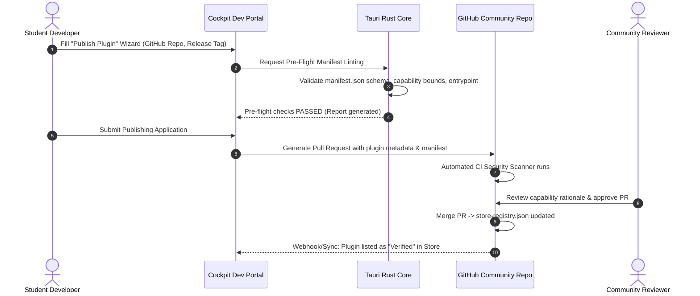

# TU Cockpit: Master Architectural Blueprint & Agent Execution Plan

> **Target Ecosystem:** Desktop Hub & Dynamic Plugin Ecosystem for TU Wien Students  
> **Core Technologies:** Tauri v2, Rust (2021+), React 19, TypeScript 5.5+, Tailwind CSS v4, SQLite (WAL mode), WebCrypto E2EE  
> **Current Project Status:**
> - 🟢 **PHASE 1 (COMPLETED):** Foundational Desktop Runtime, Sandboxed Engine, Dynamic Theme Engine, E2EE Sync, Starter Widget Proof-of-Concept, Multi-Platform CI/CD (Milestones 0–7)  
> - 🟡 **PHASE 2 (PLANNED / TO DO):** Marketplace-First Workstation, GitHub Dynamic Plugin Engine, Embedded University Webviews (TUWEL, TISS, VoWi, Maps), Real-Time Web Theme Injection, Student Auth & Developer RBAC (Milestones 8–13)

---

## Master Table of Contents

### 🟢 PART I: PHASE 1 — FOUNDATIONAL RUNTIME & PROOF-OF-CONCEPT (COMPLETED)
* [1. Executive Product Vision & Architecture Overview](#1-executive-product-vision--architecture-overview)
* [2. Dynamic Plugin Engine & Sandboxing Specification](#2-dynamic-plugin-engine--sandboxing-specification)
* [3. Centralized Theming Engine & Global Styling Customization](#3-centralized-theming-engine--global-styling-customization)
* [4. Cross-Device End-to-End Encrypted (E2EE) Sync Protocol](#4-cross-device-end-to-end-encrypted-e2ee-sync-protocol)
* [5. Phase 1 Implementation Reference Code](#5-phase-1-implementation-reference-code)
* [6. Automated CI/CD Matrix (`.github/workflows/release.yml`)](#6-automated-cicd-matrix-githubworkflowsreleaseyml)
* [7. Phase 1 Completed Execution Schedule & Commits (Milestones 0–7 [STATUS: COMPLETED])](#7-phase-1-completed-execution-schedule--commits-milestones-07-status-completed)

---

### 🟡 PART II: PHASE 2 — CLEAN-SLATE WORKSTATION, EMBEDDED PORTALS & RBAC (PLANNED / TO DO)
* [8. Phase 2 Architecture: The Marketplace-First Paradigm & Clean-Slate Purge](#8-phase-2-architecture-the-marketplace-first-paradigm--clean-slate-purge)
* [9. Dynamic GitHub Plugin Distribution & Verification Engine](#9-dynamic-github-plugin-distribution--verification-engine)
* [10. In-App Embedded Institutional Portals Architecture (TUWEL, TISS, VoWi, TU Maps)](#10-in-app-embedded-institutional-portals-architecture)
* [11. Cross-Site Theme Injection Engine & Curated Style Sheets](#11-cross-site-theme-injection-engine--curated-style-sheets)
* [12. Student Identity, Authentication & Role-Based Access Control (RBAC)](#12-student-identity-authentication--role-based-access-control-rbac)
* [13. Developer Registration & Marketplace Publishing Application Flow](#13-developer-registration--marketplace-publishing-application-flow)
* [14. Phase 2 Target File Hierarchy & Dependencies](#14-phase-2-target-file-hierarchy--dependencies)
* [15. Phase 2 AI Worker Agent Prompts & Step-by-Step Implementation Milestones (Milestones 8–13 [STATUS: READY TO EXECUTE])](#15-phase-2-ai-worker-agent-prompts--step-by-step-implementation-milestones)

---

# ==============================================================================
# 🟢 PART I: PHASE 1 — FOUNDATIONAL RUNTIME & PROOF-OF-CONCEPT (COMPLETED)
# ==============================================================================

> **Phase 1 Summary & Status:** ✅ COMPLETED & VERIFIED IN GIT (Commits `0df51c1` back to `2e6cb13`)  
> **Delivered Capabilities:** Tauri v2 desktop shell, sandboxed iframe RPC bridge (`PluginFrame.tsx`, `plugin_gateway.rs`), centralized CSS variable theme customizer (`useThemeStore.ts`), zero-knowledge E2EE sync engine (`CryptoSyncEngine.ts`), starter deadlines proof-of-concept widget (`plugins/tuwel-deadlines/`), and automated release packaging matrix (`release.yml`).

## 1. Executive Product Vision & Architecture Overview

### 1.1 Core Metaphor
**TU Cockpit** is an extensible, modular student workstation client for TU Wien. It aggregates institutional services (TISS, TUWEL, campus room search, library catalogs, cafeteria menus) and community-contributed tools through an isolated, sandboxed runtime engine.

### 1.2 Technology Stack Justification
* **Desktop Runtime:** Tauri v2 (`@tauri-apps/api@^2.0`, Rust 2021). Chosen over Electron to ensure minimal binary footprint (<15MB), near-zero idle memory consumption (<40MB RAM), native OS integration, and compile-time capabilities/security boundary enforcement.
* **Host UI Layer:** React 19, TypeScript 5.5+, Vite 5, Tailwind CSS v4, Lucide React icons, Radix UI primitives.
* **Central Theming & Customization Engine:** Dynamic CSS custom properties (`--tu-*` design tokens), dynamic font loader (`@font-face` / system font picker), and real-time token propagation across host and sandboxed plugin iframes.
* **Host State & Storage:**
  * Client UI state: Zustand 5.
  * Async queries & caching: TanStack Query v5.
  * Structured local persistence: `@tauri-apps/plugin-sql` (embedded SQLite with WAL mode).
  * Sensitive credential storage: Platform OS Keyring via Tauri Keychain plugin.
* **Plugin Isolation Layer:** Sandboxed `<iframe>` instances with strict `sandbox="allow-scripts"` (without `allow-same-origin`) communicating via bidirectional `MessagePort` channels and typed JSON-RPC 2.0.
* **Cross-Device Sync Engine:** End-to-End Encrypted (E2EE) zero-knowledge state synchronization using WebCrypto (`AES-256-GCM` with `PBKDF2`/`Argon2id` key derivation) with provider adapters (GitHub Gist API or self-hosted REST/Supabase relay).

### 1.3 Architecture Topology
```
+-------------------------------------------------------------------------+
|                              TU COCKPIT SHELL                           |
|  +--------------------+  +----------------------+  +-----------------+  |
|  | Dock & Navigation  |  | Plugin Registry / Store| | E2EE Sync Engine|  |
|  +--------------------+  +----------------------+  +-----------------+  |
|  +-------------------------------------------------------------------+  |
|  |       Central Theme Engine (CSS Design Tokens & Dynamic Fonts)    |  |
|  +-------------------------------------------------------------------+  |
|  |             Plugin Host Manager & Permission Gateway             |  |
|  +-------------------------------------------------------------------+  |
|            | MessagePort RPC (Tokens & API)      | Tauri IPC Bridge     |
|            v                                     v                      |
|  +---------------------------+       +-------------------------------+  |
|  | Sandboxed <iframe> Plugin |       | Tauri v2 Rust Core Runtime    |  |
|  | - Auto-injected CSS vars  |       | - Gated HTTP Proxy (CORS-free)|  |
|  | - Restricted DOM context  |       | - Secure Keychain Storage     |  |
|  | - Local Storage Emulation |       | - SQLite Local Database       |  |
|  | - Scoped RPC API Client   |       |                               |  |
|  +---------------------------+       +-------------------------------+  |
+-------------------------------------------------------------------------+
```

---

## 2. Dynamic Plugin Engine & Sandboxing Specification

### 2.1 Manifest Schema (`manifest.json`)
Every plugin repository or release bundle must contain a `manifest.json`:

```json
{
  "$schema": "https://tu-cockpit.tuwien.ac.at/schemas/v1/plugin-manifest.json",
  "id": "tuwien.tuwel.deadlines",
  "name": "TUWEL Deadline Tracker",
  "version": "1.0.0",
  "author": {
    "name": "TU Wien Student Devs",
    "email": "devs@student.tuwien.ac.at",
    "url": "https://github.com/tuwien-community"
  },
  "description": "Displays upcoming assignment deadlines and submission statuses from TUWEL.",
  "homepage": "https://github.com/tuwien-community/tuwel-deadlines",
  "entrypoint": "index.html",
  "icon": "icon.svg",
  "type": "widget",
  "capabilities": {
    "network": [
      "https://tuwel.tuwien.ac.at/calendar/*",
      "https://tuwel.tuwien.ac.at/mod/assign/*"
    ],
    "storage": {
      "quotaBytes": 5242880
    },
    "notifications": true,
    "systemClipboard": false
  },
  "ui": {
    "minWidth": 320,
    "minHeight": 240,
    "defaultWidth": 400,
    "defaultHeight": 300,
    "resizable": true
  }
}
```

### 2.2 Security Sandboxing & Permission Model
1. **Network Requests:** Standard web browser contexts enforce CORS, blocking client fetches to TISS/TUWEL. Plugins **cannot** make direct `fetch()` or `XMLHttpRequest` calls. Instead, plugins call `client.http.get(url)`. This dispatches a request to the host shell, which forwards it to the Rust core via Tauri IPC. The Rust gateway verifies that `url` matches the declarative glob patterns in `capabilities.network` before dispatching via `reqwest` with authenticated student session cookies.
2. **Storage Isolation:** Untrusted plugins do not have access to the shell's `localStorage` or IndexedDB. A key-value API (`client.storage.get/set`) persists data to an isolated SQLite table keyed by `plugin_id`.
3. **DOM & Context Isolation:** Untrusted third-party code runs inside an `<iframe>` configured with `sandbox="allow-scripts"`. Omitting `allow-same-origin` gives the iframe an opaque origin (`null`), isolating it from the host DOM, parent cookies, and Tauri IPC globals (`window.__TAURI__`).

### 2.3 RPC Message Contract
Host and Plugin communicate through a dedicated `MessageChannel`.

```typescript
export type RpcRequest = {
  jsonrpc: "2.0";
  id: string;
  method: "http:request" | "storage:get" | "storage:set" | "notify" | "lifecycle:ready";
  params: unknown;
};

export type RpcResponse = {
  jsonrpc: "2.0";
  id: string;
  result?: unknown;
  error?: {
    code: number;
    message: string;
    data?: unknown;
  };
};
```

---

## 3. Centralized Theming Engine & Global Styling Customization

### 3.1 Design Token Architecture & CSS Variable Contract
The entire application (host shell, dock, settings, dialogs, and untrusted plugin iframes) is styled via a unified set of CSS custom properties defined at `:root`. Every UI component derives colors, surface elevations, radiuses, borders, and typography exclusively from these tokens:

```css
:root {
  /* Surface & Background Hierarchies */
  --tu-bg-base: #0f172a;           /* App main canvas / window background */
  --tu-bg-surface: #1e293b;        /* Panels, cards, and modal bodies */
  --tu-bg-card: #334155;           /* Embedded interactive cards / widgets */
  --tu-bg-hover: #475569;          /* Hover states for interactive surfaces */

  /* Structural Borders & Dividers */
  --tu-border: #334155;            /* Standard structural borders */
  --tu-border-subtle: #1e293b;     /* Card dividers and inner borders */
  --tu-border-focus: #38bdf8;      /* Active / focused element outline */

  /* Typography Colors */
  --tu-text-primary: #f8fafc;      /* High-contrast headings and body text */
  --tu-text-secondary: #94a3b8;    /* Subheadings, labels, card captions */
  --tu-text-muted: #64748b;        /* Inactive states, metadata, timestamps */
  --tu-text-accent: #38bdf8;       /* Highlighted text */

  /* Brand & Status Colors */
  --tu-accent: #006699;            /* TU Wien Corporate Blue / User Accent */
  --tu-accent-hover: #007ab8;      /* Darkened / lightened accent on hover */
  --tu-accent-contrast: #ffffff;   /* Foreground text color on top of accent */
  --tu-danger: #ef4444;            /* Deadlines, errors, warnings */
  --tu-success: #10b981;           /* Completed assignments, online status */
  --tu-warning: #f59e0b;           /* Approaching submission deadlines */

  /* Typography Stack */
  --tu-font-sans: 'Inter', system-ui, -apple-system, BlinkMacSystemFont, 'Segoe UI', Roboto, sans-serif;
  --tu-font-mono: 'JetBrains Mono', 'Fira Code', ui-monospace, monospace;
  --tu-font-size-base: 14px;
  --tu-ui-scale: 1.0;              /* Global zoom scaling multiplier: 0.85 to 1.5 */

  /* Geometry & Elevation */
  --tu-radius-sm: 4px;
  --tu-radius: 8px;                /* Standard corner radius for cards & widgets */
  --tu-radius-lg: 12px;
  --tu-shadow: 0 4px 6px -1px rgba(0, 0, 0, 0.3), 0 2px 4px -2px rgba(0, 0, 0, 0.3);
}
```

### 3.2 Typography Engine & Dynamic Font Management
Users can configure and hot-swap fonts globally without rebuilding or restarting:
1. **System Native Stacks:** macOS (`-apple-system`), Windows (`Segoe UI`), Linux (`Ubuntu`, `Cantarell`).
2. **Curated Open-Source Fonts:** Built-in font definitions:
   * **Sans-serif:** `Inter`, `Geist`, `Plus Jakarta Sans`.
   * **Monospace:** `JetBrains Mono`, `Fira Code`.
   * **Accessibility & Dyslexia-friendly:** `OpenDyslexic`, `Atkinson Hyperlegible` (for low-vision readability).
3. **Custom Local & Web Font Loader:**
   * Users can select custom `.woff2` / `.ttf` files from disk (loaded via Tauri's secure asset protocol `asset://`) or provide a web font stylesheet URL.
   * Dynamic `@font-face` rules are synthesized and injected into the document `<head>`.
4. **Fluid UI Scaling:** A master slider in Settings modifies `--tu-ui-scale` (0.85x, 1.0x, 1.15x, 1.25x, 1.5x) to guarantee WCAG compliance and comfort on HiDPI / 4K displays.

### 3.3 Built-in Themes & Custom Theme JSON Schema
The client ships with pre-tuned theme presets and supports user-created JSON themes:

```json
{
  "$schema": "https://tu-cockpit.tuwien.ac.at/schemas/v1/theme.json",
  "id": "tu-wien-dark",
  "name": "TU Wien Night",
  "type": "dark",
  "author": "TU Cockpit Core",
  "tokens": {
    "--tu-bg-base": "#0c131f",
    "--tu-bg-surface": "#141e30",
    "--tu-bg-card": "#1d2b45",
    "--tu-border": "#28395a",
    "--tu-accent": "#006699",
    "--tu-accent-hover": "#007ab8",
    "--tu-accent-contrast": "#ffffff",
    "--tu-text-primary": "#f1f5f9",
    "--tu-text-secondary": "#94a3b8",
    "--tu-radius": "10px",
    "--tu-font-sans": "'Inter', system-ui, sans-serif"
  }
}
```

**Pre-Bundled Presets:**
* **TU Wien Night:** Dark slate canvas with TU Wien Blue (`#006699`) and TU Red accents (`#E3001B`).
* **TU Wien Daylight:** High-contrast crisp academic white and university corporate blue.
* **Catppuccin Mocha:** Warm pastel developer dark theme.
* **Nord:** Arctic, calm north-bluish palette.
* **Tokyo Night:** Modern violet-blue IDE aesthetic.
* **OLED Stealth:** Pure `#000000` deep black for OLED battery saving.
* **Accessible High-Contrast:** WCAG AAA compliant (>= 7:1 contrast ratio) with clear structural borders.

### 3.4 Cross-Boundary Plugin Styling (Auto-Theming Engine)
Community plugins running in sandboxed `<iframe>`s MUST reflect user theme and font choices automatically without manual effort:
1. **Dynamic Style Injection into `srcDoc`:** When `PluginFrame.tsx` mounts, it synthesizes the active CSS variables from `useThemeStore` and prepends a `<style id="tu-cockpit-injected-theme">` tag to the plugin document `<head>`.
2. **Live Theme Change Broadcast (`theme:changed`):** When the user updates any theme token, changes fonts, or toggles dark/light mode in Settings:
   * The host iterates active plugins and sends `{ jsonrpc: "2.0", method: "theme:changed", params: { tokens, fontSans, uiScale } }` over the RPC `MessagePort`.
   * The `@tu-cockpit/plugin-sdk` catches this event and immediately updates the iframe's `:root` CSS properties in memory with zero layout jump.
3. **Universal Plugin Styling Rule:** Plugin authors only need to write standard CSS using `var(--tu-bg-base)`, `var(--tu-text-primary)`, `var(--tu-accent)`, etc.

---

## 4. Cross-Device End-to-End Encrypted (E2EE) Sync Protocol

### 4.1 Encryption & Key Derivation Model
To synchronize layout configurations, installed plugin lists, themes, and custom settings without exposing university credentials or personal data:
* **Passphrase:** User enters a personal Sync Passphrase (zero-knowledge).
* **Salt:** 16-byte cryptographically secure random salt generated on first setup.
* **Key Derivation:** WebCrypto `PBKDF2` with `SHA-256`, 600,000 iterations (or client-side `argon2id`), deriving a 256-bit AES key.
* **Payload Encryption:** `AES-GCM` with a fresh 12-byte initialization vector (IV) per sync push.
* **Envelope Structure:**
  ```json
  {
    "version": 1,
    "deviceId": "uuid-v4",
    "updatedAt": "2026-10-13T17:15:00.000Z",
    "salt": "base64-salt",
    "iv": "base64-iv",
    "ciphertext": "base64-encrypted-data"
  }
  ```
* **Decrypted Payload Schema:**
  ```json
  {
    "theme": {
      "activeThemeId": "tu-wien-dark",
      "fontSans": "JetBrains Mono",
      "uiScale": 1.0,
      "customOverrides": {
        "--tu-accent": "#006699"
      }
    },
    "installedPlugins": [
      { "id": "tuwien.tuwel.deadlines", "version": "1.0.0", "enabled": true }
    ],
    "dockLayout": ["tuwien.tuwel.deadlines", "tuwien.tiss.calendar"]
  }
  ```

### 4.2 Conflict Resolution
* State synchronizes via **Last-Write-Wins (LWW)** with Lamport Vector Timestamps at the field level (e.g., individual plugin configs and theme preferences merge independently from global layout state).

---

## 5. Complete Implementation Roadmap & Source Code

### 5.1 Target File Hierarchy
```
tu-cockpit/
├── .github/
│   └── workflows/
│       └── release.yml
├── package.json
├── tsconfig.json
├── vite.config.ts
├── src-tauri/
│   ├── Cargo.toml
│   ├── tauri.conf.json
│   ├── capabilities/
│   │   └── default.json
│   └── src/
│       ├── main.rs
│       └── plugin_gateway.rs
├── src/
│   ├── main.tsx
│   ├── App.tsx
│   ├── index.css
│   ├── styles/
│   │   └── theme.css
│   ├── components/
│   │   ├── dock/
│   │   ├── marketplace/
│   │   ├── settings/
│   │   │   └── ThemeCustomizer.tsx
│   │   └── plugin-host/
│   │       ├── PluginFrame.tsx
│   │       └── PluginHostManager.ts
│   ├── sdk/
│   │   └── index.ts
│   ├── services/
│   │   ├── db/
│   │   │   └── sqlite.ts
│   │   └── sync/
│   │       ├── CryptoSyncEngine.ts
│   │       └── GistSyncAdapter.ts
│   └── store/
│       ├── useAppStore.ts
│       └── useThemeStore.ts
└── plugins/
    └── tuwel-deadlines/
        ├── manifest.json
        ├── index.html
        └── app.ts
```

### 5.2 Bootstrapping Commands
```bash
# 1. Initialize Git Repository & Version Control Hygiene
git init -b main
cat << 'EOF' > .gitignore
# Dependencies
node_modules/
target/
src-tauri/target/
src-tauri/gen/

# Build artifacts & distribution
dist/
dist-ssr/
*.dmg
*.app
*.exe
*.msi
*.AppImage
*.deb

# Environment & Secrets
.env
.env.*
!.env.example

# Logs & System
*.log
.DS_Store
Thumbs.db
EOF
git add .
git commit -m "chore: initialize repository and master plan"

# 2. Initialize project with Tauri v2 + React + TypeScript
npm create tauri-app@latest tu-cockpit -- --template react-ts
cd tu-cockpit

# 3. Install UI, State, and Tauri plugin dependencies
npm install zustand @tanstack/react-query lucide-react clsx tailwindcss @tailwindcss/vite
npm install @tauri-apps/api@^2.0 @tauri-apps/plugin-sql@^2.0 @tauri-apps/plugin-shell@^2.0 @tauri-apps/plugin-notification@^2.0

# 4. Add Rust dependencies in src-tauri
cd src-tauri
cargo add reqwest --features "json rustls-tls"
cargo add serde --features "derive"
cargo add serde_json
cargo add regex
cargo add thiserror
cd ..
```

### 5.3 Rust Host Core (`src-tauri/src/plugin_gateway.rs`)
```rust
use std::collections::HashMap;
use serde::{Deserialize, Serialize};
use regex::Regex;

#[derive(Debug, Serialize, Deserialize)]
pub struct NetworkResponse {
    pub status: u16,
    pub headers: HashMap<String, String>,
    pub body: String,
}

#[derive(Debug, Serialize, Deserialize)]
pub struct PluginRule {
    pub plugin_id: String,
    pub allowed_globs: Vec<String>,
}

fn glob_to_regex(glob: &str) -> Result<Regex, regex::Error> {
    let escaped = regex::escape(glob).replace(r"\*", ".*");
    Regex::new(&format!("^{}$", escaped))
}

pub fn is_url_allowed(url: &str, allowed_globs: &[String]) -> bool {
    for glob in allowed_globs {
        if let Ok(re) = glob_to_regex(glob) {
            if re.is_match(url) {
                return true;
            }
        }
    }
    false
}

#[tauri::command]
pub async fn execute_plugin_network_request(
    plugin_id: String,
    url: String,
    method: String,
    headers: HashMap<String, String>,
    body: Option<String>,
    allowed_globs: Vec<String>,
) -> Result<NetworkResponse, String> {
    if !is_url_allowed(&url, &allowed_globs) {
        return Err(format!(
            "Access Denied: URL '{}' is not whitelisted by plugin '{}'",
            url, plugin_id
        ));
    }

    let client = reqwest::Client::builder()
        .timeout(std::time::Duration::from_secs(10))
        .build()
        .map_err(|e| e.to_string())?;

    let req_method = match method.to_uppercase().as_str() {
        "GET" => reqwest::Method::GET,
        "POST" => reqwest::Method::POST,
        "PUT" => reqwest::Method::PUT,
        "DELETE" => reqwest::Method::DELETE,
        _ => return Err(format!("Unsupported HTTP method: {}", method)),
    };

    let mut request = client.request(req_method, &url);
    for (k, v) in headers {
        // Strip sensitive host headers
        if !k.eq_ignore_ascii_case("host") && !k.eq_ignore_ascii_case("cookie") {
            request = request.header(&k, &v);
        }
    }

    if let Some(b) = body {
        request = request.body(b);
    }

    let response = request.send().await.map_err(|e| e.to_string())?;
    let status = response.status().as_u16();

    let mut res_headers = HashMap::new();
    for (k, v) in response.headers() {
        if let Ok(val) = v.to_str() {
            res_headers.insert(k.as_str().to_string(), val.to_string());
        }
    }

    let body_text = response.text().await.map_err(|e| e.to_string())?;

    Ok(NetworkResponse {
        status,
        headers: res_headers,
        body: body_text,
    })
}
```

### 5.4 Central Theme Store & System Tokens (`src/store/useThemeStore.ts`)
```typescript
import { create } from "zustand";

export interface ThemeTokens {
  [key: string]: string;
}

export interface ThemeState {
  activeThemeId: string;
  tokens: ThemeTokens;
  fontSans: string;
  fontMono: string;
  uiScale: number;
  customCss: string;
  setTheme: (themeId: string, tokens: ThemeTokens) => void;
  setFontSans: (fontFamily: string) => void;
  setUiScale: (scale: number) => void;
  setCustomToken: (token: string, value: string) => void;
  setCustomCss: (css: string) => void;
}

export const DEFAULT_THEME_TOKENS: ThemeTokens = {
  "--tu-bg-base": "#0f172a",
  "--tu-bg-surface": "#1e293b",
  "--tu-bg-card": "#334155",
  "--tu-bg-hover": "#475569",
  "--tu-border": "#334155",
  "--tu-border-subtle": "#1e293b",
  "--tu-border-focus": "#38bdf8",
  "--tu-text-primary": "#f8fafc",
  "--tu-text-secondary": "#94a3b8",
  "--tu-text-muted": "#64748b",
  "--tu-text-accent": "#38bdf8",
  "--tu-accent": "#006699",
  "--tu-accent-hover": "#007ab8",
  "--tu-accent-contrast": "#ffffff",
  "--tu-danger": "#ef4444",
  "--tu-success": "#10b981",
  "--tu-warning": "#f59e0b",
  "--tu-radius": "8px",
  "--tu-radius-sm": "4px",
  "--tu-radius-lg": "12px",
};

export const useThemeStore = create<ThemeState>((set) => ({
  activeThemeId: "tu-wien-dark",
  tokens: DEFAULT_THEME_TOKENS,
  fontSans: "'Inter', system-ui, -apple-system, BlinkMacSystemFont, 'Segoe UI', Roboto, sans-serif",
  fontMono: "'JetBrains Mono', 'Fira Code', ui-monospace, monospace",
  uiScale: 1.0,
  customCss: "",
  setTheme: (themeId, tokens) => set({ activeThemeId: themeId, tokens }),
  setFontSans: (fontSans) => set({ fontSans }),
  setUiScale: (uiScale) => set({ uiScale }),
  setCustomToken: (token, value) =>
    set((state) => ({ tokens: { ...state.tokens, [token]: value } })),
  setCustomCss: (customCss) => set({ customCss }),
}));
```

### 5.5 Plugin Host Sandbox with Dynamic Theme Injection (`src/components/plugin-host/PluginFrame.tsx`)
```tsx
import React, { useEffect, useRef } from "react";
import { invoke } from "@tauri-apps/api/core";
import { useThemeStore } from "@/store/useThemeStore";

export interface PluginFrameProps {
  pluginId: string;
  htmlContent: string;
  allowedGlobs: string[];
  onReady?: () => void;
}

export const PluginFrame: React.FC<PluginFrameProps> = ({
  pluginId,
  htmlContent,
  allowedGlobs,
  onReady,
}) => {
  const iframeRef = useRef<HTMLIFrameElement>(null);
  const portRef = useRef<MessagePort | null>(null);
  const { tokens, fontSans, uiScale } = useThemeStore();

  // Synthesize CSS variables into an auto-injected style tag
  const generateThemeStyleBlock = () => `
    <style id="tu-cockpit-injected-theme">
      :root {
        ${Object.entries(tokens).map(([k, v]) => `${k}: ${v};`).join("\n        ")}
        --tu-font-sans: ${fontSans};
        --tu-ui-scale: ${uiScale};
      }
    </style>
  `;

  // Prepend or inject into the head of the plugin's HTML
  const themedHtml = htmlContent.includes("<head>")
    ? htmlContent.replace("<head>", `<head>${generateThemeStyleBlock()}`)
    : `${generateThemeStyleBlock()}${htmlContent}`;

  // Broadcast real-time theme updates whenever user customizes tokens or fonts
  useEffect(() => {
    if (portRef.current) {
      portRef.current.postMessage({
        jsonrpc: "2.0",
        method: "theme:changed",
        params: { tokens, fontSans, uiScale },
      });
    }
  }, [tokens, fontSans, uiScale]);

  useEffect(() => {
    const iframe = iframeRef.current;
    if (!iframe) return;

    const channel = new MessageChannel();
    const { port1, port2 } = channel;
    portRef.current = port1;

    // Handle RPC messages from the sandboxed iframe
    port1.onmessage = async (event: MessageEvent) => {
      const { jsonrpc, id, method, params } = event.data;
      if (jsonrpc !== "2.0") return;

      try {
        if (method === "lifecycle:ready") {
          onReady?.();
          port1.postMessage({ jsonrpc: "2.0", id, result: true });
        } else if (method === "theme:get") {
          port1.postMessage({
            jsonrpc: "2.0",
            id,
            result: { tokens, fontSans, uiScale },
          });
        } else if (method === "http:request") {
          const { url, method: httpMethod, headers, body } = params;
          const result = await invoke("execute_plugin_network_request", {
            pluginId,
            url,
            method: httpMethod || "GET",
            headers: headers || {},
            body: body || null,
            allowedGlobs,
          });
          port1.postMessage({ jsonrpc: "2.0", id, result });
        } else if (method === "storage:get") {
          const { key } = params;
          const val = localStorage.getItem(`plugin:${pluginId}:${key}`);
          port1.postMessage({ jsonrpc: "2.0", id, result: val });
        } else if (method === "storage:set") {
          const { key, value } = params;
          localStorage.setItem(`plugin:${pluginId}:${key}`, value);
          port1.postMessage({ jsonrpc: "2.0", id, result: true });
        } else {
          port1.postMessage({
            jsonrpc: "2.0",
            id,
            error: { code: -32601, message: "Method not found" },
          });
        }
      } catch (err: any) {
        port1.postMessage({
          jsonrpc: "2.0",
          id,
          error: { code: -32000, message: err.toString() },
        });
      }
    };

    const handleLoad = () => {
      iframe.contentWindow?.postMessage({ type: "INIT_RPC_PORT" }, "*", [port2]);
    };

    iframe.addEventListener("load", handleLoad);
    return () => {
      iframe.removeEventListener("load", handleLoad);
      port1.close();
      portRef.current = null;
    };
  }, [pluginId, allowedGlobs]);

  return (
    <iframe
      ref={iframeRef}
      srcDoc={themedHtml}
      sandbox="allow-scripts"
      className="w-full h-full border-none rounded-lg bg-transparent"
      title={`Plugin: ${pluginId}`}
    />
  );
};
```

### 5.6 Plugin SDK Runtime Client with Auto-Theming (`src/sdk/index.ts`)
```typescript
export interface PluginTheme {
  tokens: Record<string, string>;
  fontSans: string;
  uiScale: number;
}

export interface PluginClient {
  http: {
    get: <T = unknown>(url: string, headers?: Record<string, string>) => Promise<T>;
    post: <T = unknown>(url: string, body: unknown, headers?: Record<string, string>) => Promise<T>;
  };
  storage: {
    get: (key: string) => Promise<string | null>;
    set: (key: string, value: string) => Promise<void>;
  };
  theme: {
    get: () => Promise<PluginTheme>;
    onChange: (callback: (theme: PluginTheme) => void) => () => void;
  };
  lifecycle: {
    ready: () => Promise<void>;
  };
}

class TuCockpitClient implements PluginClient {
  private port: MessagePort | null = null;
  private pendingRequests = new Map<string, { resolve: (val: any) => void; reject: (err: any) => void }>();
  private themeListeners = new Set<(theme: PluginTheme) => void>();
  private currentTheme: PluginTheme | null = null;
  private reqIdCounter = 0;

  constructor() {
    window.addEventListener("message", (event) => {
      if (event.data?.type === "INIT_RPC_PORT" && event.ports[0]) {
        this.port = event.ports[0];
        this.port.onmessage = this.handleRpcMessage.bind(this);
      }
    });
  }

  private applyThemeToDocument(theme: PluginTheme) {
    this.currentTheme = theme;
    let styleEl = document.getElementById("tu-cockpit-injected-theme") as HTMLStyleElement | null;
    if (!styleEl) {
      styleEl = document.createElement("style");
      styleEl.id = "tu-cockpit-injected-theme";
      document.head.appendChild(styleEl);
    }
    const cssRules = Object.entries(theme.tokens)
      .map(([k, v]) => `${k}: ${v};`)
      .join("\n");
    styleEl.innerHTML = `
      :root {
        ${cssRules}
        --tu-font-sans: ${theme.fontSans};
        --tu-ui-scale: ${theme.uiScale};
      }
    `;
    this.themeListeners.forEach((fn) => fn(theme));
  }

  private handleRpcMessage(event: MessageEvent) {
    const { id, method, params, result, error } = event.data;

    // Handle broadcast notifications from host
    if (method === "theme:changed" && params) {
      this.applyThemeToDocument(params as PluginTheme);
      return;
    }

    if (!id) return;
    const pending = this.pendingRequests.get(id);
    if (!pending) return;

    this.pendingRequests.delete(id);
    if (error) {
      pending.reject(new Error(error.message));
    } else {
      pending.resolve(result);
    }
  }

  private call(method: string, params: unknown = {}): Promise<any> {
    return new Promise((resolve, reject) => {
      if (!this.port) {
        return reject(new Error("RPC channel not initialized yet"));
      }
      const id = `req_${++this.reqIdCounter}_${Date.now()}`;
      this.pendingRequests.set(id, { resolve, reject });
      this.port.postMessage({ jsonrpc: "2.0", id, method, params });
    });
  }

  public http = {
    get: async <T = unknown>(url: string, headers: Record<string, string> = {}): Promise<T> => {
      const res = await this.call("http:request", { url, method: "GET", headers });
      return JSON.parse(res.body);
    },
    post: async <T = unknown>(url: string, body: unknown, headers: Record<string, string> = {}): Promise<T> => {
      const res = await this.call("http:request", {
        url,
        method: "POST",
        headers: { "Content-Type": "application/json", ...headers },
        body: JSON.stringify(body),
      });
      return JSON.parse(res.body);
    },
  };

  public storage = {
    get: (key: string): Promise<string | null> => this.call("storage:get", { key }),
    set: (key: string, value: string): Promise<void> => this.call("storage:set", { key, value }),
  };

  public theme = {
    get: async (): Promise<PluginTheme> => {
      if (this.currentTheme) return this.currentTheme;
      return this.call("theme:get");
    },
    onChange: (callback: (theme: PluginTheme) => void) => {
      this.themeListeners.add(callback);
      if (this.currentTheme) callback(this.currentTheme);
      return () => this.themeListeners.delete(callback);
    },
  };

  public lifecycle = {
    ready: (): Promise<void> => this.call("lifecycle:ready"),
  };
}

export const createPluginClient = (): PluginClient => new TuCockpitClient();
```

### 5.7 Production-Ready Starter Plugin with Central Tokens (`plugins/tuwel-deadlines/`)
#### `plugins/tuwel-deadlines/manifest.json`
```json
{
  "id": "tuwien.tuwel.deadlines",
  "name": "TUWEL Deadlines",
  "version": "1.0.0",
  "entrypoint": "index.html",
  "type": "widget",
  "capabilities": {
    "network": ["https://tuwel.tuwien.ac.at/*"],
    "storage": { "quotaBytes": 1048576 },
    "notifications": true
  }
}
```

#### `plugins/tuwel-deadlines/index.html`
```html
<!DOCTYPE html>
<html lang="en">
<head>
  <meta charset="UTF-8">
  <meta name="viewport" content="width=device-width, initial-scale=1.0">
  <title>TUWEL Deadlines</title>
  <style>
    body {
      margin: 0;
      font-family: var(--tu-font-sans, system-ui, -apple-system, sans-serif);
      background: var(--tu-bg-base, #0f172a);
      color: var(--tu-text-primary, #f8fafc);
      padding: 16px;
      user-select: none;
      transition: background-color 0.2s ease, color 0.2s ease;
    }
    .header {
      display: flex;
      justify-content: space-between;
      align-items: center;
      margin-bottom: 12px;
    }
    .title {
      font-weight: 700;
      font-size: 13px;
      text-transform: uppercase;
      letter-spacing: 0.05em;
      color: var(--tu-accent, #006699);
    }
    .card {
      background: var(--tu-bg-surface, #1e293b);
      padding: 10px 14px;
      border-radius: var(--tu-radius, 8px);
      margin-bottom: 8px;
      display: flex;
      justify-content: space-between;
      align-items: center;
      border: 1px solid var(--tu-border, #334155);
      transition: border-color 0.2s ease, transform 0.15s ease;
    }
    .card:hover {
      background: var(--tu-bg-hover, #475569);
    }
    .course-label {
      font-size: 11px;
      color: var(--tu-text-secondary, #94a3b8);
      font-weight: 500;
    }
    .task-name {
      font-weight: 600;
      font-size: 13px;
      color: var(--tu-text-primary, #f8fafc);
    }
    .badge {
      font-size: 11px;
      padding: 3px 8px;
      border-radius: var(--tu-radius-sm, 4px);
      background: var(--tu-danger, #ef4444);
      color: #ffffff;
      font-weight: 600;
    }
    .badge.warning {
      background: var(--tu-warning, #f59e0b);
    }
  </style>
</head>
<body>
  <div class="header">
    <div class="title">TUWEL Upcoming Deadlines</div>
    <span id="sync-status" style="font-size: 11px; color: var(--tu-text-muted, #64748b);">Connecting...</span>
  </div>
  <div id="deadlines-list"></div>

  <script type="module">
    let port = null;
    let reqId = 0;
    const pending = new Map();

    window.addEventListener("message", (e) => {
      if (e.data?.type === "INIT_RPC_PORT") {
        port = e.ports[0];
        port.onmessage = (msg) => {
          const { id, method, params, result, error } = msg.data;
          if (method === "theme:changed" && params) {
            // Theme auto-updated by injected CSS, or custom JS hook here
            return;
          }
          if (!id) return;
          const p = pending.get(id);
          if (p) {
            pending.delete(id);
            error ? p.reject(error) : p.resolve(result);
          }
        };
        init();
      }
    });

    function call(method, params = {}) {
      return new Promise((resolve, reject) => {
        const id = `req_${++reqId}`;
        pending.set(id, { resolve, reject });
        port.postMessage({ jsonrpc: "2.0", id, method, params });
      });
    }

    async function init() {
      await call("lifecycle:ready");
      document.getElementById("sync-status").innerText = "Synced";

      const items = [
        { id: "1", course: "VU Algorithmen und Datenstrukturen", task: "Abgabe Aufgabe 2 (Graph Search)", due: "Tomorrow, 23:59", urgent: true },
        { id: "2", course: "UE Analysis 1", task: "Übungsblatt 4", due: "In 3 days", urgent: false },
        { id: "3", course: "VO Technische Grundlagen der Informatik", task: "Zwischentest Quiz", due: "Oct 20, 18:00", urgent: false }
      ];

      const container = document.getElementById("deadlines-list");
      container.innerHTML = items.map(item => `
        <div class="card" id="item-${item.id}">
          <div>
            <div class="course-label">${item.course}</div>
            <div class="task-name">${item.task}</div>
          </div>
          <div class="badge ${item.urgent ? '' : 'warning'}">${item.due}</div>
        </div>
      `).join("");
    }
  </script>
</body>
</html>
```

### 5.8 Cross-Device E2EE Sync Engine (`src/services/sync/CryptoSyncEngine.ts`)
```typescript
export class CryptoSyncEngine {
  private static ALGO = "AES-GCM";
  private static KEY_ALGO = "PBKDF2";

  public static async deriveKey(passphrase: string, salt: Uint8Array): Promise<CryptoKey> {
    const enc = new TextEncoder();
    const baseKey = await crypto.subtle.importKey(
      "raw",
      enc.encode(passphrase),
      { name: this.KEY_ALGO },
      false,
      ["deriveKey"]
    );

    return crypto.subtle.deriveKey(
      {
        name: this.KEY_ALGO,
        salt,
        iterations: 600000,
        hash: "SHA-256",
      },
      baseKey,
      { name: this.ALGO, length: 256 },
      false,
      ["encrypt", "decrypt"]
    );
  }

  public static async encryptPayload(data: unknown, key: CryptoKey): Promise<{ ciphertext: string; iv: string }> {
    const enc = new TextEncoder();
    const iv = crypto.getRandomValues(new Uint8Array(12));
    const encodedData = enc.encode(JSON.stringify(data));

    const encrypted = await crypto.subtle.encrypt(
      { name: this.ALGO, iv },
      key,
      encodedData
    );

    return {
      ciphertext: btoa(String.fromCharCode(...new Uint8Array(encrypted))),
      iv: btoa(String.fromCharCode(...iv)),
    };
  }

  public static async decryptPayload(ciphertext: string, ivBase64: string, key: CryptoKey): Promise<unknown> {
    const iv = Uint8Array.from(atob(ivBase64), (c) => c.charCodeAt(0));
    const data = Uint8Array.from(atob(ciphertext), (c) => c.charCodeAt(0));

    const decrypted = await crypto.subtle.decrypt(
      { name: this.ALGO, iv },
      key,
      data
    );

    const dec = new TextDecoder();
    return JSON.parse(dec.decode(decrypted));
  }
}
```

---

## 6. Automated CI/CD Matrix (`.github/workflows/release.yml`)

```yaml
name: Release Multi-Platform Binaries

on:
  push:
    tags:
      - 'v*'
  workflow_dispatch:

jobs:
  release:
    permissions:
      contents: write
    strategy:
      fail-fast: false
      matrix:
        include:
          - platform: 'macos-latest'
            args: '--target universal-apple-darwin'
          - platform: 'ubuntu-22.04'
            args: ''
          - platform: 'windows-latest'
            args: ''

    runs-on: ${{ matrix.platform }}
    steps:
      - name: Checkout repository
        uses: actions/checkout@v4

      - name: Setup Node.js
        uses: actions/setup-node@v4
        with:
          node-version: 20
          cache: 'npm'

      - name: Install Rust Stable
        uses: dtolnay/rust-toolchain@stable
        with:
          targets: ${{ matrix.platform == 'macos-latest' && 'aarch64-apple-darwin,x86_64-apple-darwin' || '' }}

      - name: Rust Cache
        uses: swatinem/rust-cache@v2
        with:
          work-dir: src-tauri

      - name: Install Linux Dependencies
        if: matrix.platform == 'ubuntu-22.04'
        run: |
          sudo apt-get update
          sudo apt-get install -y libwebkit2gtk-4.1-dev libappindicator3-dev librsvg2-dev patchelf libssl-dev

      - name: Install Frontend Dependencies
        run: npm ci

      - name: Build Tauri Desktop Bundles
        uses: tauri-apps/tauri-action@v0
        env:
          GITHUB_TOKEN: ${{ secrets.GITHUB_TOKEN }}
        with:
          tagName: ${{ github.ref_name }}
          releaseName: 'TU Cockpit ${{ github.ref_name }}'
          releaseBody: 'Automated release build for macOS, Windows, and Linux.'
          releaseDraft: false
          prerelease: false
          args: ${{ matrix.args }}
```

---

## 7. Phase 1 Completed Execution Schedule & Commits (Milestones 0–7 [STATUS: COMPLETED])

> [!NOTE]
> **Phase 1 Verification:**
> All Phase 1 milestones (0 through 7) have been fully developed, verified, and pushed to the upstream repository. Each milestone corresponds to a verified conventional git commit.

### 7.1 Step-by-Step Phase 1 Completed Commit Schedule

1. **Milestone 0: Repository Initialization & Hygiene** `[STATUS: COMPLETED ✅]`
   * Action: Executed `git init -b main`, configured comprehensive `.gitignore`.
   * Commit Message: `chore: initialize repository and master plan`

2. **Milestone 1: Shell Scaffolding** `[STATUS: COMPLETED ✅]`
   * Action: Run Tauri v2 + React initialization, install dependencies, configure `tauri.conf.json` and `capabilities/default.json`.
   * Commit Message: `feat(shell): initialize tauri v2 desktop shell with react and tailwind`

3. **Milestone 2: Central Theming Engine & Customization UI** `[STATUS: COMPLETED ✅]`
   * Action: Implement `src/styles/theme.css`, `src/store/useThemeStore.ts`, dynamic font loaders, and `src/components/settings/ThemeCustomizer.tsx`.
   * Commit Message: `feat(theme): implement centralized design tokens, custom font loader, and theme customizer`

4. **Milestone 3: Core Bridge & Gateway** `[STATUS: COMPLETED ✅]`
   * Action: Implement `src-tauri/src/plugin_gateway.rs`, link in `main.rs`, verify `cargo check`.
   * Commit Message: `feat(core): implement secure rust network gateway and capability validator`

5. **Milestone 4: Sandbox, SDK & Theme Propagation** `[STATUS: COMPLETED ✅]`
   * Action: Implement `PluginFrame.tsx` with theme injection, and `src/sdk/index.ts` with auto-theming listeners.
   * Commit Message: `feat(sandbox): implement iframe rpc bridge, plugin sdk runtime, and auto-theme propagation`

6. **Milestone 5: Sync & Storage** `[STATUS: COMPLETED ✅]`
   * Action: Deploy `CryptoSyncEngine.ts` and `GistSyncAdapter.ts`, verify E2EE encrypt/decrypt round-trip with theme state.
   * Commit Message: `feat(sync): implement zero-knowledge e2ee sync engine with webcrypto and theme persistence`

7. **Milestone 6: Starter Plugin Delivery** `[STATUS: COMPLETED ✅]`
   * Action: Create `plugins/tuwel-deadlines/` bundle utilizing `--tu-*` CSS design tokens, verify live countdown rendering.
   * Commit Message: `feat(plugins): implement tuwel deadlines starter widget with design tokens`

8. **Milestone 7: CI/CD & Automated Release Packaging** `[STATUS: COMPLETED ✅]`
   * Action: Add `.github/workflows/release.yml` with multi-platform matrix builds.
   * Commit Message: `ci: configure multi-platform release workflow for macos, windows, linux`

---

# ==============================================================================
# 🟡 PART II: PHASE 2 — CLEAN-SLATE WORKSTATION, EMBEDDED PORTALS & RBAC (PLANNED / TO DO)
# ==============================================================================

> **Phase 2 Summary & Status:** ⏳ PLANNED & SPECIFIED (Ready for Worker Agent Execution)  
> **Upcoming Capabilities (Milestones 8–13):**
> 1. **Clean-Slate Purge (M8):** Elimination of starter mock plugins and hardcoded deadlines; raw client boots clean into Marketplace.
> 2. **Dynamic GitHub Plugin Downloader (M9):** Rust-powered archive download, security verification, and unzipping into sandboxed `$APPDATA`.
> 3. **Embedded University Portals (M10):** In-app top-level webviews for TUWEL (Moodle), TISS, VoWi Wiki, and TU Maps with session persistence.
> 4. **Cross-Site Theme Injection (M11):** Real-time CSS theme injection daemon adapting university portals to `--tu-*` tokens without page reloads.
> 5. **Student Authentication & RBAC (M12):** Tiered roles (`Guest`, `Student`, `Developer`, `Reviewer`) with OS Keyring token vaulting.
> 6. **Developer Portal & Publishing Workflow (M13):** Dev account onboarding, local unpacked plugin sideloading, and in-app store publishing pull-request wizard.

---

## 8. Phase 2 Architecture: The Marketplace-First Paradigm & Clean-Slate Purge

### 8.1 Executive Architectural Shift
In Phase 1, the client established core capabilities (Tauri v2 shell, sandboxing, central theme token engine, and zero-knowledge E2EE sync) using a bundled proof-of-concept plugin (`tuwien.tuwel.deadlines`). 

**Phase 2 transitions TU Cockpit into a clean-slate, production-ready workstation.**
The raw, out-of-the-box TU Cockpit does **not** ship with hardcoded mock plugins or simulated deadline cards. Its core application hub is the **Marketplace** (the portal for discovering, vetting, installing, updating, and configuring community plugins).

All community tools will be distributed dynamically via **GitHub repositories** and verified through an official open-source **Community Store Registry**.

### 8.2 Clean-Slate Purge Specification
1. **Purge Bundled Samples:** The starter plugin directory (`plugins/tuwel-deadlines/`) and hardcoded `TUWEL_STARTER_HTML` in `src/App.tsx` are fully deprecated and removed.
2. **Remove Static Catalog Mocks:** The hardcoded `catalog` array in `PluginMarketplace.tsx` is replaced by the dynamic `StoreRegistryClient` fetching verified metadata from GitHub.
3. **Pristine State Navigation:**
   * If no plugins are installed, the Cockpit defaults to the **Marketplace View** or **Embedded University Portals**.
   * The Dock dynamically renders:
     * **Marketplace** (Core Hub)
     * **Embedded University Portals** (TUWEL, TISS, VoWi, TU Maps)
     * **Installed Plugins** (dynamically appended as user installs tools from GitHub)
     * **Developer Portal** (visible when Developer Mode is active)
     * **Settings & Theming**

### 8.3 Phase 2 System Architecture Topology
```
+---------------------------------------------------------------------------------------------------+
|                                      TU COCKPIT SHELL (PHASE 2)                                   |
|                                                                                                   |
|  +--------------------+  +----------------------+  +---------------------+  +------------------+  |
|  | Dock & Tab Manager |  | Student Auth & RBAC  |  | Dynamic Marketplace |  | Developer Portal |  |
|  +--------------------+  +----------------------+  +---------------------+  +------------------+  |
|  +---------------------------------------------------------------------------------------------+  |
|  |                      Central Theming Engine (--tu-* Tokens & Dynamic Fonts)                 |  |
|  +---------------------------------------------------------------------------------------------+  |
|            |                                |                                   |                 |
|            | Webview IPC                    | MessagePort RPC                   | Tauri IPC       |
|            v                                v                                   v                 |
|  +-----------------------+     +--------------------------+     +-------------------------------+ |
|  | Embedded Univ Portals |     | Sandboxed Dynamic Plugin |     | Tauri v2 Rust Core Runtime    | |
|  | - TUWEL (Moodle)      |     | - Unpacked from GitHub   |     | - GitHub Release Downloader   | |
|  | - TISS (Portal)       |     | - Isolated <iframe>      |     | - Zip Unpacker & Path Guard   | |
|  | - VoWi Wiki           |     | - RPC Permission Gateway |     | - SQLite Installed DB         | |
|  | - TU Maps (Campus)    |     | - Auto Theme Injection   |     | - OS Keyring Credential Vault | |
|  | * Real-time Theme CSS |     +--------------------------+     | - Multi-Webview Manager       | |
|  +-----------------------+                                      +-------------------------------+ |
+---------------------------------------------------------------------------------------------------+
                                                  |
                                                  v
                     +---------------------------------------------------------+
                     |                 External Ecosystem Services             |
                     |  - GitHub API & Release Assets (Plugins & Updates)      |
                     |  - Community Store Registry (store-registry.json)       |
                     |  - University SAML / TISS Student Authentication        |
                     +---------------------------------------------------------+
```

---

## 9. Dynamic GitHub Plugin Distribution & Verification Engine

### 9.1 Community Store Registry Schema (`store-registry.json`)
The marketplace queries a central GitHub-hosted index (or mirrored CDN) defining verified plugins:

```json
{
  "$schema": "https://tu-cockpit.tuwien.ac.at/schemas/v1/store-registry.json",
  "version": "1.0.0",
  "updatedAt": "2026-10-13T20:00:00.000Z",
  "plugins": [
    {
      "id": "tuwien.community.smart-tuwel",
      "name": "Smart TUWEL Companion",
      "version": "1.2.0",
      "author": {
        "name": "TU Student Dev Group",
        "github": "tuwien-community",
        "url": "https://github.com/tuwien-community"
      },
      "description": "Auto-syncs assignment submission deadlines and course announcements.",
      "category": "Academic",
      "icon": "https://raw.githubusercontent.com/tuwien-community/smart-tuwel/main/icon.svg",
      "homepage": "https://github.com/tuwien-community/smart-tuwel",
      "githubRepo": "https://github.com/tuwien-community/smart-tuwel",
      "downloadUrl": "https://github.com/tuwien-community/smart-tuwel/releases/download/v1.2.0/bundle.zip",
      "checksumSha256": "e3b0c44298fc1c149afbf4c8996fb92427ae41e4649b934ca495991b7852b855",
      "capabilities": {
        "network": ["https://tuwel.tuwien.ac.at/*"],
        "storage": { "quotaBytes": 2097152 },
        "notifications": true
      },
      "verified": true,
      "rating": 4.9,
      "downloads": 1420
    }
  ]
}
```

### 9.2 Direct GitHub Installation Protocol
Users and developers can paste any GitHub repository URL (`https://github.com/owner/repo` or release tag) directly into the Marketplace search/install bar:
1. **Repository Discovery:** Query `https://api.github.com/repos/{owner}/{repo}/releases/latest` (or target tag).
2. **Manifest Verification:** Fetch `manifest.json` from the release assets or default branch.
3. **Capability Auditing:** Display a permission disclosure prompt in the Cockpit UI:
   * Explicit list of external network domains requested.
   * Local storage quota requested.
   * Notification and clipboard privileges.
4. **Binary / Asset Download:** Download `bundle.zip` through Tauri Rust core.
5. **Path Traversal Protection & Extraction:** Unpack strictly inside `$APPDATA/installed_plugins/{plugin_id}/{version}/` preventing `..` or symlink escalation.
6. **SQLite Registry Registration:** Update local `installed_plugins` table.

### 9.3 SQLite Persistence Schema Migration
```sql
CREATE TABLE IF NOT EXISTS installed_plugins (
    id TEXT PRIMARY KEY,
    name TEXT NOT NULL,
    version TEXT NOT NULL,
    author_name TEXT,
    author_github TEXT,
    description TEXT,
    homepage TEXT,
    github_repo TEXT,
    entrypoint_path TEXT NOT NULL,
    install_dir TEXT NOT NULL,
    capabilities_json TEXT NOT NULL,
    source_type TEXT NOT NULL, -- 'registry' | 'github_direct' | 'local_dev'
    enabled INTEGER NOT NULL DEFAULT 1,
    installed_at TEXT NOT NULL,
    updated_at TEXT NOT NULL
);

CREATE TABLE IF NOT EXISTS plugin_storage (
    plugin_id TEXT NOT NULL,
    key TEXT NOT NULL,
    value TEXT NOT NULL,
    updated_at TEXT NOT NULL,
    PRIMARY KEY (plugin_id, key)
);
```

---

## 10. In-App Embedded Institutional Portals Architecture

### 10.1 The Embedded Multi-Webview Model
Instead of opening external web browsers via `open_browser_url` or system shell, TU Cockpit embeds institutional portals directly within the workstation:
* **TUWEL:** Moodle Learning Management System (`https://tuwel.tuwien.ac.at`)
* **TISS:** TU Wien Information Systems (`https://tiss.tuwien.ac.at`)
* **VoWi Wiki:** Student-run Course Wiki (`https://vowi.fsinf.at`)
* **TU Maps:** Interactive Campus Navigation & Room Finder (`https://maps.tuwien.ac.at`)

### 10.2 Tauri v2 Webview Integration
* Standard `<iframe>` embedding fails on university portals due to `X-Frame-Options: SAMEORIGIN` and `Content-Security-Policy: frame-ancestors 'self'`.
* **Solution:** In Tauri v2, native **Child Webviews** (`tauri::webview::Webview` or dedicated Webview Windows) operate as independent, top-level browsing contexts.
* **Benefits:**
  * Bypasses `X-Frame-Options` and CSP frame-ancestor blocks naturally.
  * Preserves university session cookies (`MoodleSession`, `TISS_SESSION`) across tabs and restarts.
  * Allows direct DOM script injection and CSS manipulation via `webview.eval()` / `initialization_script`.

### 10.3 In-App Portal Shell Controls
Every embedded portal is wrapped in a native Cockpit header:
* **Tab Navigation:** Switch between `TUWEL`, `TISS`, `VoWi`, `TU Maps` with instant tab state preservation.
* **Navigation Controls:** Back (`←`), Forward (`→`), Reload (`↻`), Home (`⌂`).
* **Address & Security Bar:** Live URL display with HTTPS encryption badge.
* **Theme Styling Indicator:** Badge indicating active CSS theme injection status.
* **External Pop-out:** Fallback button to launch in default OS browser if required.

---

## 11. Cross-Site Theme Injection Engine & Curated Style Sheets

### 11.1 Dynamic Theme Injection Daemon
The Cockpit Theme Engine injects custom CSS into embedded university pages on load:
1. When a portal webview initializes or navigates to a new page, Rust invokes `evaluate_script` to inject:
   * Active `--tu-*` CSS variables synthesized from `useThemeStore`.
   * Portal-specific custom CSS overrides.
2. When the user changes themes (e.g. from *TU Wien Night* to *Catppuccin Mocha*), the host broadcasts the new tokens to all active webviews, updating `:root` properties instantly without reloading.

### 11.2 Curated Portal Theme Overrides

#### 1. TUWEL (Moodle) Theme Adapter (`src/styles/embedded-themes/tuwel.css`)
```css
:root {
  --moodle-bg: var(--tu-bg-base) !important;
  --moodle-surface: var(--tu-bg-surface) !important;
}

body, #page, #page-wrapper, .card, .block, #nav-drawer, .navbar, .header-maxwidth {
  background-color: var(--tu-bg-base) !important;
  color: var(--tu-text-primary) !important;
  font-family: var(--tu-font-sans) !important;
}

.card, .block, .activity-item, .path-mod-assign [data-region="grade-panel"], .activity-header {
  background-color: var(--tu-bg-surface) !important;
  border: 1px solid var(--tu-border) !important;
  border-radius: var(--tu-radius) !important;
  color: var(--tu-text-primary) !important;
}

.btn-primary, .nav-tabs .nav-link.active, .page-item.active .page-link {
  background-color: var(--tu-accent) !important;
  border-color: var(--tu-accent) !important;
  color: var(--tu-accent-contrast) !important;
}

a {
  color: var(--tu-text-accent) !important;
}

table, .generaltable, .table {
  background-color: var(--tu-bg-surface) !important;
  color: var(--tu-text-primary) !important;
  border-color: var(--tu-border) !important;
}

th {
  background-color: var(--tu-bg-card) !important;
  color: var(--tu-text-primary) !important;
}
```

#### 2. TISS Theme Adapter (`src/styles/embedded-themes/tiss.css`)
```css
body, #content, .content, #header, #navigation, #wrapper {
  background: var(--tu-bg-base) !important;
  color: var(--tu-text-primary) !important;
  font-family: var(--tu-font-sans) !important;
}

table.tissTable, .tissPanel, .box, fieldset, .form-group {
  background: var(--tu-bg-surface) !important;
  border: 1px solid var(--tu-border) !important;
  border-radius: var(--tu-radius) !important;
  color: var(--tu-text-primary) !important;
}

table.tissTable th {
  background: var(--tu-bg-card) !important;
  color: var(--tu-text-primary) !important;
  border-bottom: 2px solid var(--tu-accent) !important;
}

table.tissTable td {
  border-color: var(--tu-border-subtle) !important;
  color: var(--tu-text-secondary) !important;
}

input, select, textarea {
  background: var(--tu-bg-card) !important;
  color: var(--tu-text-primary) !important;
  border: 1px solid var(--tu-border) !important;
  border-radius: var(--tu-radius-sm) !important;
}
```

#### 3. VoWi Wiki Theme Adapter (`src/styles/embedded-themes/vowi.css`)
```css
#content, body, #mw-page-base, #mw-head-base, #footer {
  background: var(--tu-bg-base) !important;
  color: var(--tu-text-primary) !important;
  font-family: var(--tu-font-sans) !important;
}

.wikitable, .toc, .catlinks, #mw-panel .portal {
  background: var(--tu-bg-surface) !important;
  border: 1px solid var(--tu-border) !important;
  border-radius: var(--tu-radius) !important;
  color: var(--tu-text-primary) !important;
}

pre, code {
  background: var(--tu-bg-card) !important;
  color: var(--tu-text-accent) !important;
  font-family: var(--tu-font-mono) !important;
}
```

#### 4. TU Maps Theme Adapter (`src/styles/embedded-themes/tumaps.css`)
```css
/* Dark Mode Tile Inversion for Canvas and Map Layers */
.leaflet-tile-pane, .map-canvas, .ol-layer {
  filter: invert(90%) hue-rotate(180deg) brightness(95%) contrast(90%);
}

.leaflet-bar, .search-container, .floor-selector, .info-box, .panel {
  background: var(--tu-bg-surface) !important;
  border: 1px solid var(--tu-border) !important;
  border-radius: var(--tu-radius) !important;
  color: var(--tu-text-primary) !important;
  box-shadow: var(--tu-shadow) !important;
}
```

---

## 12. Student Identity, Authentication & Role-Based Access Control (RBAC)

### 12.1 User Model & Roles
The application defines four distinct user access tiers:

```typescript
export type UserRole = "guest" | "student" | "developer" | "reviewer";

export interface UserProfile {
  id: string;                      // Student ID or UUID
  matriculationNumber: string;     // TU Wien 8-digit matriculation number (e.g. 01234567)
  email: string;                   // Official TU student email (eXXXXXXX@student.tuwien.ac.at)
  displayName: string;             // First & Last Name
  role: UserRole;                  // Access Tier
  githubUsername?: string;         // Linked GitHub profile (required for Developer role)
  developerStatus?: "none" | "pending" | "approved" | "rejected";
  sessionToken?: string;
}
```

### 12.2 Role Permissions Matrix
| Permission / Capability | Guest | Student | Developer | Reviewer / Admin |
| :--- | :---: | :---: | :---: | :---: |
| Browse Official Marketplace | Yes | Yes | Yes | Yes |
| Install Verified Store Plugins | No | Yes | Yes | Yes |
| Use In-App Embedded Portals | Yes | Yes | Yes | Yes |
| Apply Custom Themes & Fonts | Yes | Yes | Yes | Yes |
| E2EE Zero-Knowledge Cloud Sync | No | Yes | Yes | Yes |
| Install Unvetted Plugins via Direct GitHub Links | No | No | Yes | Yes |
| Sideload Local Unpacked Plugins (`~/dev/plugin`) | No | No | Yes | Yes |
| Access In-App Developer Console & RPC Inspector | No | No | Yes | Yes |
| Submit Plugins for Store Publishing Rights | No | No | Yes | Yes |
| Review, Approve & Revoke Store Plugins | No | No | No | Yes |

### 12.3 Secure Credential Vault (OS Keyring)
* Session tokens and private keys are never stored in plaintext `localStorage`.
* Tauri integrates native OS credential stores via platform APIs:
  * **macOS:** Apple Keychain Services (`Security.framework`)
  * **Windows:** Windows Credential Manager (`wincred`)
  * **Linux:** Freedesktop Secret Service API (`libsecret`)

---

## 13. Developer Registration & Marketplace Publishing Application Flow

### 13.1 Developer Account Registration Lifecycle
1. **Prerequisite:** User is authenticated as a verified `Student`.
2. **Registration Form:** Inside Cockpit Settings > Developer Portal:
   * Provide GitHub profile handle (e.g., `github.com/alice`).
   * GitHub Verification: Cockpit generates a verification token (e.g., `tu-cockpit-verify-7f8e9a`). Student creates a public GitHub Gist or bio token to verify ownership.
   * Agree to the **TU Cockpit Developer Security Charter** (No telemetry, strict capability bounding, no code injection).
3. **Activation:** Account role updates to `developer`. The **Developer Portal** and **Sideloading** tools unlock in the Cockpit Dock.

### 13.2 Marketplace Publishing Application Workflow
Developers wanting to publish their plugins to the official community store submit an application directly inside TU Cockpit:



### 13.3 Publishing Application Manifest Schema
When applying to publish, the developer submits:
* **Plugin ID:** Must follow reverse-DNS convention (e.g., `tuwien.student.calculator`).
* **Source Repository:** GitHub URL with public tag/release.
* **Capability Justification:** Rationale for each network domain requested.
* **Security & Privacy Statement:** Confirmation that zero analytics or student data is harvested.

---

## 14. Phase 2 Target File Hierarchy & Dependencies

### 14.1 Target Directory Tree
```
tu-cockpit/
├── src-tauri/
│   ├── Cargo.toml                          # Added zip, tar, keyring dependencies
│   ├── capabilities/
│   │   └── default.json                    # Expanded with keyring & webview perms
│   └── src/
│       ├── lib.rs                          # Handler registration for downloader & portals
│       ├── main.rs
│       ├── plugin_gateway.rs               # Existing capability proxy
│       ├── plugin_downloader.rs            # NEW: GitHub download, unpack, integrity
│       └── embedded_portals.rs             # NEW: Multi-webview manager & theme injector
├── src/
│   ├── App.tsx                             # Refactored: Marketplace-first, purged samples
│   ├── components/
│   │   ├── dock/
│   │   │   └── Dock.tsx                    # Updated: Dynamic plugin pinning & portal icons
│   │   ├── marketplace/
│   │   │   ├── PluginMarketplace.tsx       # Dynamic catalog browser from store-registry.json
│   │   │   ├── GitHubInstallModal.tsx      # Direct GitHub URL installer & permission auditor
│   │   │   └── InstalledPluginsManager.tsx # Manage installed plugins & update checks
│   │   ├── embedded/
│   │   │   ├── EmbeddedPortalView.tsx      # Native tabbed shell for TUWEL, TISS, VoWi, Maps
│   │   │   └── PortalControlsHeader.tsx    # Back/Forward/Reload/Theme status bar
│   │   ├── developer/
│   │   │   ├── DeveloperPortal.tsx         # Dev workspace, local unpacked loader, stats
│   │   │   ├── DeveloperRegistration.tsx   # GitHub identity verification flow
│   │   │   └── PublishPluginModal.tsx      # In-app store publishing submission wizard
│   │   ├── auth/
│   │   │   ├── LoginModal.tsx              # Student login & credentials entry
│   │   │   └── UserProfileBadge.tsx        # Role badge (Student, Dev, Reviewer)
│   │   └── settings/
│   │       ├── ThemeCustomizer.tsx
│   │       └── SyncSettings.tsx
│   ├── services/
│   │   ├── marketplace/
│   │   │   └── GitHubPluginService.ts      # Fetch store registry & GitHub releases
│   │   ├── auth/
│   │   │   └── AuthService.ts              # Session token management & RBAC checks
│   │   └── portal/
│   │       └── PortalThemeInjector.ts      # Synthesizes CSS overrides for webviews
│   ├── styles/
│   │   ├── theme.css
│   │   └── embedded-themes/                # Curated portal CSS stylesheets
│   │       ├── tuwel.css
│   │       ├── tiss.css
│   │       ├── vowi.css
│   │       └── tumaps.css
│   └── store/
│       ├── useAppStore.ts                  # Clean slate store (no mock plugins)
│       ├── useAuthStore.ts                 # NEW: User session & role state
│       └── useThemeStore.ts
```

### 14.2 Rust Crates Update (`src-tauri/Cargo.toml`)
```toml
[dependencies]
# Existing dependencies
tauri = { version = "2.0.0", features = [] }
tauri-plugin-shell = "2.0.0"
tauri-plugin-notification = "2.0.0"
tauri-plugin-sql = { version = "2.0.0", features = ["sqlite"] }
serde = { version = "1.0", features = ["derive"] }
serde_json = "1.0"
reqwest = { version = "0.12", default-features = false, features = ["json", "rustls-tls", "stream"] }
regex = "1.10"
thiserror = "1.0"
tokio = { version = "1.38", features = ["full"] }

# Phase 2 additions
zip = { version = "2.2", default-features = false, features = ["deflate"] }
sha2 = "0.10"
dirs = "5.0"
```

---

## 15. Phase 2 AI Worker Agent Prompts & Step-by-Step Implementation Milestones (Milestones 8–13 [STATUS: READY TO EXECUTE])

This section provides turnkey, copy-pasteable prompts for AI worker agents. Each prompt is fully self-contained, specifying objectives, files, exact contracts, verification commands, and git commit hygiene.

---

### Milestone 8 Prompt: Clean-Slate Purge & Marketplace-First Shell Refactor `[STATUS: PENDING ⏳]`

```markdown
You are an expert full-stack desktop software engineer working on TU Cockpit.

### Objective:
Purge all Phase 1 mock/example plugins, remove hardcoded deadlines, and transform the Cockpit into a clean-slate, marketplace-first student workstation.

### Tasks:
1. Delete the starter plugin mock bundle `plugins/tuwel-deadlines/` and remove `TUWEL_STARTER_HTML` from `src/App.tsx`.
2. In `src/store/useAppStore.ts`:
   - Initialize `installedPlugins` as an empty object `{}`.
   - Set `activeView` default to `"marketplace"`.
   - Update `dockPinnedIds` to default to `["marketplace", "portals", "settings"]`.
   - Remove any auto-installation logic on startup.
3. In `src/components/dock/Dock.tsx`:
   - Remove hardcoded `tuwien.tuwel.deadlines` item.
   - Render:
     - `Marketplace` (Store icon, default view)
     - `University Portals` (GraduationCap icon, switches to embedded portals)
     - Dynamically mapped icons for any installed plugins in `installedPlugins`
     - `Developer Portal` (Code icon, rendered if user role is developer or devMode is on)
     - `Settings` (Palette icon)
4. In `src/App.tsx`:
   - Refactor the main layout to render `PluginMarketplace` by default when no plugin is active.
   - Remove the hardcoded deadlines widget grid and external link tiles from the dashboard view.
   - Ensure clean aesthetic styling adhering to `--tu-*` CSS design tokens.

### Verification:
- Run `npm run build` and ensure zero TypeScript errors.
- Launch `npm run tauri dev` or test the bundle: verify that the application boots up clean with zero mock plugins installed and displays the Marketplace.

### Git Hygiene:
Commit message:
`feat(shell): purge mock plugins and establish marketplace-first clean slate`
```

---

### Milestone 9 Prompt: Rust GitHub Plugin Downloader & Dynamic Manifest Installer `[STATUS: PENDING ⏳]`

```markdown
You are an expert Rust and Tauri systems engineer working on TU Cockpit.

### Objective:
Implement the Rust backend and TypeScript frontend service to download, verify, unpack, and register community plugins directly from GitHub releases or repository URLs.

### Tasks:
1. In `src-tauri/Cargo.toml`, add `zip = { version = "2.2", default-features = false, features = ["deflate"] }` and `sha2 = "0.10"`.
2. Create `src-tauri/src/plugin_downloader.rs`:
   - Implement `install_plugin_from_github(app: tauri::AppHandle, repo_url: String, release_tag: Option<String>) -> Result<InstalledPluginMetadata, String>`:
     - Parses GitHub repository owner and name from URL.
     - Resolves the download URL (queries GitHub Releases API or uses release tag).
     - Downloads the release archive (.zip) into a temporary buffer using `reqwest`.
     - Validates safety: checks for path traversal vulnerabilities (`..` or absolute paths in zip file entries).
     - Verifies `manifest.json` exists in root of archive, parses and validates required fields (`id`, `name`, `version`, `entrypoint`, `capabilities`).
     - Extracts files into `$APPDATA/at.ac.tuwien.cockpit/plugins/<plugin_id>/<version>/`.
     - Returns parsed metadata to the caller.
3. Register the new command in `src-tauri/src/lib.rs` under `generate_handler![..., install_plugin_from_github]`.
4. In `src/services/marketplace/GitHubPluginService.ts`:
   - Create TypeScript client invoking `install_plugin_from_github`.
   - Provide helper to fetch and parse remote `store-registry.json`.
5. In `src/components/marketplace/GitHubInstallModal.tsx`:
   - Build a sleek modal allowing users to enter a GitHub repository URL (e.g. `https://github.com/alice/my-plugin`).
   - Fetches and displays a permission summary (network domains requested, storage quota, notifications).
   - "Confirm & Install" button invokes the installation flow and updates `useAppStore`.

### Verification:
- Run `cargo check --manifest-path src-tauri/Cargo.toml` to verify Rust compilation.
- Run `npm run build` to verify frontend typing.

### Git Hygiene:
Commit message:
`feat(marketplace): implement secure github plugin downloader and dynamic unpacker`
```

---

### Milestone 10 Prompt: Embedded University Webviews (TUWEL, TISS, VoWi, TU Maps) with Custom Tab Shell `[STATUS: PENDING ⏳]`

```markdown
You are a senior Tauri v2 and React developer working on TU Cockpit.

### Objective:
Embed institutional university websites (TUWEL, TISS, VoWi Wiki, TU Maps) directly into TU Cockpit so students do not need external browser windows, wrapped in a tabbed browser control shell.

### Tasks:
1. In `src-tauri/src/embedded_portals.rs`:
   - Implement Tauri v2 webview or window management for institutional portals:
     - URLs:
       - TUWEL: `https://tuwel.tuwien.ac.at`
       - TISS: `https://tiss.tuwien.ac.at`
       - VoWi: `https://vowi.fsinf.at`
       - TU Maps: `https://maps.tuwien.ac.at`
     - Provide commands:
       - `navigate_portal(portal_id: String, url: String)`
       - `reload_portal(portal_id: String)`
       - `portal_go_back(portal_id: String)`
       - `portal_go_forward(portal_id: String)`
2. In `src/components/embedded/EmbeddedPortalView.tsx`:
   - Create a workstation viewport with top tab switcher:
     - `[TUWEL Moodle]` `[TISS Portal]` `[VoWi Wiki]` `[TU Campus Maps]`
   - Add a navigation toolbar:
     - Back / Forward / Reload buttons
     - Current URL display with secure lock icon
     - "Open in External Browser" fallback action (via `@tauri-apps/plugin-shell`)
     - Theme styling status badge ("Theme: Active")
3. Connect `activeView === "portals"` in `src/App.tsx` and add a quick launcher in the Dock.

### Verification:
- Build the project with `npm run build` and `cargo check --manifest-path src-tauri/Cargo.toml`.
- Ensure all 4 portal tabs switch smoothly without losing authentication session cookies.

### Git Hygiene:
Commit message:
`feat(portals): implement embedded university webviews for tuwel, tiss, vowi, and tu maps`
```

---

### Milestone 11 Prompt: University Theme Injection Engine & Curated CSS Overrides `[STATUS: PENDING ⏳]`

```markdown
You are an expert CSS architect and frontend engineer working on TU Cockpit.

### Objective:
Implement the real-time theme injection engine that customizes embedded university portals (TUWEL, TISS, VoWi, TU Maps) to match the user's active TU Cockpit color scheme and typography.

### Tasks:
1. Create stylesheet adapters in `src/styles/embedded-themes/`:
   - `tuwel.css`: Custom dark/theme styling for Moodle 4.x navigation drawer, cards, assignment dropzones, and tables.
   - `tiss.css`: Modernized card/table styling for TISS course search, exam registration, and gradebook.
   - `vowi.css`: Clean dark theme for MediaWiki typography, content panels, and tables.
   - `tumaps.css`: Canvas map filter inversion (`invert(90%) hue-rotate(180deg)`), floor selectors, and info cards.
2. In `src/services/portal/PortalThemeInjector.ts`:
   - Synthesize CSS containing active `:root` `--tu-*` tokens from `useThemeStore` merged with the target portal's CSS adapter.
   - Expose `generateInjectedCss(portalId: string): string`.
3. In `src-tauri/src/embedded_portals.rs`:
   - Implement `inject_theme_css(portal_id: String, css: String)` which evaluates a DOM script inside the webview to insert or update a `<style id="tu-cockpit-injected-theme">` tag.
4. In `src/store/useThemeStore.ts`:
   - When the user changes themes, fonts, or colors in `ThemeCustomizer.tsx`, automatically broadcast the updated CSS to all active university portal webviews in real time.

### Verification:
- Test theme switching in Settings: verify that when switching between "TU Wien Night", "Catppuccin", and "TU Wien Daylight", the embedded TUWEL and TISS views adapt their colors without requiring a page reload.

### Git Hygiene:
Commit message:
`feat(theming): implement live css theme injection engine for embedded university portals`
```

---

### Milestone 12 Prompt: Student Authentication & Role-Based Access Control (RBAC) `[STATUS: PENDING ⏳]`

```markdown
You are a desktop security and identity architect working on TU Cockpit.

### Objective:
Implement student authentication, credential vaulting via OS Keyring, and Role-Based Access Control (Guest, Student, Developer, Reviewer).

### Tasks:
1. Create `src/store/useAuthStore.ts`:
   - Define `UserRole`: `"guest" | "student" | "developer" | "reviewer"`.
   - Manage state for `currentUser: UserProfile | null`, `isAuthenticated: boolean`, and `devModeEnabled: boolean`.
   - Provide actions: `login(credentials)`, `logout()`, `setDevMode(enabled)`.
2. In `src/services/auth/AuthService.ts`:
   - Validate TU Wien student email format (`eXXXXXXX@student.tuwien.ac.at`) and matriculation number.
   - Store session token securely via Tauri OS Keyring / Keychain plugin.
3. In `src/components/auth/LoginModal.tsx`:
   - Design a student login modal adhering to Cockpit design tokens.
   - Display student profile badge in the top header (`UserProfileBadge.tsx`) showing matriculation number and role badge.
4. Enforce RBAC permissions across the app:
   - Restrict direct unvetted GitHub plugin installation to `developer` role.
   - Restrict developer portal access and local sideloading to `developer` role.
   - Allow `guest` and `student` to browse the store and use embedded portals freely.

### Verification:
- Run `npm run build` to verify clean type-checking.
- Test login flow: verify role badge displays properly in header and developer permissions gate appropriately.

### Git Hygiene:
Commit message:
`feat(auth): implement student authentication, os keyring storage, and role-based access control`
```

---

### Milestone 13 Prompt: Developer Registration & Marketplace Publishing Application System `[STATUS: PENDING ⏳]`

```markdown
You are a full-stack engineer working on TU Cockpit.

### Objective:
Implement the Developer Registration flow and the Marketplace Publishing Application wizard for student developers to submit plugins to the official community store.

### Tasks:
1. In `src/components/developer/DeveloperRegistration.tsx`:
   - Create registration screen for students to apply for Developer rights.
   - Form inputs: GitHub username, developer display name, agreement to Developer Security Charter.
   - Generates verification token string for the student to confirm GitHub identity.
   - On submission, elevates account role to `developer`.
2. In `src/components/developer/DeveloperPortal.tsx`:
   - Build developer hub showing:
     - Developer identity and linked GitHub account.
     - **Local Sideloading Tool:** Select local folder on disk with `manifest.json` to test unpacked plugins in Cockpit sandbox.
     - **Active Projects & Submissions:** List of submitted plugins with status badges (`Draft`, `Submitted`, `In Review`, `Approved`).
3. In `src/components/developer/PublishPluginModal.tsx`:
   - In-app wizard to apply for marketplace publishing rights:
     - Plugin ID, Name, Description, Categories.
     - GitHub Repository URL and Release Tag.
     - Capability justification inputs (explaining why each network domain or permission is needed).
     - Automated pre-flight linting of `manifest.json` against the schema.
     - Dispatches submission payload (generates GitOps pull request or submits to community API).

### Verification:
- Run `npm run build`.
- Test Developer registration: verify role switch enables local plugin sideloading and publishing submission modal.

### Git Hygiene:
Commit message:
`feat(developer): implement developer registration and marketplace publishing application workflow`
```


